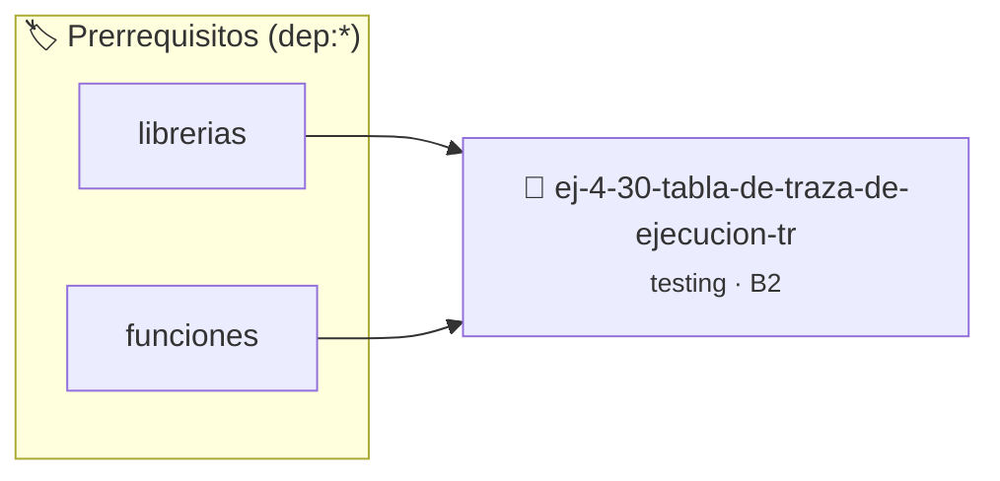

# Tabla de Traza de Ejecución (Trace Table)
> **ID:** `ej-4-30-tabla-de-traza-de-ejecucion-tr`
 · **Tema:** `testing`
 · **Bloom:** B2 (Comprender)
 · **Carga:** ~15 min
>
> **🏷️ Prerrequisitos temáticos (tags):** `dep:librerias`, `dep:funciones`
>
> **Etiquetas conceptuales:** `aserciones`, `fundamentos`, `ejecucion`, `tabla`, `table`


::: {admonition} 📦 Paquete de Verificación Local (Ripley)
:class: tip

Para compilar, resolver y autoevaluar tu entrega con pruebas unitarias en tu máquina:

- [📥 **Descargar paquete `ej-4-30-tabla-de-traza-de-ejecucion-tr.ripkg`**](../../paquetes/ej-4-30-tabla-de-traza-de-ejecucion-tr.ripkg)

Ejecución con el asistente de cátedra:
```bash
ripley run ej-4-30-tabla-de-traza-de-ejecucion-tr.ripkg
```
:::


### 🗺️ Itinerario Pedagógico




## 📖 Consigna

### Ejercicio 4.30 - Tabla de Traza de Ejecución (Trace Table) ⭐⭐☆☆☆

:::{exercise}
:label: ej-test-tabla-traza
Construí una tabla de traza paso a paso para la llamada `mcd(18, 12)` mostrando
los valores de las variables en cada iteración del lazo:

```{code-block} c
:linenos:
int mcd(int a, int b)
{
    while (b != 0)
    {
        int temp = b;
        b = a % b;
        a = temp;
    }
    return a;
}

```
<!-- {code-block} c -->

-   **[*plus ultra*]:** Escribir una suite de tests unitarios verificando
    `mcd(18, 12) == 6`, `mcd(7, 5) == 1` y `mcd(20, 0) == 20`.
-   **[*plus ultra*]:** Demostrar la invariante del algoritmo: $\text{mcd}(a, b)
    = \text{mcd}(b, a \pmod b)$.

:::
<!-- {exercise} -->

:::{solution} ej-test-tabla-traza
:class: dropdown
| Iteración | `a` (inicio) | `b` (inicio) | `temp` (`b`) | `a % b` | `b` (nuevo) | `a` (nuevo) | Condición (`b != 0`) |
| :--- | :--- | :--- | :--- | :--- | :--- | :--- | :--- |
| **Inicio** | 18 | 12 | - | - | - | - | `true` |
| **1** | 18 | 12 | 12 | 6 | 6 | 12 | `true` |
| **2** | 12 | 6 | 6 | 0 | 0 | 6 | `false` |
| **Fin** | 6 | 0 | - | - | - | - | Retorna `6` |

:::
<!-- {solution} ej-test-tabla-traza -->

---


## 📋 Prototipos y Cabecera (`ej-4-30-tabla-de-traza-de-ejecucion-tr.h`)

```{code-block} c
#ifndef EJERCICIO_EJ_4_30_TABLA_DE_TRAZA_DE_EJECUCION_TR_H
#define EJERCICIO_EJ_4_30_TABLA_DE_TRAZA_DE_EJECUCION_TR_H

#include <stddef.h>
#include <stdbool.h>
#include <stdint.h>

/* Operación mcd */
int mcd(int a, int b);

#endif /* EJERCICIO_EJ_4_30_TABLA_DE_TRAZA_DE_EJECUCION_TR_H */
```


## ⚙️ Especificación de Funciones

| Función | Retorno | Parámetros | Descripción |
| :--- | :--- | :--- | :--- |

| `mcd` | `int` | `int a, int b` | Operación mcd |


## 🧪 Casos de Prueba

| Prueba Unitaria | Función Objetivo | Verificación |
| :--- | :--- | :--- |

| **test_mcd_1** | `mcd` | `/* Verificación unitaria de mcd */ int res = mcd(1, 2); (void)res; assert(true);` |


## ✓ Solución Modelo de Cátedra

```{dropdown} 🔍 Revelar solución canónica en C
:open: false

```{code-block} c
int mcd(int a, int b)
{
    while (b != 0)
    {
        int temp = b;
        b = a % b;
        a = temp;
    }
    return a;
}

int main(void)
{
    return 0;
}
```
```
