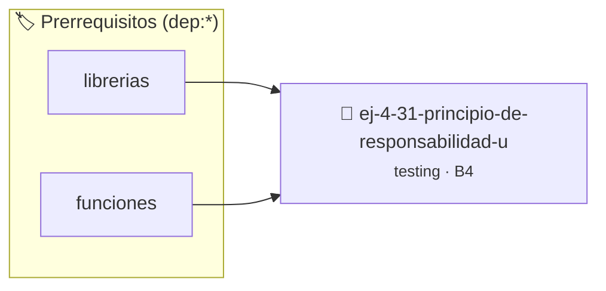

# Principio de Responsabilidad Única (SRP)
> **ID:** `ej-4-31-principio-de-responsabilidad-u` · **Unidad:** 5 (Ingeniería de Software y Calidad en C)
 · **Tema:** `testing` / `aserciones_defensivas`
 · **Bloom:** B4 (Analizar) · **Dificultad:** Avanzada
 · **Carga:** ~35 min · **Tipo:** Laboratorio
>
> **🏷️ Prerrequisitos temáticos (tags):** `dep:librerias`, `dep:funciones`
>
> **Etiquetas conceptuales:** `aserciones`, `responsabilidad`, `fundamentos`, `unica`, `principio`


::: {admonition} 📦 Paquete de Verificación Local (Ripley)
:class: tip

Para compilar, resolver y autoevaluar tu entrega con pruebas unitarias en tu máquina:

- [📥 **Descargar paquete `ej-4-31-principio-de-responsabilidad-u.ripkg`**](../../paquetes/ej-4-31-principio-de-responsabilidad-u.ripkg)

Ejecución con el asistente de cátedra:
```bash
ripley run ej-4-31-principio-de-responsabilidad-u.ripkg
```
:::


### 🗺️ Itinerario Pedagógico




## 📖 Consigna

### Ejercicio 4.31 - Principio de Responsabilidad Única (SRP) ⭐⭐☆☆☆

:::{exercise}
:label: ej-test-srp-refactor
La siguiente función realiza tres tareas simultáneas: calcular la suma de un
arreglo, buscar el máximo y contar negativos. Refactorizala en tres funciones
atómicas según la [Regla 0x2005h](../../reglas/2_funciones.md#0x2005h):

``` c
void procesar_todo(const int arr[], int n, int *suma, int *maximo, int *negativos);
```
<!-- c -->

-   **[*plus ultra*]:** Escribir pruebas unitarias independientes para cada
    función resultante.
-   **[*plus ultra*]:** Explicar por qué es más fácil reutilizar y mantener
    funciones con una sola responsabilidad.

:::
<!-- {exercise} -->

:::{solution} ej-test-srp-refactor
:class: dropdown
```{code-block} c
:linenos:
#include <assert.h>

int calcular_suma(const int arr[], int n)
{
    int total = 0;
    for (int i = 0; i < n; i++)
    {
        total += arr[i];
    }
    return total;
}

int encontrar_maximo(const int arr[], int n)
{
    if (n <= 0)
    {
        return 0;
    }
    int max = arr[0];
    for (int i = 1; i < n; i++)
    {
        if (arr[i] > max)
        {
            max = arr[i];
        }
    }
    return max;
}

int contar_negativos(const int arr[], int n)
{
    int cont = 0;
    for (int i = 0; i < n; i++)
    {
        if (arr[i] < 0)
        {
            cont++;
        }
    }
    return cont;
}

void test_funciones_atomicas(void)
{
    int datos[] = {3, -1, 8, -5, 2};
    assert(calcular_suma(datos, 5) == 7);
    assert(encontrar_maximo(datos, 5) == 8);
    assert(contar_negativos(datos, 5) == 2);
}

```
<!-- {code-block} c -->

:::
<!-- {solution} ej-test-srp-refactor -->

---


## 📋 Prototipos y Cabecera (`ej-4-31-principio-de-responsabilidad-u.h`)

```{code-block} c
#ifndef EJERCICIO_EJ_4_31_PRINCIPIO_DE_RESPONSABILIDAD_U_H
#define EJERCICIO_EJ_4_31_PRINCIPIO_DE_RESPONSABILIDAD_U_H

#include <stddef.h>
#include <stdbool.h>
#include <stdint.h>

/* Operación calcular_suma */
int calcular_suma(const int arr[], int n);
/* Operación encontrar_maximo */
int encontrar_maximo(const int arr[], int n);
/* Operación contar_negativos */
int contar_negativos(const int arr[], int n);
/* Operación test_funciones_atomicas */
void test_funciones_atomicas(void);

#endif /* EJERCICIO_EJ_4_31_PRINCIPIO_DE_RESPONSABILIDAD_U_H */
```


## ⚙️ Especificación de Funciones

| Función | Retorno | Parámetros | Descripción |
| :--- | :--- | :--- | :--- |

| `calcular_suma` | `int` | `const int arr[], int n` | Operación calcular_suma |

| `encontrar_maximo` | `int` | `const int arr[], int n` | Operación encontrar_maximo |

| `contar_negativos` | `int` | `const int arr[], int n` | Operación contar_negativos |

| `test_funciones_atomicas` | `void` | `void` | Operación test_funciones_atomicas |


## 💡 Pistas Progresivas

````{tab-set}

```{tab-item} Pista 1
Descomponé funciones monolíticas en funciones más pequeñas, cada una con un único propósito bien definido.
```

```{tab-item} Pista 2
Separá la lógica de cálculo y procesamiento de la lógica de entrada/salida (I/O) o formateo.
```

```{tab-item} Pista 3
Facilitá las pruebas unitarias asegurando que cada función pueda testearse de forma aislada.
```

````


## 🧪 Casos de Prueba

| Prueba Unitaria | Función Objetivo | Verificación |
| :--- | :--- | :--- |

| **test_calcular_suma_1** | `calcular_suma` | `/* Verificación unitaria de calcular_suma */ int arr[] = {1, 2, 3, 4}; int res = calcular_suma(arr, 4); (void)res; assert(true);` |

| **test_encontrar_maximo_2** | `encontrar_maximo` | `/* Verificación unitaria de encontrar_maximo */ int arr[] = {1, 2, 3, 4}; int res = encontrar_maximo(arr, 4); (void)res; assert(true);` |


## ✓ Solución Modelo de Cátedra

```{dropdown} 🔍 Revelar solución canónica en C
:open: false

```{code-block} c
#include <assert.h>

int calcular_suma(const int arr[], int n)
{
    int total = 0;
    for (int i = 0; i < n; i++)
    {
        total += arr[i];
    }
    return total;
}

int encontrar_maximo(const int arr[], int n)
{
    if (n <= 0)
    {
        return 0;
    }
    int max = arr[0];
    for (int i = 1; i < n; i++)
    {
        if (arr[i] > max)
        {
            max = arr[i];
        }
    }
    return max;
}

int contar_negativos(const int arr[], int n)
{
    int cont = 0;
    for (int i = 0; i < n; i++)
    {
        if (arr[i] < 0)
        {
            cont++;
        }
    }
    return cont;
}

void test_funciones_atomicas(void)
{
    int datos[] = {3, -1, 8, -5, 2};
    assert(calcular_suma(datos, 5) == 7);
    assert(encontrar_maximo(datos, 5) == 8);
    assert(contar_negativos(datos, 5) == 2);
}

int main(void)
{
    return 0;
}
```
```
