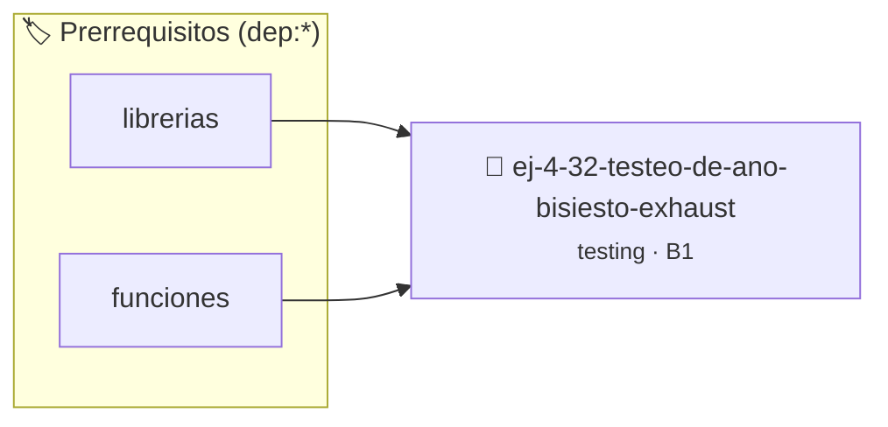

# Testeo de Año Bisiesto Exhaustivo
> **ID:** `ej-4-32-testeo-de-ano-bisiesto-exhaust`
 · **Tema:** `testing`
 · **Bloom:** B1 (Recordar)
 · **Carga:** ~10 min
>
> **🏷️ Prerrequisitos temáticos (tags):** `dep:librerias`, `dep:funciones`
>
> **Etiquetas conceptuales:** `aserciones`, `fundamentos`, `testeo`, `bisiesto`, `exhaustivo`


::: {admonition} 📦 Paquete de Verificación Local (Ripley)
:class: tip

Para compilar, resolver y autoevaluar tu entrega con pruebas unitarias en tu máquina:

- [📥 **Descargar paquete `ej-4-32-testeo-de-ano-bisiesto-exhaust.ripkg`**](../../paquetes/ej-4-32-testeo-de-ano-bisiesto-exhaust.ripkg)

Ejecución con el asistente de cátedra:
```bash
ripley run ej-4-32-testeo-de-ano-bisiesto-exhaust.ripkg
```
:::


### 🗺️ Itinerario Pedagógico




## 📖 Consigna

### Ejercicio 4.32 - Testeo de Año Bisiesto Exhaustivo ⭐⭐☆☆☆

:::{exercise}
:label: ej-test-bisiesto-exhaustivo
Implementá `bool es_bisiesto(int anio)` y diseñá una suite de pruebas que
verifique las cuatro reglas del calendario gregoriano:
1. Años múltiplos de 4 no múltiplos de 100 (ej. 2024 $\rightarrow$ `true`).
2. Años no múltiplos de 4 (ej. 2023 $\rightarrow$ `false`).
3. Años múltiplos de 100 pero no de 400 (ej. 1900 $\rightarrow$ `false`).
4. Años múltiplos de 400 (ej. 2000 $\rightarrow$ `true`).

-   **[*plus ultra*]:** Validar que años $\le 0$ retornen `false`.
-   **[*plus ultra*]:** Escribir una función de test por cada regla evaluada.

:::
<!-- {exercise} -->

:::{solution} ej-test-bisiesto-exhaustivo
:class: dropdown
```{code-block} c
:linenos:
#include <assert.h>
#include <stdbool.h>

bool es_bisiesto(int anio)
{
    if (anio <= 0)
    {
        return false;
    }
    return ((anio % 4 == 0 && anio % 100 != 0) || (anio % 400 == 0));
}

void test_bisiesto_multiplo_4(void)
{
    assert(es_bisiesto(2024) == true);
}

void test_no_bisiesto_comun(void)
{
    assert(es_bisiesto(2023) == false);
}

void test_no_bisiesto_fin_de_siglo(void)
{
    assert(es_bisiesto(1900) == false);
}

void test_bisiesto_cuatrisecular(void)
{
    assert(es_bisiesto(2000) == true);
}

void test_bisiesto_invalido(void)
{
    assert(es_bisiesto(-400) == false);
}

```
<!-- {code-block} c -->

:::
<!-- {solution} ej-test-bisiesto-exhaustivo -->

---


## 📋 Prototipos y Cabecera (`ej-4-32-testeo-de-ano-bisiesto-exhaust.h`)

```{code-block} c
#ifndef EJERCICIO_EJ_4_32_TESTEO_DE_ANO_BISIESTO_EXHAUST_H
#define EJERCICIO_EJ_4_32_TESTEO_DE_ANO_BISIESTO_EXHAUST_H

#include <stddef.h>
#include <stdbool.h>
#include <stdint.h>

/* Operación es_bisiesto */
bool es_bisiesto(int anio);
/* Operación test_bisiesto_multiplo_4 */
void test_bisiesto_multiplo_4(void);
/* Operación test_no_bisiesto_comun */
void test_no_bisiesto_comun(void);
/* Operación test_no_bisiesto_fin_de_siglo */
void test_no_bisiesto_fin_de_siglo(void);
/* Operación test_bisiesto_cuatrisecular */
void test_bisiesto_cuatrisecular(void);
/* Operación test_bisiesto_invalido */
void test_bisiesto_invalido(void);

#endif /* EJERCICIO_EJ_4_32_TESTEO_DE_ANO_BISIESTO_EXHAUST_H */
```


## ⚙️ Especificación de Funciones

| Función | Retorno | Parámetros | Descripción |
| :--- | :--- | :--- | :--- |

| `es_bisiesto` | `bool` | `int anio` | Operación es_bisiesto |

| `test_bisiesto_multiplo_4` | `void` | `void` | Operación test_bisiesto_multiplo_4 |

| `test_no_bisiesto_comun` | `void` | `void` | Operación test_no_bisiesto_comun |

| `test_no_bisiesto_fin_de_siglo` | `void` | `void` | Operación test_no_bisiesto_fin_de_siglo |

| `test_bisiesto_cuatrisecular` | `void` | `void` | Operación test_bisiesto_cuatrisecular |

| `test_bisiesto_invalido` | `void` | `void` | Operación test_bisiesto_invalido |


## 🧪 Casos de Prueba

| Prueba Unitaria | Función Objetivo | Verificación |
| :--- | :--- | :--- |

| **test_es_bisiesto_1** | `es_bisiesto` | `/* Verificación unitaria de es_bisiesto */ bool ok = es_bisiesto(1); (void)ok; assert(true);` |

| **test_test_bisiesto_multiplo_4_2** | `test_bisiesto_multiplo_4` | `/* Verificación unitaria de test_bisiesto_multiplo_4 */ test_bisiesto_multiplo_4(); assert(true);` |


## ✓ Solución Modelo de Cátedra

```{dropdown} 🔍 Revelar solución canónica en C
:open: false

```{code-block} c
#include <assert.h>
#include <stdbool.h>

bool es_bisiesto(int anio)
{
    if (anio <= 0)
    {
        return false;
    }
    return ((anio % 4 == 0 && anio % 100 != 0) || (anio % 400 == 0));
}

void test_bisiesto_multiplo_4(void)
{
    assert(es_bisiesto(2024) == true);
}

void test_no_bisiesto_comun(void)
{
    assert(es_bisiesto(2023) == false);
}

void test_no_bisiesto_fin_de_siglo(void)
{
    assert(es_bisiesto(1900) == false);
}

void test_bisiesto_cuatrisecular(void)
{
    assert(es_bisiesto(2000) == true);
}

void test_bisiesto_invalido(void)
{
    assert(es_bisiesto(-400) == false);
}

int main(void)
{
    return 0;
}
```
```
