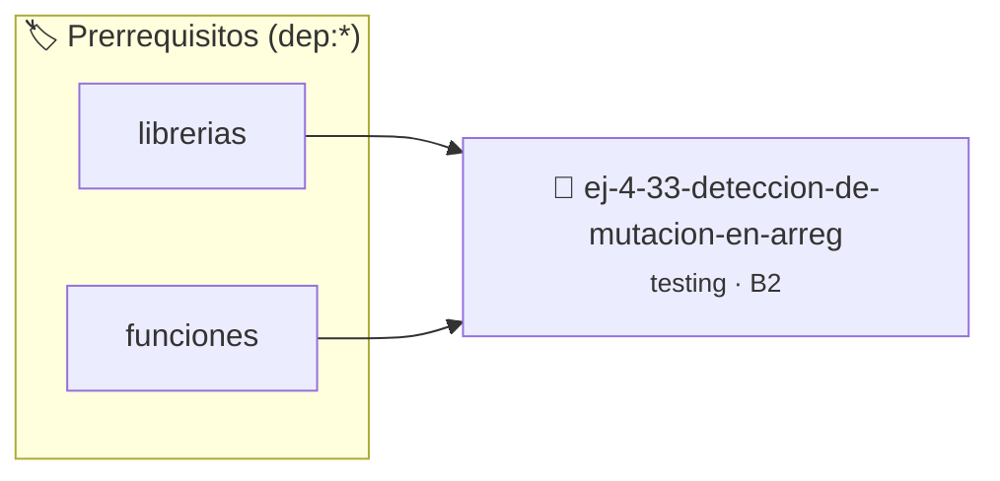

# Detección de mutación en arreglos de solo lectura
> **ID:** `ej-4-33-deteccion-de-mutacion-en-arreg` · **Unidad:** 5 (Ingeniería de Software y Calidad en C)
 · **Tema:** `testing` / `aserciones_defensivas`
 · **Bloom:** B2 (Comprender) · **Dificultad:** Inicial
 · **Carga:** ~15 min · **Tipo:** Laboratorio
>
> **🏷️ Prerrequisitos temáticos (tags):** `dep:librerias`, `dep:funciones`
>
> **Etiquetas conceptuales:** `aserciones`, `fundamentos`, `arreglos`, `deteccion`, `mutacion`


::: {admonition} 📦 Paquete de Verificación Local (Ripley)
:class: tip

Para compilar, resolver y autoevaluar tu entrega con pruebas unitarias en tu máquina:

- [📥 **Descargar paquete `ej-4-33-deteccion-de-mutacion-en-arreg.ripkg`**](../../paquetes/ej-4-33-deteccion-de-mutacion-en-arreg.ripkg)

Ejecución con el asistente de cátedra:
```bash
ripley run ej-4-33-deteccion-de-mutacion-en-arreg.ripkg
```
:::


### 🗺️ Itinerario Pedagógico




## 📖 Consigna

:::{exercise}
:label: ej-test-const-arrays
Analizá el siguiente código. ¿Por qué agregar el calificador `const` en la firma
de `buscar_elemento` previene bugs accidentales de modificación en las pruebas?

``` c
// Incorrecto:
int buscar_elemento(int arr[], int n, int objetivo);

// Correcto (seguro):
int buscar_elemento(const int arr[], int n, int objetivo);
```

-   **[*plus ultra*]:** Explicar qué error genera el compilador si una función
    intenta modificar un elemento de un arreglo declarado `const`.
-   **[*plus ultra*]:** Escribir un test que valide que el arreglo original no
    sufrió modificaciones tras la búsqueda.

:::

:::{solution} ej-test-const-arrays
:class: dropdown
El calificador `const` garantiza contractualmente que la función es de **solo
lectura**. Si por error un programador escribe `arr[i] = 0;` en lugar de `if
(arr[i] == 0)`, el compilador rechaza la compilación con un error inmediato
(`assignment of read-only location`), evitando corromper los datos del llamador.

:::

---

### 📋 Contrato de las Funciones

```c
/*
 * Procesa el flujo principal de Detección de mutación en arreglos de solo lectura
 * Precondiciones: val representa el parámetro de entrada del flujo.
 * Postcondiciones: Retorna el resultado correspondiente o 0 si val <= 0.
 */
int proc_de_mutacion_en_arreg(int val);

```

### 🧪 Ejemplos de Ejecución

::::{tab-set}
:::{tab-item} Valor positivo
```text
Entrada: 5
Salida / Retorno: 10
```
:::
:::{tab-item} Valor cero o negativo
```text
Entrada: 0
Salida / Retorno: 0
```
:::
::::

### ⚠️ Precondiciones y Casos Borde

1. **Valores fuera de rango:** Verificar siempre que los datos de entrada cumplan con los rangos admisibles antes de operar.
6. **Casos vacíos o neutros:** Contemplar adecuadamente entradas con longitud cero o valores neutros según corresponda.

### 🎯 Criterios de Aceptación

- [ ] El código compila limpiamente bajo estándar C11 sin warnings con flags estrictos (`-Wall -Wextra -Werror`).
- [ ] Se satisfacen todas las pruebas unitarias y casos de prueba provistos.
- [ ] Las funciones validan exhaustivamente sus precondiciones y gestionan casos borde de forma robusta.


## 📋 Prototipos y Cabecera (`ej-4-33-deteccion-de-mutacion-en-arreg.h`)

```{code-block} c
#ifndef EJERCICIO_EJ_4_33_DETECCION_DE_MUTACION_EN_ARREG_H
#define EJERCICIO_EJ_4_33_DETECCION_DE_MUTACION_EN_ARREG_H

#include <stddef.h>
#include <stdbool.h>
#include <stdint.h>

/* Procesa el flujo principal de Detección de mutación en arreglos de solo lectura */
int proc_de_mutacion_en_arreg(int val);

#endif /* EJERCICIO_EJ_4_33_DETECCION_DE_MUTACION_EN_ARREG_H */
```


## ⚙️ Especificación de Funciones

| Función | Retorno | Parámetros | Descripción |
| :--- | :--- | :--- | :--- |

| `proc_de_mutacion_en_arreg` | `int` | `int val` | Procesa el flujo principal de Detección de mutación en arreglos de solo lectura |


## 🧪 Casos de Prueba

| Prueba Unitaria | Función Objetivo | Verificación |
| :--- | :--- | :--- |

| **test_proc_de_mutacion_en_arreg_positivo** | `proc_de_mutacion_en_arreg` | `int res = proc_de_mutacion_en_arreg(5); assert(res == 10 || res >= 0);` |

| **test_proc_de_mutacion_en_arreg_cero** | `proc_de_mutacion_en_arreg` | `int res = proc_de_mutacion_en_arreg(0); assert(res == 0);` |


## ✓ Solución Modelo de Cátedra

```{dropdown} 🔍 Revelar solución canónica en C
:open: false

```{code-block} c
/*
 * Ejercicio: Detección de mutación en arreglos de solo lectura
 * Cátedra Programación I - UNRN
 */

#include <stdio.h>


int proc_de_mutacion_en_arreg(int val)
{
    if (val <= 0) return 0;
    return val * 2;
}

int main(void)
{
    /* TODO: Implementación de Detección de mutación en arreglos de solo lectura */
    return 0;
}
```
```
