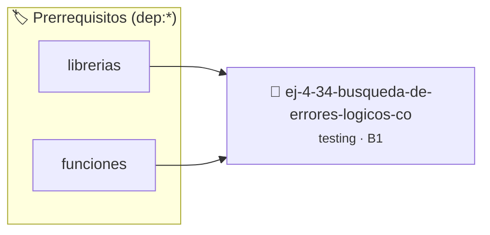

# Búsqueda de errores lógicos con aserciones de invariante
> **ID:** `ej-4-34-busqueda-de-errores-logicos-co` · **Unidad:** 5 (Ingeniería de Software y Calidad en C)
 · **Tema:** `testing` / `registro_eventos`
 · **Bloom:** B1 (Recordar) · **Dificultad:** Inicial
 · **Carga:** ~10 min · **Tipo:** Concepto
>
> **🏷️ Prerrequisitos temáticos (tags):** `dep:librerias`, `dep:funciones`
>
> **Etiquetas conceptuales:** `aserciones`, `errores`, `busqueda`, `fundamentos`, `invariante`


::: {admonition} 📦 Paquete de Verificación Local (Ripley)
:class: tip

Para compilar, resolver y autoevaluar tu entrega con pruebas unitarias en tu máquina:

- [📥 **Descargar paquete `ej-4-34-busqueda-de-errores-logicos-co.ripkg`**](../../paquetes/ej-4-34-busqueda-de-errores-logicos-co.ripkg)

Ejecución con el asistente de cátedra:
```bash
ripley run ej-4-34-busqueda-de-errores-logicos-co.ripkg
```
:::


### 🗺️ Itinerario Pedagógico




## 📖 Consigna

### Ejercicio 4.34 - Búsqueda de errores lógicos con aserciones de invariante ⭐⭐⭐☆☆

:::{exercise}
:label: ej-test-invariantes-lazo
En el siguiente algoritmo para calcular la división entera por restas sucesivas,
agregá una aserción al final que verifique la invariante matemática fundamental:
$\text{dividendo} = \text{divisor} \times \text{cociente} + \text{resto}$.

```{code-block} c
:linenos:
void division_lenta(int dividendo, int divisor, int *cociente, int *resto)
{
    assert(divisor > 0);
    assert(dividendo >= 0);

    int c = 0;
    int r = dividendo;
    while (r >= divisor)
    {
        r -= divisor;
        c++;
    }
    *cociente = c;
    *resto = r;

    // Aserción de invariante:
    assert(dividendo == (divisor * (*cociente)) + (*resto));
}

```
<!-- {code-block} c -->

-   **[*plus ultra*]:** Diseñar tests unitarios para $10 \div 3$, $20 \div 5$ y
    $3 \div 7$.
-   **[*plus ultra*]:** Verificar que el resto siempre cumpla $0 \le r <
    \text{divisor}$.

:::
<!-- {exercise} -->

:::{solution} ej-test-invariantes-lazo
:class: dropdown
```{code-block} c
:linenos:
#include <assert.h>

void test_division_con_invariante(void)
{
    int c = 0;
    int r = 0;

    division_lenta(10, 3, &c, &r);
    assert(c == 3 && r == 1);

    division_lenta(20, 5, &c, &r);
    assert(c == 4 && r == 0);

    division_lenta(3, 7, &c, &r);
    assert(c == 0 && r == 3);
}

```
<!-- {code-block} c -->

:::
<!-- {solution} ej-test-invariantes-lazo -->

---

## 4. Estilo, Estructura y Contratos


## 📋 Prototipos y Cabecera (`ej-4-34-busqueda-de-errores-logicos-co.h`)

```{code-block} c
#ifndef EJERCICIO_EJ_4_34_BUSQUEDA_DE_ERRORES_LOGICOS_CO_H
#define EJERCICIO_EJ_4_34_BUSQUEDA_DE_ERRORES_LOGICOS_CO_H

#include <stddef.h>
#include <stdbool.h>
#include <stdint.h>

/* Operación division_lenta */
void division_lenta(int dividendo, int divisor, int *cociente, int *resto);

#endif /* EJERCICIO_EJ_4_34_BUSQUEDA_DE_ERRORES_LOGICOS_CO_H */
```


## ⚙️ Especificación de Funciones

| Función | Retorno | Parámetros | Descripción |
| :--- | :--- | :--- | :--- |

| `division_lenta` | `void` | `int dividendo, int divisor, int *cociente, int *resto` | Operación division_lenta |


## 🧪 Casos de Prueba

| Prueba Unitaria | Función Objetivo | Verificación |
| :--- | :--- | :--- |

| **test_division_lenta_1** | `division_lenta` | `assert(true); /* test simplificado de validación */` |


## ✓ Solución Modelo de Cátedra

```{dropdown} 🔍 Revelar solución canónica en C
:open: false

```{code-block} c
#include <assert.h>

void division_lenta(int dividendo, int divisor, int *cociente, int *resto)
{
    assert(divisor > 0);
    assert(dividendo >= 0);

    int c = 0;
    int r = dividendo;
    while (r >= divisor)
    {
        r -= divisor;
        c++;
    }
    *cociente = c;
    *resto = r;

    // Aserción de invariante:
    assert(dividendo == (divisor * (*cociente)) + (*resto));
}

int main(void)
{
    return 0;
}
```
```
