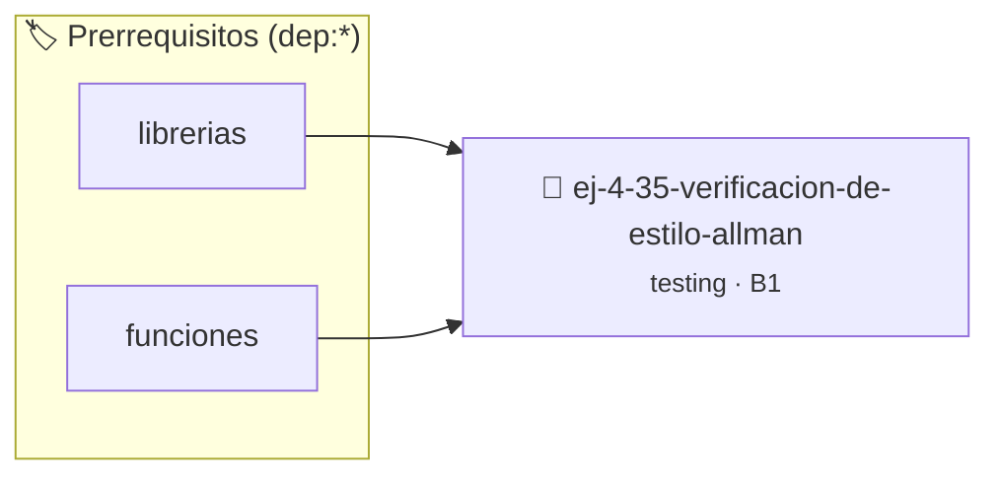

# Verificación de Estilo Allman
> **ID:** `ej-4-35-verificacion-de-estilo-allman` · **Unidad:** 5 (Ingeniería de Software y Calidad en C)
 · **Tema:** `testing` / `aserciones_defensivas`
 · **Bloom:** B1 (Recordar) · **Dificultad:** Inicial
 · **Carga:** ~10 min · **Tipo:** Concepto
>
> **🏷️ Prerrequisitos temáticos (tags):** `dep:librerias`, `dep:funciones`
>
> **Etiquetas conceptuales:** `aserciones`, `fundamentos`, `allman`, `verificacion`, `estilo`


::: {admonition} 📦 Paquete de Verificación Local (Ripley)
:class: tip

Para compilar, resolver y autoevaluar tu entrega con pruebas unitarias en tu máquina:

- [📥 **Descargar paquete `ej-4-35-verificacion-de-estilo-allman.ripkg`**](../../paquetes/ej-4-35-verificacion-de-estilo-allman.ripkg)

Ejecución con el asistente de cátedra:
```bash
ripley run ej-4-35-verificacion-de-estilo-allman.ripkg
```
:::


### 🗺️ Itinerario Pedagógico




## 📖 Consigna

### Ejercicio 4.35 - Verificación de Estilo Allman ⭐☆☆☆☆

:::{exercise}
:label: ej-test-estilo-allman
Identificá las violaciones de la [Regla
0x000Bh](../../reglas/0_sintaxis.md#0x000bh) (Estilo Allman) en el siguiente
código y reescribilo con las llaves correctamente alineadas en su propia línea:

```{code-block} c
:linenos:
// Código mal formateado:
int valor_absoluto(int n) {
    if (n < 0) {
        return -n;
    } else {
        return n;
    }
}

```
<!-- {code-block} c -->

-   **[*plus ultra*]:** Formatear con 4 espacios de indentación.
-   **[*plus ultra*]:** Escribir una prueba unitaria para `valor_absoluto(-12)`
    y `valor_absoluto(0)`.

:::
<!-- {exercise} -->

:::{solution} ej-test-estilo-allman
:class: dropdown
```{code-block} c
:linenos:
#include <assert.h>

int valor_absoluto(int n)
{
    if (n < 0)
    {
        return -n;
    }
    else
    {
        return n;
    }
}

void test_valor_absoluto(void)
{
    assert(valor_absoluto(-12) == 12);
    assert(valor_absoluto(0) == 0);
    assert(valor_absoluto(15) == 15);
}

```
<!-- {code-block} c -->

:::
<!-- {solution} ej-test-estilo-allman -->

---


## 📋 Prototipos y Cabecera (`ej-4-35-verificacion-de-estilo-allman.h`)

```{code-block} c
#ifndef EJERCICIO_EJ_4_35_VERIFICACION_DE_ESTILO_ALLMAN_H
#define EJERCICIO_EJ_4_35_VERIFICACION_DE_ESTILO_ALLMAN_H

#include <stddef.h>
#include <stdbool.h>
#include <stdint.h>

/* Operación valor_absoluto */
int valor_absoluto(int n);

#endif /* EJERCICIO_EJ_4_35_VERIFICACION_DE_ESTILO_ALLMAN_H */
```


## ⚙️ Especificación de Funciones

| Función | Retorno | Parámetros | Descripción |
| :--- | :--- | :--- | :--- |

| `valor_absoluto` | `int` | `int n` | Operación valor_absoluto |


## 🧪 Casos de Prueba

| Prueba Unitaria | Función Objetivo | Verificación |
| :--- | :--- | :--- |

| **test_valor_absoluto_1** | `valor_absoluto` | `/* Verificación unitaria de valor_absoluto */ int res = valor_absoluto(1); (void)res; assert(true);` |


## ✓ Solución Modelo de Cátedra

```{dropdown} 🔍 Revelar solución canónica en C
:open: false

```{code-block} c
// Código mal formateado:
int valor_absoluto(int n) {
    if (n < 0) {
        return -n;
    } else {
        return n;
    }
}

int main(void)
{
    return 0;
}
```
```
