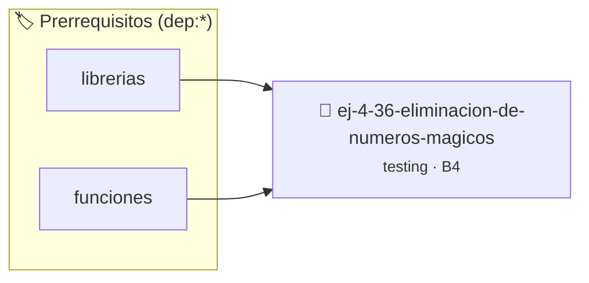

# Eliminación de Números Mágicos
> **ID:** `ej-4-36-eliminacion-de-numeros-magicos`
 · **Tema:** `testing`
 · **Bloom:** B4 (Analizar)
 · **Carga:** ~35 min
>
> **🏷️ Prerrequisitos temáticos (tags):** `dep:librerias`, `dep:funciones`
>
> **Etiquetas conceptuales:** `aserciones`, `fundamentos`, `magicos`, `eliminacion`, `numeros`


::: {admonition} 📦 Paquete de Verificación Local (Ripley)
:class: tip

Para compilar, resolver y autoevaluar tu entrega con pruebas unitarias en tu máquina:

- [📥 **Descargar paquete `ej-4-36-eliminacion-de-numeros-magicos.ripkg`**](../../paquetes/ej-4-36-eliminacion-de-numeros-magicos.ripkg)

Ejecución con el asistente de cátedra:
```bash
ripley run ej-4-36-eliminacion-de-numeros-magicos.ripkg
```
:::


### 🗺️ Itinerario Pedagógico




## 📖 Consigna

### Ejercicio 4.36 - Eliminación de Números Mágicos ⭐⭐☆☆☆

:::{exercise}
:label: ej-test-numeros-magicos
Refactorizá la siguiente función reemplazando todos los **números mágicos** por
constantes simbólicas (`#define` o `const`) descriptivas según la [Regla
0x0004h](../../reglas/0_sintaxis.md#0x0004h):

```{code-block} c
:linenos:
double calcular_costo_envio(double peso)
{
    if (peso <= 5.0)
    {
        return 500.0;
    }
    if (peso <= 20.0)
    {
        return 500.0 + (peso - 5.0) * 80.0;
    }
    return 1700.0 + (peso - 20.0) * 120.0;
}

```
<!-- {code-block} c -->

-   **[*plus ultra*]:** Escribir tests unitarios para los puntos de quiebre (5.0
    kg y 20.0 kg).
-   **[*plus ultra*]:** Explicar por qué los números mágicos dificultan el
    mantenimiento del código.

:::
<!-- {exercise} -->

:::{solution} ej-test-numeros-magicos
:class: dropdown
```{code-block} c
:linenos:
#include <assert.h>

#define PESO_LIMITE_LIVIANO 5.0
#define PESO_LIMITE_MEDIO 20.0
#define TARIFA_BASE_LIVIANO 500.0
#define TARIFA_BASE_MEDIO 1700.0
#define COSTO_KG_MEDIO 80.0
#define COSTO_KG_PESADO 120.0

double calcular_costo_envio(double peso)
{
    if (peso <= 0.0)
    {
        return -1.0;
    }
    if (peso <= PESO_LIMITE_LIVIANO)
    {
        return TARIFA_BASE_LIVIANO;
    }
    if (peso <= PESO_LIMITE_MEDIO)
    {
        return TARIFA_BASE_LIVIANO + (peso - PESO_LIMITE_LIVIANO) * COSTO_KG_MEDIO;
    }
    return TARIFA_BASE_MEDIO + (peso - PESO_LIMITE_MEDIO) * COSTO_KG_PESADO;
}

void test_costo_envio_limites(void)
{
    assert(calcular_costo_envio(5.0) == 500.0);
    assert(calcular_costo_envio(10.0) == 900.0);
    assert(calcular_costo_envio(20.0) == 1700.0);
}

```
<!-- {code-block} c -->

:::
<!-- {solution} ej-test-numeros-magicos -->

---


## 📋 Prototipos y Cabecera (`ej-4-36-eliminacion-de-numeros-magicos.h`)

```{code-block} c
#ifndef EJERCICIO_EJ_4_36_ELIMINACION_DE_NUMEROS_MAGICOS_H
#define EJERCICIO_EJ_4_36_ELIMINACION_DE_NUMEROS_MAGICOS_H

#include <stddef.h>
#include <stdbool.h>
#include <stdint.h>

/* Operación calcular_costo_envio */
double calcular_costo_envio(double peso);

#endif /* EJERCICIO_EJ_4_36_ELIMINACION_DE_NUMEROS_MAGICOS_H */
```


## ⚙️ Especificación de Funciones

| Función | Retorno | Parámetros | Descripción |
| :--- | :--- | :--- | :--- |

| `calcular_costo_envio` | `double` | `double peso` | Operación calcular_costo_envio |


## 💡 Pistas Progresivas

````{tab-set}

```{tab-item} Pista 1
Reemplazá literales numéricos 'mágicos' por constantes descriptivas con #define o enum.
```

```{tab-item} Pista 2
Agrupá constantes relacionadas en enumeraciones para mejorar la legibilidad y seguridad de tipos.
```

```{tab-item} Pista 3
Centralizá los parámetros de configuración en la cabecera del módulo para facilitar su mantenimiento.
```

````


## 🧪 Casos de Prueba

| Prueba Unitaria | Función Objetivo | Verificación |
| :--- | :--- | :--- |

| **test_calcular_costo_envio_1** | `calcular_costo_envio` | `/* Verificación unitaria de calcular_costo_envio */ double res = calcular_costo_envio(1); (void)res; assert(true);` |


## ✓ Solución Modelo de Cátedra

```{dropdown} 🔍 Revelar solución canónica en C
:open: false

```{code-block} c
double calcular_costo_envio(double peso)
{
    if (peso <= 5.0)
    {
        return 500.0;
    }
    if (peso <= 20.0)
    {
        return 500.0 + (peso - 5.0) * 80.0;
    }
    return 1700.0 + (peso - 20.0) * 120.0;
}

int main(void)
{
    return 0;
}
```
```
