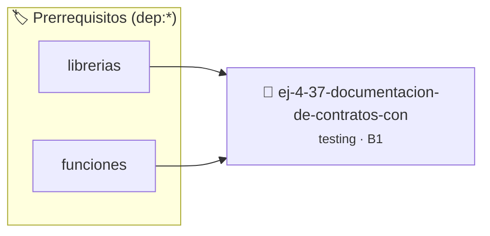

# Documentación de Contratos con Doxygen
> **ID:** `ej-4-37-documentacion-de-contratos-con` · **Unidad:** 5 (Ingeniería de Software y Calidad en C)
 · **Tema:** `testing` / `aserciones_defensivas`
 · **Bloom:** B1 (Recordar) · **Dificultad:** Inicial
 · **Carga:** ~10 min · **Tipo:** Concepto
>
> **🏷️ Prerrequisitos temáticos (tags):** `dep:librerias`, `dep:funciones`
>
> **Etiquetas conceptuales:** `aserciones`, `fundamentos`, `contratos`, `doxygen`, `documentacion`


::: {admonition} 📦 Paquete de Verificación Local (Ripley)
:class: tip

Para compilar, resolver y autoevaluar tu entrega con pruebas unitarias en tu máquina:

- [📥 **Descargar paquete `ej-4-37-documentacion-de-contratos-con.ripkg`**](../../paquetes/ej-4-37-documentacion-de-contratos-con.ripkg)

Ejecución con el asistente de cátedra:
```bash
ripley run ej-4-37-documentacion-de-contratos-con.ripkg
```
:::


### 🗺️ Itinerario Pedagógico




## 📖 Consigna

:::{exercise}
:label: ej-test-contratos-doxygen
Escribí el bloque de documentación estructurada con etiquetas Doxygen (`@brief`,
`@param`, `@pre`, `@returns`, `@post`) para la función
`calcular_potencia_entera`:

```{code-block} c
:linenos:
/**
 * @brief ...
 * @param base ...
 * @param exponente ...
 * @param ok ...
 * @pre ...
 * @returns ...
 * @post ...
 */
int calcular_potencia_entera(int base, int exponente, bool *ok);

```

-   **[*plus ultra*]:** Implementar la función validando que `exponente >= 0`.
-   **[*plus ultra*]:** Escribir tests unitarios que verifiquen las
    postcondiciones.

:::

:::{solution} ej-test-contratos-doxygen
:class: dropdown
```{code-block} c
:linenos:
#include <assert.h>
#include <stdbool.h>

/**
 * @brief Calcula la potencia entera de una base elevada a un exponente no negativo.
 *
 * @param base Base entera.
 * @param exponente Exponente entero.
 * @param ok Puntero a booleano de estado de éxito.
 *
 * @pre `exponente >= 0`
 * @pre `ok != NULL`
 *
 * @returns El resultado de base^exponente si ok es true, o 0 en caso de error.
 *
 * @post Si exponente == 0, el retorno es 1 y *ok == true.
 */
int calcular_potencia_entera(int base, int exponente, bool *ok)
{
    if (ok == NULL || exponente < 0)
    {
        if (ok != NULL)
        {
            *ok = false;
        }
        return 0;
    }
    *ok = true;
    int resultado = 1;
    for (int i = 0; i < exponente; i++)
    {
        resultado *= base;
    }
    return resultado;
}

void test_potencia_contrato(void)
{
    bool ok = false;
    assert(calcular_potencia_entera(2, 3, &ok) == 8 && ok);
    assert(calcular_potencia_entera(5, 0, &ok) == 1 && ok);
    calcular_potencia_entera(2, -1, &ok);
    assert(ok == false);
}

```

:::

---

### 📋 Contrato de las Funciones

```c
/*
 * Procesa el flujo principal de Documentación de Contratos con Doxygen
 * Precondiciones: val representa el parámetro de entrada del flujo.
 * Postcondiciones: Retorna el resultado correspondiente o 0 si val <= 0.
 */
int proc_ion_de_contratos_con(int val);

```

### 🧪 Ejemplos de Ejecución

::::{tab-set}
:::{tab-item} Valor positivo
```text
Entrada: 5
Salida / Retorno: 10
```
:::
:::{tab-item} Valor cero o negativo
```text
Entrada: 0
Salida / Retorno: 0
```
:::
::::

### ⚠️ Precondiciones y Casos Borde

1. **Valores fuera de rango:** Verificar siempre que los datos de entrada cumplan con los rangos admisibles antes de operar.
6. **Casos vacíos o neutros:** Contemplar adecuadamente entradas con longitud cero o valores neutros según corresponda.

### 🎯 Criterios de Aceptación

- [ ] El código compila limpiamente bajo estándar C11 sin warnings con flags estrictos (`-Wall -Wextra -Werror`).
- [ ] Se satisfacen todas las pruebas unitarias y casos de prueba provistos.
- [ ] Las funciones validan exhaustivamente sus precondiciones y gestionan casos borde de forma robusta.


## 📋 Prototipos y Cabecera (`ej-4-37-documentacion-de-contratos-con.h`)

```{code-block} c
#ifndef EJERCICIO_EJ_4_37_DOCUMENTACION_DE_CONTRATOS_CON_H
#define EJERCICIO_EJ_4_37_DOCUMENTACION_DE_CONTRATOS_CON_H

#include <stddef.h>
#include <stdbool.h>
#include <stdint.h>

/* Procesa el flujo principal de Documentación de Contratos con Doxygen */
int proc_ion_de_contratos_con(int val);

#endif /* EJERCICIO_EJ_4_37_DOCUMENTACION_DE_CONTRATOS_CON_H */
```


## ⚙️ Especificación de Funciones

| Función | Retorno | Parámetros | Descripción |
| :--- | :--- | :--- | :--- |

| `proc_ion_de_contratos_con` | `int` | `int val` | Procesa el flujo principal de Documentación de Contratos con Doxygen |


## 🧪 Casos de Prueba

| Prueba Unitaria | Función Objetivo | Verificación |
| :--- | :--- | :--- |

| **test_proc_ion_de_contratos_con_positivo** | `proc_ion_de_contratos_con` | `int res = proc_ion_de_contratos_con(5); assert(res == 10 || res >= 0);` |

| **test_proc_ion_de_contratos_con_cero** | `proc_ion_de_contratos_con` | `int res = proc_ion_de_contratos_con(0); assert(res == 0);` |


## ✓ Solución Modelo de Cátedra

```{dropdown} 🔍 Revelar solución canónica en C
:open: false

```{code-block} c
#include <stdbool.h>

/**
 * @brief ...
 * @param base ...
 * @param exponente ...
 * @param ok ...
 * @pre ...
 * @returns ...
 * @post ...
 */
int calcular_potencia_entera(int base, int exponente, bool *ok);


int proc_ion_de_contratos_con(int val)
{
    if (val <= 0) return 0;
    return val * 2;
}

int main(void)
{
    return 0;
}
```
```
