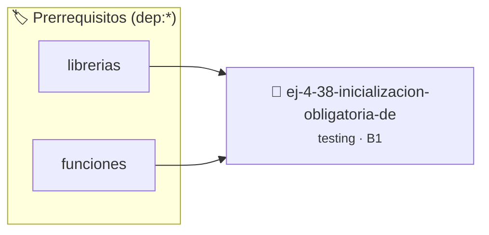

# Inicialización obligatoria de variables
> **ID:** `ej-4-38-inicializacion-obligatoria-de` · **Unidad:** 5 (Ingeniería de Software y Calidad en C)
 · **Tema:** `testing` / `aserciones_defensivas`
 · **Bloom:** B1 (Recordar) · **Dificultad:** Inicial
 · **Carga:** ~10 min · **Tipo:** Concepto
>
> **🏷️ Prerrequisitos temáticos (tags):** `dep:librerias`, `dep:funciones`
>
> **Etiquetas conceptuales:** `aserciones`, `fundamentos`, `inicializacion`, `variables`, `obligatoria`


::: {admonition} 📦 Paquete de Verificación Local (Ripley)
:class: tip

Para compilar, resolver y autoevaluar tu entrega con pruebas unitarias en tu máquina:

- [📥 **Descargar paquete `ej-4-38-inicializacion-obligatoria-de.ripkg`**](../../paquetes/ej-4-38-inicializacion-obligatoria-de.ripkg)

Ejecución con el asistente de cátedra:
```bash
ripley run ej-4-38-inicializacion-obligatoria-de.ripkg
```
:::


### 🗺️ Itinerario Pedagógico




## 📖 Consigna

:::{exercise}
:label: ej-test-inicializacion-vars
Analizá qué comportamiento indefinido (*Undefined Behavior*) ocurre en la
siguiente función y corregilo aplicando la [Regla
0x0003h](../../reglas/0_sintaxis.md#0x0003h):

```{code-block} c
:linenos:
int contar_multiplos(const int arr[], int n, int divisor)
{
    int contador; // ¡Variable no inicializada!
    for (int i = 0; i < n; i++)
    {
        if (arr[i] % divisor == 0)
        {
            contador++;
        }
    }
    return contador;
}

```

-   **[*plus ultra*]:** Explicar por qué las variables locales contienen valores
    basura si no se inicializan explícitamente.
-   **[*plus ultra*]:** Escribir una prueba unitaria para verificar
    `contar_multiplos`.

:::

:::{solution} ej-test-inicializacion-vars
:class: dropdown
Al no inicializarse, `contador` contiene un valor residual indeterminado
proveniente de la memoria de la pila. El incremento `contador++` genera
comportamiento indefinido y resultados erróneos impredecibles.

**Corrección:**
```{code-block} c
:linenos:
int contar_multiplos(const int arr[], int n, int divisor)
{
    if (divisor == 0)
    {
        return -1;
    }
    int contador = 0;
    for (int i = 0; i < n; i++)
    {
        if (arr[i] % divisor == 0)
        {
            contador++;
        }
    }
    return contador;
}

```

:::

---

### 📋 Contrato de las Funciones

```c
/*
 * Operación contar_multiplos
 * Precondiciones: Parámetros dentro del dominio válido de la operación.
 * Postcondiciones: Retorna el valor procesado.
 */
int contar_multiplos(const int arr[], int n, int divisor);

```

### 🧪 Ejemplos de Ejecución

::::{tab-set}
:::{tab-item} Caso general
```text
val = 10
Retorno esperado calculado
```
:::
:::{tab-item} Caso límite
```text
val = 0
Retorno 0 o manejo de borde
```
:::
::::

### ⚠️ Precondiciones y Casos Borde

1. **Valores fuera de rango:** Verificar siempre que los datos de entrada cumplan con los rangos admisibles antes de operar.
6. **Casos vacíos o neutros:** Contemplar adecuadamente entradas con longitud cero o valores neutros según corresponda.

### 🎯 Criterios de Aceptación

- [ ] El código compila limpiamente bajo estándar C11 sin warnings con flags estrictos (`-Wall -Wextra -Werror`).
- [ ] Se satisfacen todas las pruebas unitarias y casos de prueba provistos.
- [ ] Las funciones validan exhaustivamente sus precondiciones y gestionan casos borde de forma robusta.


## 📋 Prototipos y Cabecera (`ej-4-38-inicializacion-obligatoria-de.h`)

```{code-block} c
#ifndef EJERCICIO_EJ_4_38_INICIALIZACION_OBLIGATORIA_DE_H
#define EJERCICIO_EJ_4_38_INICIALIZACION_OBLIGATORIA_DE_H

#include <stddef.h>
#include <stdbool.h>
#include <stdint.h>

/* Operación contar_multiplos */
int contar_multiplos(const int arr[], int n, int divisor);

#endif /* EJERCICIO_EJ_4_38_INICIALIZACION_OBLIGATORIA_DE_H */
```


## ⚙️ Especificación de Funciones

| Función | Retorno | Parámetros | Descripción |
| :--- | :--- | :--- | :--- |

| `contar_multiplos` | `int` | `const int arr[], int n, int divisor` | Operación contar_multiplos |


## 🧪 Casos de Prueba

| Prueba Unitaria | Función Objetivo | Verificación |
| :--- | :--- | :--- |

| **test_contar_multiplos_1** | `contar_multiplos` | `assert(true); /* test simplificado de validación */` |


## ✓ Solución Modelo de Cátedra

```{dropdown} 🔍 Revelar solución canónica en C
:open: false

```{code-block} c
int contar_multiplos(const int arr[], int n, int divisor)
{
    int contador; // ¡Variable no inicializada!
    for (int i = 0; i < n; i++)
    {
        if (arr[i] % divisor == 0)
        {
            contador++;
        }
    }
    return contador;
}

int main(void)
{
    return 0;
}
```
```
