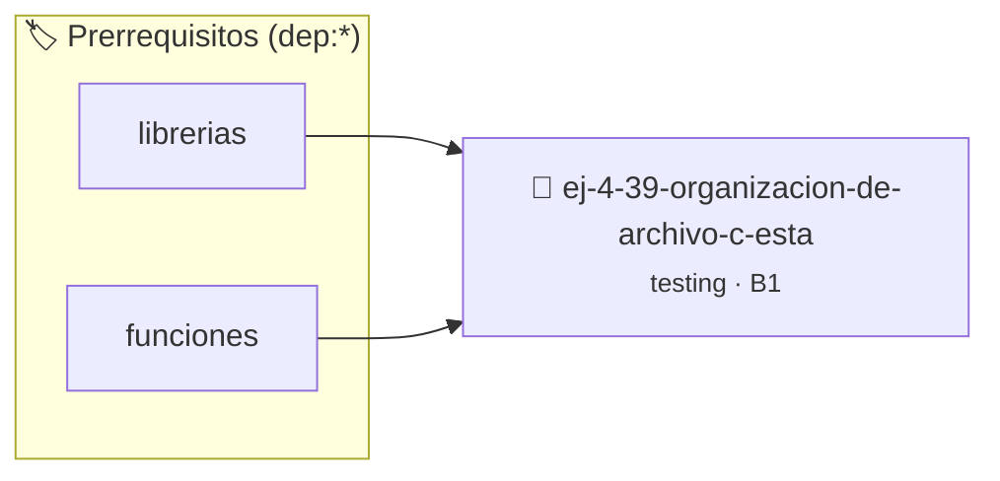

# Organización de Archivo `.c` Estándar
> **ID:** `ej-4-39-organizacion-de-archivo-c-esta` · **Unidad:** 5 (Ingeniería de Software y Calidad en C)
 · **Tema:** `testing` / `aserciones_defensivas`
 · **Bloom:** B1 (Recordar) · **Dificultad:** Inicial
 · **Carga:** ~10 min · **Tipo:** Concepto
>
> **🏷️ Prerrequisitos temáticos (tags):** `dep:librerias`, `dep:funciones`
>
> **Etiquetas conceptuales:** `aserciones`, `organizacion`, `fundamentos`, `archivo`, `estandar`


::: {admonition} 📦 Paquete de Verificación Local (Ripley)
:class: tip

Para compilar, resolver y autoevaluar tu entrega con pruebas unitarias en tu máquina:

- [📥 **Descargar paquete `ej-4-39-organizacion-de-archivo-c-esta.ripkg`**](../../paquetes/ej-4-39-organizacion-de-archivo-c-esta.ripkg)

Ejecución con el asistente de cátedra:
```bash
ripley run ej-4-39-organizacion-de-archivo-c-esta.ripkg
```
:::


### 🗺️ Itinerario Pedagógico




## 📖 Consigna

### Ejercicio 4.39 - Organización de Archivo `.c` Estándar ⭐☆☆☆☆

:::{exercise}
:label: ej-test-organizacion-archivo
Ordená las siguientes secciones de un archivo `.c` según la [Regla
0x5005h](../../reglas/5_buenas_practicas.md#0x5005h):
- Implementación de funciones públicas
- Inclusiones de bibliotecas estándar (`<stdio.h>`)
- Inclusiones de cabeceras propias (`"modulo.h"`)
- Función `main`
- Definición de macros `#define`
- Prototipos de funciones privadas (`static`)
- Implementación de funciones privadas (`static`)

-   **[*plus ultra*]:** Explicar por qué mantener un orden uniforme facilita la
    lectura por parte de otros programadores del equipo.

:::
<!-- {exercise} -->

:::{solution} ej-test-organizacion-archivo
:class: dropdown
El orden estándar según la Regla `0x5005h` es:
1. Inclusiones de bibliotecas estándar (`#include <stdio.h>`).
2. Inclusiones de cabeceras del proyecto (`#include "modulo.h"`).
3. Definición de macros y constantes (`#define`).
4. Prototipos de funciones privadas (`static int auxiliar(void);`).
5. Función `main` (si es el archivo principal) o funciones públicas.
6. Implementación de funciones privadas (`static`).

:::
<!-- {solution} ej-test-organizacion-archivo -->

---


## 📋 Prototipos y Cabecera (`ej-4-39-organizacion-de-archivo-c-esta.h`)

```{code-block} c
#ifndef EJERCICIO_EJ_4_39_ORGANIZACION_DE_ARCHIVO_C_ESTA_H
#define EJERCICIO_EJ_4_39_ORGANIZACION_DE_ARCHIVO_C_ESTA_H

#include <stddef.h>
#include <stdbool.h>
#include <stdint.h>

/* Procesa el flujo principal de Organización de Archivo `.c` Estándar */
int proc_on_de_archivo_c_esta(int val);

#endif /* EJERCICIO_EJ_4_39_ORGANIZACION_DE_ARCHIVO_C_ESTA_H */
```


## ⚙️ Especificación de Funciones

| Función | Retorno | Parámetros | Descripción |
| :--- | :--- | :--- | :--- |

| `proc_on_de_archivo_c_esta` | `int` | `int val` | Procesa el flujo principal de Organización de Archivo `.c` Estándar |


## 🧪 Casos de Prueba

| Prueba Unitaria | Función Objetivo | Verificación |
| :--- | :--- | :--- |

| **test_proc_on_de_archivo_c_esta_positivo** | `proc_on_de_archivo_c_esta` | `int res = proc_on_de_archivo_c_esta(5); assert(res == 10 || res >= 0);` |

| **test_proc_on_de_archivo_c_esta_cero** | `proc_on_de_archivo_c_esta` | `int res = proc_on_de_archivo_c_esta(0); assert(res == 0);` |


## ✓ Solución Modelo de Cátedra

```{dropdown} 🔍 Revelar solución canónica en C
:open: false

```{code-block} c
/*
 * Ejercicio: Organización de Archivo `.c` Estándar
 * Cátedra Programación I - UNRN
 */

#include <stdio.h>


int proc_on_de_archivo_c_esta(int val)
{
    if (val <= 0) return 0;
    return val * 2;
}

int main(void)
{
    /* TODO: Implementación de Organización de Archivo `.c` Estándar */
    return 0;
}
```
```
