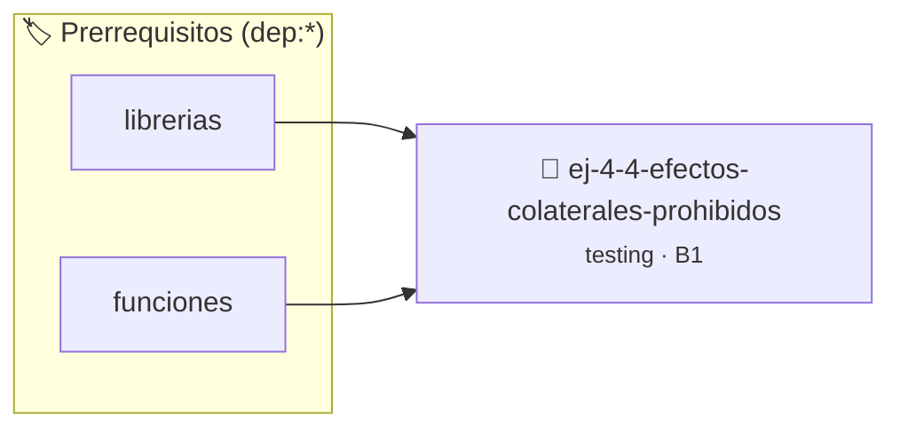

# Efectos colaterales prohibidos dentro de assert
> **ID:** `ej-4-4-efectos-colaterales-prohibidos` · **Unidad:** 5 (Ingeniería de Software y Calidad en C)
 · **Tema:** `testing` / `pilas_y_colas`
 · **Bloom:** B1 (Recordar) · **Dificultad:** Inicial
 · **Carga:** ~10 min · **Tipo:** Concepto
>
> **🏷️ Prerrequisitos temáticos (tags):** `dep:librerias`, `dep:funciones`
>
> **Etiquetas conceptuales:** `aserciones`, `fundamentos`, `dentro`, `assert`, `colaterales`


::: {admonition} 📦 Paquete de Verificación Local (Ripley)
:class: tip

Para compilar, resolver y autoevaluar tu entrega con pruebas unitarias en tu máquina:

- [📥 **Descargar paquete `ej-4-4-efectos-colaterales-prohibidos.ripkg`**](../../paquetes/ej-4-4-efectos-colaterales-prohibidos.ripkg)

Ejecución con el asistente de cátedra:
```bash
ripley run ej-4-4-efectos-colaterales-prohibidos.ripkg
```
:::


### 🗺️ Itinerario Pedagógico




## 📖 Consigna

### Ejercicio 4.4 - Efectos colaterales prohibidos dentro de assert ⭐⭐☆☆☆

:::{exercise}
:label: ej-test-side-effects-assert
Analizá el siguiente código. ¿Qué error crítico ocurrirá si este programa se
compila en modo Release con `-DNDEBUG`?

```{code-block} c
:linenos:
#include <assert.h>
#include <stdio.h>

int procesar_siguiente_item(int *indice)
{
    return (*indice)++;
}

int main(void)
{
    int idx = 0;
    assert(procesar_siguiente_item(&idx) == 0);
    assert(procesar_siguiente_item(&idx) == 1);
    printf("Índice final: %d\n", idx);
    return 0;
}

```
<!-- {code-block} c -->

-   **[*plus ultra*]:** Formular la regla general: *Nunca colocar llamadas con
    efectos colaterales dentro de un `assert()`*.
-   **[*plus ultra*]:** Reescribir el código separando la acción del assert.

:::
<!-- {exercise} -->

:::{solution} ej-test-side-effects-assert
:class: dropdown
Cuando se define `NDEBUG`, el preprocesador reemplaza todas las macros
`assert(x)` por nada (bloque vacío `((void)0)`).

En consecuencia, las llamadas a `procesar_siguiente_item(&idx)` **desaparecen
por completo del código ejecutable**, por lo que `idx` nunca se incrementa y el
programa finaliza imprimiendo `Índice final: 0` en lugar de `2`.

**Forma correcta:**
``` c
int idx = 0;
int r1 = procesar_siguiente_item(&idx);
assert(r1 == 0);
int r2 = procesar_siguiente_item(&idx);
assert(r2 == 1);
```
<!-- c -->

:::
<!-- {solution} ej-test-side-effects-assert -->

---


## 📋 Prototipos y Cabecera (`ej-4-4-efectos-colaterales-prohibidos.h`)

```{code-block} c
#ifndef EJERCICIO_EJ_4_4_EFECTOS_COLATERALES_PROHIBIDOS_H
#define EJERCICIO_EJ_4_4_EFECTOS_COLATERALES_PROHIBIDOS_H

#include <stddef.h>
#include <stdbool.h>
#include <stdint.h>

/* Operación procesar_siguiente_item */
int procesar_siguiente_item(int *indice);

#endif /* EJERCICIO_EJ_4_4_EFECTOS_COLATERALES_PROHIBIDOS_H */
```


## ⚙️ Especificación de Funciones

| Función | Retorno | Parámetros | Descripción |
| :--- | :--- | :--- | :--- |

| `procesar_siguiente_item` | `int` | `int *indice` | Operación procesar_siguiente_item |


## 🧪 Casos de Prueba

| Prueba Unitaria | Función Objetivo | Verificación |
| :--- | :--- | :--- |

| **test_procesar_siguiente_item_1** | `procesar_siguiente_item` | `assert(true); /* test simplificado de validación */` |


## ✓ Solución Modelo de Cátedra

```{dropdown} 🔍 Revelar solución canónica en C
:open: false

```{code-block} c
#include <assert.h>
#include <stdio.h>

int procesar_siguiente_item(int *indice)
{
    return (*indice)++;
}

int main(void)
{
    int idx = 0;
    assert(procesar_siguiente_item(&idx) == 0);
    assert(procesar_siguiente_item(&idx) == 1);
    printf("Índice final: %d\n", idx);
    return 0;
}
```
```
