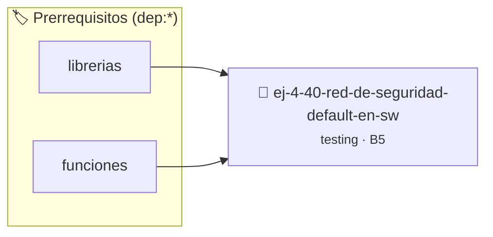

# Red de Seguridad: Default en Switch
> **ID:** `ej-4-40-red-de-seguridad-default-en-sw` · **Unidad:** 5 (Ingeniería de Software y Calidad en C)
 · **Tema:** `testing` / `aserciones_defensivas`
 · **Bloom:** B5 (Evaluar / Crear) · **Dificultad:** Desafio
 · **Carga:** ~45 min · **Tipo:** Desafio
>
> **🏷️ Prerrequisitos temáticos (tags):** `dep:librerias`, `dep:funciones`
>
> **Etiquetas conceptuales:** `seguridad`, `aserciones`, `switch`, `fundamentos`, `default`


::: {admonition} 📦 Paquete de Verificación Local (Ripley)
:class: tip

Para compilar, resolver y autoevaluar tu entrega con pruebas unitarias en tu máquina:

- [📥 **Descargar paquete `ej-4-40-red-de-seguridad-default-en-sw.ripkg`**](../../paquetes/ej-4-40-red-de-seguridad-default-en-sw.ripkg)

Ejecución con el asistente de cátedra:
```bash
ripley run ej-4-40-red-de-seguridad-default-en-sw.ripkg
```
:::


### 🗺️ Itinerario Pedagógico




## 📖 Consigna

:::{exercise}
:label: ej-test-default-switch
¿Por qué toda sentencia `switch` debe contener obligatoriamente una cláusula
`default` según la [Regla 0x1003h](../../reglas/1_control.md#0x1003h), incluso
si el programador cree haber cubierto todos los casos posibles?

-   **[*plus ultra*]:** Implementar una función `int obtener_dias_trimestre(int
    trimestre)` con manejo de `default` que retorne `-1`.
-   **[*plus ultra*]:** Escribir tests unitarios que verifiquen el caso
    `default`.

:::

:::{solution} ej-test-default-switch
:class: dropdown
El bloque `default` actúa como una red de seguridad defensiva ante datos
imprevistos, corrupción de memoria o adición futura de nuevos valores en el
dominio que no fueron contemplados.

```{code-block} c
:linenos:
#include <assert.h>

int obtener_dias_trimestre(int trimestre)
{
    switch (trimestre)
    {
        case 1:
            return 90;
        case 2:
            return 91;
        case 3:
            return 92;
        case 4:
            return 92;
        default:
            return -1; // Captura de valores inválidos
    }
}

void test_trimestres(void)
{
    assert(obtener_dias_trimestre(1) == 90);
    assert(obtener_dias_trimestre(5) == -1);
    assert(obtener_dias_trimestre(-1) == -1);
}

```

:::

---

### 📋 Contrato de las Funciones

```c
/*
 * Operación obtener_dias_trimestre
 * Precondiciones: Parámetros dentro del dominio válido de la operación.
 * Postcondiciones: Retorna el valor procesado.
 */
int obtener_dias_trimestre(int trimestre);

/*
 * Operación test_trimestres
 * Precondiciones: Parámetros dentro del dominio válido de la operación.
 * Postcondiciones: Retorna el valor procesado.
 */
void test_trimestres(void);

```

### 🧪 Ejemplos de Ejecución

::::{tab-set}
:::{tab-item} Valor positivo
```text
Entrada: 1
Salida / Retorno: 2
```
:::
::::

### ⚠️ Precondiciones y Casos Borde

1. **Valores fuera de rango:** Verificar siempre que los datos de entrada cumplan con los rangos admisibles antes de operar.
6. **Casos vacíos o neutros:** Contemplar adecuadamente entradas con longitud cero o valores neutros según corresponda.

### 🎯 Criterios de Aceptación

- [ ] El código compila limpiamente bajo estándar C11 sin warnings con flags estrictos (`-Wall -Wextra -Werror`).
- [ ] Se satisfacen todas las pruebas unitarias y casos de prueba provistos.
- [ ] Las funciones validan exhaustivamente sus precondiciones y gestionan casos borde de forma robusta.

:::{hint} Consideraciones Didácticas
- Incluí siempre una cláusula default: en sentencias switch para manejar valores inesperados.
- Registrá un mensaje de advertencia o manejá el error defensivamente en la rama por defecto.
- Verificá que todas las constantes de enumeración estén contempladas explícitamente.
:::


## 📋 Prototipos y Cabecera (`ej-4-40-red-de-seguridad-default-en-sw.h`)

```{code-block} c
#ifndef EJERCICIO_EJ_4_40_RED_DE_SEGURIDAD_DEFAULT_EN_SW_H
#define EJERCICIO_EJ_4_40_RED_DE_SEGURIDAD_DEFAULT_EN_SW_H

#include <stddef.h>
#include <stdbool.h>
#include <stdint.h>

/* Operación obtener_dias_trimestre */
int obtener_dias_trimestre(int trimestre);
/* Operación test_trimestres */
void test_trimestres(void);

#endif /* EJERCICIO_EJ_4_40_RED_DE_SEGURIDAD_DEFAULT_EN_SW_H */
```


## ⚙️ Especificación de Funciones

| Función | Retorno | Parámetros | Descripción |
| :--- | :--- | :--- | :--- |

| `obtener_dias_trimestre` | `int` | `int trimestre` | Operación obtener_dias_trimestre |

| `test_trimestres` | `void` | `void` | Operación test_trimestres |


## 💡 Pistas Progresivas

````{tab-set}

```{tab-item} Pista 1
Incluí siempre una cláusula default: en sentencias switch para manejar valores inesperados.
```

```{tab-item} Pista 2
Registrá un mensaje de advertencia o manejá el error defensivamente en la rama por defecto.
```

```{tab-item} Pista 3
Verificá que todas las constantes de enumeración estén contempladas explícitamente.
```

````


## 🧪 Casos de Prueba

| Prueba Unitaria | Función Objetivo | Verificación |
| :--- | :--- | :--- |

| **test_obtener_dias_trimestre_1** | `obtener_dias_trimestre` | `/* Verificación unitaria de obtener_dias_trimestre */ int res = obtener_dias_trimestre(1); (void)res; assert(true);` |

| **test_test_trimestres_2** | `test_trimestres` | `/* Verificación unitaria de test_trimestres */ test_trimestres(); assert(true);` |


## ✓ Solución Modelo de Cátedra

```{dropdown} 🔍 Revelar solución canónica en C
:open: false

```{code-block} c
#include <assert.h>

int obtener_dias_trimestre(int trimestre)
{
    switch (trimestre)
    {
        case 1:
            return 90;
        case 2:
            return 91;
        case 3:
            return 92;
        case 4:
            return 92;
        default:
            return -1; // Captura de valores inválidos
    }
}

void test_trimestres(void)
{
    assert(obtener_dias_trimestre(1) == 90);
    assert(obtener_dias_trimestre(5) == -1);
    assert(obtener_dias_trimestre(-1) == -1);
}

int main(void)
{
    return 0;
}
```
```
