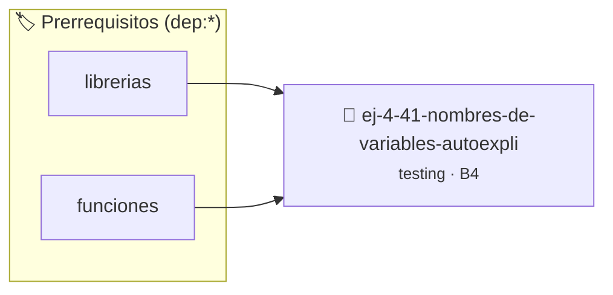

# Nombres de Variables Autoexplicativos
> **ID:** `ej-4-41-nombres-de-variables-autoexpli`
 · **Tema:** `testing`
 · **Bloom:** B4 (Analizar)
 · **Carga:** ~35 min
>
> **🏷️ Prerrequisitos temáticos (tags):** `dep:librerias`, `dep:funciones`
>
> **Etiquetas conceptuales:** `nombres`, `aserciones`, `variables`, `fundamentos`, `autoexplicativos`


::: {admonition} 📦 Paquete de Verificación Local (Ripley)
:class: tip

Para compilar, resolver y autoevaluar tu entrega con pruebas unitarias en tu máquina:

- [📥 **Descargar paquete `ej-4-41-nombres-de-variables-autoexpli.ripkg`**](../../paquetes/ej-4-41-nombres-de-variables-autoexpli.ripkg)

Ejecución con el asistente de cátedra:
```bash
ripley run ej-4-41-nombres-de-variables-autoexpli.ripkg
```
:::


### 🗺️ Itinerario Pedagógico




## 📖 Consigna

### Ejercicio 4.41 - Nombres de Variables Autoexplicativos ⭐☆☆☆☆

:::{exercise}
:label: ej-test-nombres-variables
Refactorizá el siguiente código reemplazando los nombres de variables crípticos
por identificadores claros en `snake_case` según la [Regla
0x0007h](../../reglas/0_sintaxis.md#0x0007h):

```{code-block} c
:linenos:
// Código críptico:
double c(double p, double d, double t)
{
    double r = p - (p * (d / 100.0));
    double f = r + (r * (t / 100.0));
    return f;
}

```
<!-- {code-block} c -->

-   **[*plus ultra*]:** Escribir un test unitario con assert para verificar el
    cálculo del precio final con descuento e impuesto.

:::
<!-- {exercise} -->

:::{solution} ej-test-nombres-variables
:class: dropdown
```{code-block} c
:linenos:
#include <assert.h>

double calcular_precio_final(double precio_base, double porcentaje_descuento, double porcentaje_impuesto)
{
    double precio_con_descuento = precio_base - (precio_base * (porcentaje_descuento / 100.0));
    double precio_final = precio_con_descuento + (precio_con_descuento * (porcentaje_impuesto / 100.0));
    return precio_final;
}

void test_precio_final(void)
{
    assert(calcular_precio_final(100.0, 10.0, 21.0) == 108.9);
}

```
<!-- {code-block} c -->

:::
<!-- {solution} ej-test-nombres-variables -->

---


## 📋 Prototipos y Cabecera (`ej-4-41-nombres-de-variables-autoexpli.h`)

```{code-block} c
#ifndef EJERCICIO_EJ_4_41_NOMBRES_DE_VARIABLES_AUTOEXPLI_H
#define EJERCICIO_EJ_4_41_NOMBRES_DE_VARIABLES_AUTOEXPLI_H

#include <stddef.h>
#include <stdbool.h>
#include <stdint.h>

/* Operación c */
double c(double p, double d, double t);

#endif /* EJERCICIO_EJ_4_41_NOMBRES_DE_VARIABLES_AUTOEXPLI_H */
```


## ⚙️ Especificación de Funciones

| Función | Retorno | Parámetros | Descripción |
| :--- | :--- | :--- | :--- |

| `c` | `double` | `double p, double d, double t` | Operación c |


## 🧪 Casos de Prueba

| Prueba Unitaria | Función Objetivo | Verificación |
| :--- | :--- | :--- |

| **test_c_1** | `c` | `/* Verificación unitaria de c */ double res = c(1, 2, 3); (void)res; assert(true);` |


## ✓ Solución Modelo de Cátedra

```{dropdown} 🔍 Revelar solución canónica en C
:open: false

```{code-block} c
// Código críptico:
double c(double p, double d, double t)
{
    double r = p - (p * (d / 100.0));
    double f = r + (r * (t / 100.0));
    return f;
}

int main(void)
{
    return 0;
}
```
```
