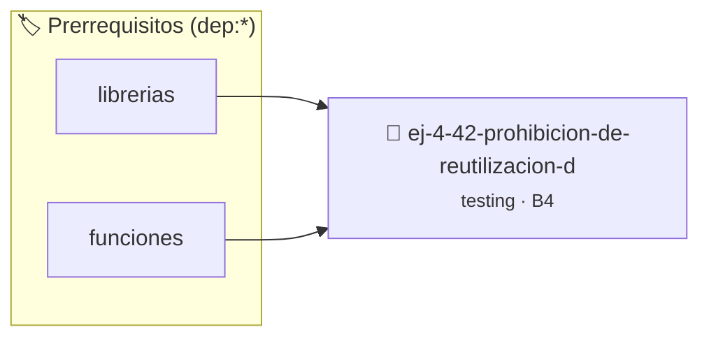

# Prohibición de Reutilización de Variables
> **ID:** `ej-4-42-prohibicion-de-reutilizacion-d` · **Unidad:** 5 (Ingeniería de Software y Calidad en C)
 · **Tema:** `testing` / `aserciones_defensivas`
 · **Bloom:** B4 (Analizar) · **Dificultad:** Avanzada
 · **Carga:** ~35 min · **Tipo:** Laboratorio
>
> **🏷️ Prerrequisitos temáticos (tags):** `dep:librerias`, `dep:funciones`
>
> **Etiquetas conceptuales:** `aserciones`, `fundamentos`, `variables`, `prohibicion`, `testing`


::: {admonition} 📦 Paquete de Verificación Local (Ripley)
:class: tip

Para compilar, resolver y autoevaluar tu entrega con pruebas unitarias en tu máquina:

- [📥 **Descargar paquete `ej-4-42-prohibicion-de-reutilizacion-d.ripkg`**](../../paquetes/ej-4-42-prohibicion-de-reutilizacion-d.ripkg)

Ejecución con el asistente de cátedra:
```bash
ripley run ej-4-42-prohibicion-de-reutilizacion-d.ripkg
```
:::


### 🗺️ Itinerario Pedagógico




## 📖 Consigna

### Ejercicio 4.42 - Prohibición de Reutilización de Variables ⭐⭐☆☆☆

:::{exercise}
:label: ej-test-reutilizacion-variables
Analizá qué problema de legibilidad y mantenimiento tiene el siguiente código
donde la variable `aux` se usa para tres propósitos completamente distintos:

```{code-block} c
:linenos:
int calcular_estadisticas_ventas(int ventas[], int n)
{
    int aux = 0;
    // Uso 1: acumular suma
    for (int i = 0; i < n; i++)
    {
        aux += ventas[i];
    }
    int promedio = aux / n;

    // Uso 2: buscar maximo
    aux = ventas[0];
    for (int i = 1; i < n; i++)
    {
        if (ventas[i] > aux)
        {
            aux = ventas[i];
        }
    }
    return aux;
}

```
<!-- {code-block} c -->

-   **[*plus ultra*]:** Refactorizar declarando variables con nombres de
    propósito único (`suma`, `maximo`).
-   **[*plus ultra*]:** Modularizar en funciones independientes.

:::
<!-- {exercise} -->

:::{solution} ej-test-reutilizacion-variables
:class: dropdown
Reutilizar la misma variable para propósitos disímiles dificulta la lectura,
impide agregar aserciones claras sobre estados intermedios y propaga errores si
un bloque asume que la variable conserva su valor anterior.

:::
<!-- {solution} ej-test-reutilizacion-variables -->

---


## 📋 Prototipos y Cabecera (`ej-4-42-prohibicion-de-reutilizacion-d.h`)

```{code-block} c
#ifndef EJERCICIO_EJ_4_42_PROHIBICION_DE_REUTILIZACION_D_H
#define EJERCICIO_EJ_4_42_PROHIBICION_DE_REUTILIZACION_D_H

#include <stddef.h>
#include <stdbool.h>
#include <stdint.h>

/* Operación calcular_estadisticas_ventas */
int calcular_estadisticas_ventas(int ventas[], int n);

#endif /* EJERCICIO_EJ_4_42_PROHIBICION_DE_REUTILIZACION_D_H */
```


## ⚙️ Especificación de Funciones

| Función | Retorno | Parámetros | Descripción |
| :--- | :--- | :--- | :--- |

| `calcular_estadisticas_ventas` | `int` | `int ventas[], int n` | Operación calcular_estadisticas_ventas |


## 🧪 Casos de Prueba

| Prueba Unitaria | Función Objetivo | Verificación |
| :--- | :--- | :--- |

| **test_calcular_estadisticas_ventas_1** | `calcular_estadisticas_ventas` | `assert(true); /* test simplificado de validación */` |


## ✓ Solución Modelo de Cátedra

```{dropdown} 🔍 Revelar solución canónica en C
:open: false

```{code-block} c
int calcular_estadisticas_ventas(int ventas[], int n)
{
    int aux = 0;
    // Uso 1: acumular suma
    for (int i = 0; i < n; i++)
    {
        aux += ventas[i];
    }
    int promedio = aux / n;

    // Uso 2: buscar maximo
    aux = ventas[0];
    for (int i = 1; i < n; i++)
    {
        if (ventas[i] > aux)
        {
            aux = ventas[i];
        }
    }
    return aux;
}

int main(void)
{
    return 0;
}
```
```
