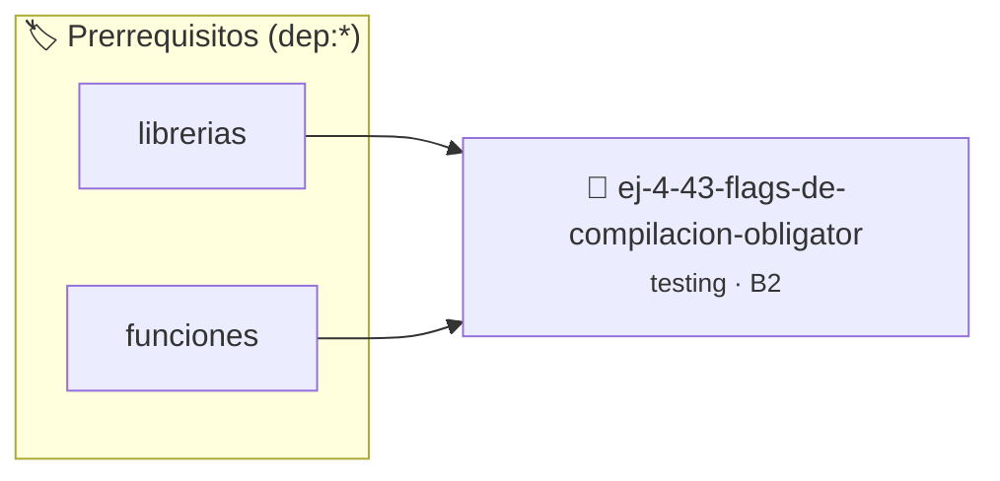

# Flags de Compilación Obligatorios
> **ID:** `ej-4-43-flags-de-compilacion-obligator`
 · **Tema:** `testing`
 · **Bloom:** B2 (Comprender)
 · **Carga:** ~15 min
>
> **🏷️ Prerrequisitos temáticos (tags):** `dep:librerias`, `dep:funciones`
>
> **Etiquetas conceptuales:** `aserciones`, `fundamentos`, `obligatorios`, `flags`, `testing`


::: {admonition} 📦 Paquete de Verificación Local (Ripley)
:class: tip

Para compilar, resolver y autoevaluar tu entrega con pruebas unitarias en tu máquina:

- [📥 **Descargar paquete `ej-4-43-flags-de-compilacion-obligator.ripkg`**](../../paquetes/ej-4-43-flags-de-compilacion-obligator.ripkg)

Ejecución con el asistente de cátedra:
```bash
ripley run ej-4-43-flags-de-compilacion-obligator.ripkg
```
:::


### 🗺️ Itinerario Pedagógico




## 📖 Consigna

### Ejercicio 4.43 - Flags de Compilación Obligatorios ⭐☆☆☆☆

:::{exercise}
:label: ej-test-flags-compilacion
Explicá qué detecta cada uno de los siguientes flags de `gcc` y por qué son
obligatorios en las buenas prácticas de ingeniería ([Regla
0x5002h](../../reglas/5_buenas_practicas.md#0x5002h)):
- `-Wall`
- `-Wextra`
- `-Werror`
- `-Wpedantic`

-   **[*plus ultra*]:** Configurar una línea de compilación modelo en un archivo
    Makefile.

:::
<!-- {exercise} -->

:::{solution} ej-test-flags-compilacion
:class: dropdown
- `-Wall`: Habilita todas las advertencias comunes sobre construcciones dudosas
  (variables no usadas, conversiones implícitas riesgosas).
- `-Wextra`: Habilita advertencias adicionales más rigurosas (comparaciones con
  signo/sin signo, parámetros no utilizados).
- `-Werror`: Trata todas las advertencias como errores de compilación,
  impidiendo generar el binario si existen problemas.
- `-Wpedantic`: Exige estricto apego al estándar ISO de C, rechazando
  extensiones propietarias del compilador.

:::
<!-- {solution} ej-test-flags-compilacion -->

---


## 📋 Prototipos y Cabecera (`ej-4-43-flags-de-compilacion-obligator.h`)

```{code-block} c
#ifndef EJERCICIO_EJ_4_43_FLAGS_DE_COMPILACION_OBLIGATOR_H
#define EJERCICIO_EJ_4_43_FLAGS_DE_COMPILACION_OBLIGATOR_H

#include <stddef.h>
#include <stdbool.h>
#include <stdint.h>

/* Procesa el flujo principal de Flags de Compilación Obligatorios */
int proc_ompilacion_obligator(int val);

#endif /* EJERCICIO_EJ_4_43_FLAGS_DE_COMPILACION_OBLIGATOR_H */
```


## ⚙️ Especificación de Funciones

| Función | Retorno | Parámetros | Descripción |
| :--- | :--- | :--- | :--- |

| `proc_ompilacion_obligator` | `int` | `int val` | Procesa el flujo principal de Flags de Compilación Obligatorios |


## 🧪 Casos de Prueba

| Prueba Unitaria | Función Objetivo | Verificación |
| :--- | :--- | :--- |

| **test_proc_ompilacion_obligator_positivo** | `proc_ompilacion_obligator` | `int res = proc_ompilacion_obligator(5); assert(res == 10 || res >= 0);` |

| **test_proc_ompilacion_obligator_cero** | `proc_ompilacion_obligator` | `int res = proc_ompilacion_obligator(0); assert(res == 0);` |


## ✓ Solución Modelo de Cátedra

```{dropdown} 🔍 Revelar solución canónica en C
:open: false

```{code-block} c
/*
 * Ejercicio: Flags de Compilación Obligatorios
 * Cátedra Programación I - UNRN
 */

#include <stdio.h>


int proc_ompilacion_obligator(int val)
{
    if (val <= 0) return 0;
    return val * 2;
}

int main(void)
{
    /* TODO: Implementación de Flags de Compilación Obligatorios */
    return 0;
}
```
```
