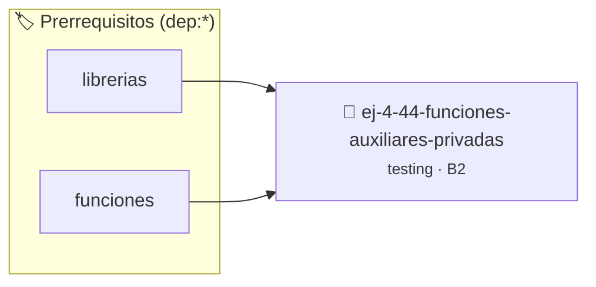

# Funciones Auxiliares Privadas `static`
> **ID:** `ej-4-44-funciones-auxiliares-privadas` · **Unidad:** 5 (Ingeniería de Software y Calidad en C)
 · **Tema:** `testing` / `aserciones_defensivas`
 · **Bloom:** B2 (Comprender) · **Dificultad:** Inicial
 · **Carga:** ~15 min · **Tipo:** Laboratorio
>
> **🏷️ Prerrequisitos temáticos (tags):** `dep:librerias`, `dep:funciones`
>
> **Etiquetas conceptuales:** `aserciones`, `fundamentos`, `funciones`, `static`, `auxiliares`


::: {admonition} 📦 Paquete de Verificación Local (Ripley)
:class: tip

Para compilar, resolver y autoevaluar tu entrega con pruebas unitarias en tu máquina:

- [📥 **Descargar paquete `ej-4-44-funciones-auxiliares-privadas.ripkg`**](../../paquetes/ej-4-44-funciones-auxiliares-privadas.ripkg)

Ejecución con el asistente de cátedra:
```bash
ripley run ej-4-44-funciones-auxiliares-privadas.ripkg
```
:::


### 🗺️ Itinerario Pedagógico




## 📖 Consigna

:::{exercise}
:label: ej-test-funciones-static
Explicá por qué las funciones auxiliares de un módulo `.c` que no forman parte
de la interfaz pública deben declararse obligatoriamente con el calificador
`static`.

-   **[*plus ultra*]:** Explicar el concepto de visibilidad de enlace (*internal
    linkage*).
-   **[*plus ultra*]:** Explicar cómo esto previene colisiones de nombres con
    funciones auxiliares de otros archivos `.c`.

:::

:::{solution} ej-test-funciones-static
:class: dropdown
El calificador `static` en una función a nivel de archivo restringe su
visibilidad exclusivamente a la unidad de traducción actual (*internal
linkage*). Esto encapsula los detalles de implementación internos y previene
errores de símbolos duplicados en tiempo de enlace (*linker collision*).

:::

---

### 📋 Contrato de las Funciones

```c
/*
 * Procesa el flujo principal de Funciones Auxiliares Privadas `static`
 * Precondiciones: val representa el parámetro de entrada del flujo.
 * Postcondiciones: Retorna el resultado correspondiente o 0 si val <= 0.
 */
int proc__auxiliares_privadas(int val);

```

### 🧪 Ejemplos de Ejecución

::::{tab-set}
:::{tab-item} Valor positivo
```text
Entrada: 5
Salida / Retorno: 10
```
:::
:::{tab-item} Valor cero o negativo
```text
Entrada: 0
Salida / Retorno: 0
```
:::
::::

### ⚠️ Precondiciones y Casos Borde

1. **Valores fuera de rango:** Verificar siempre que los datos de entrada cumplan con los rangos admisibles antes de operar.
6. **Casos vacíos o neutros:** Contemplar adecuadamente entradas con longitud cero o valores neutros según corresponda.

### 🎯 Criterios de Aceptación

- [ ] El código compila limpiamente bajo estándar C11 sin warnings con flags estrictos (`-Wall -Wextra -Werror`).
- [ ] Se satisfacen todas las pruebas unitarias y casos de prueba provistos.
- [ ] Las funciones validan exhaustivamente sus precondiciones y gestionan casos borde de forma robusta.


## 📋 Prototipos y Cabecera (`ej-4-44-funciones-auxiliares-privadas.h`)

```{code-block} c
#ifndef EJERCICIO_EJ_4_44_FUNCIONES_AUXILIARES_PRIVADAS_H
#define EJERCICIO_EJ_4_44_FUNCIONES_AUXILIARES_PRIVADAS_H

#include <stddef.h>
#include <stdbool.h>
#include <stdint.h>

/* Procesa el flujo principal de Funciones Auxiliares Privadas `static` */
int proc__auxiliares_privadas(int val);

#endif /* EJERCICIO_EJ_4_44_FUNCIONES_AUXILIARES_PRIVADAS_H */
```


## ⚙️ Especificación de Funciones

| Función | Retorno | Parámetros | Descripción |
| :--- | :--- | :--- | :--- |

| `proc__auxiliares_privadas` | `int` | `int val` | Procesa el flujo principal de Funciones Auxiliares Privadas `static` |


## 🧪 Casos de Prueba

| Prueba Unitaria | Función Objetivo | Verificación |
| :--- | :--- | :--- |

| **test_proc__auxiliares_privadas_positivo** | `proc__auxiliares_privadas` | `int res = proc__auxiliares_privadas(5); assert(res == 10 || res >= 0);` |

| **test_proc__auxiliares_privadas_cero** | `proc__auxiliares_privadas` | `int res = proc__auxiliares_privadas(0); assert(res == 0);` |


## ✓ Solución Modelo de Cátedra

```{dropdown} 🔍 Revelar solución canónica en C
:open: false

```{code-block} c
/*
 * Ejercicio: Funciones Auxiliares Privadas `static`
 * Cátedra Programación I - UNRN
 */

#include <stdio.h>


int proc__auxiliares_privadas(int val)
{
    if (val <= 0) return 0;
    return val * 2;
}

int main(void)
{
    /* TODO: Implementación de Funciones Auxiliares Privadas `static` */
    return 0;
}
```
```
