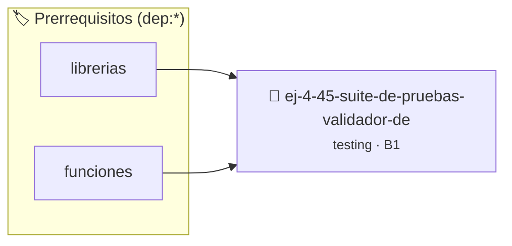

# Suite de Pruebas: Validador de Fecha
> **ID:** `ej-4-45-suite-de-pruebas-validador-de` · **Unidad:** 5 (Ingeniería de Software y Calidad en C)
 · **Tema:** `testing` / `aserciones_defensivas`
 · **Bloom:** B1 (Recordar) · **Dificultad:** Inicial
 · **Carga:** ~10 min · **Tipo:** Concepto
>
> **🏷️ Prerrequisitos temáticos (tags):** `dep:librerias`, `dep:funciones`
>
> **Etiquetas conceptuales:** `aserciones`, `fundamentos`, `pruebas`, `fecha`, `suite`


::: {admonition} 📦 Paquete de Verificación Local (Ripley)
:class: tip

Para compilar, resolver y autoevaluar tu entrega con pruebas unitarias en tu máquina:

- [📥 **Descargar paquete `ej-4-45-suite-de-pruebas-validador-de.ripkg`**](../../paquetes/ej-4-45-suite-de-pruebas-validador-de.ripkg)

Ejecución con el asistente de cátedra:
```bash
ripley run ej-4-45-suite-de-pruebas-validador-de.ripkg
```
:::


### 🗺️ Itinerario Pedagógico




## 📖 Consigna

### Ejercicio 4.45 - Suite de Pruebas: Validador de Fecha ⭐⭐⭐☆☆

:::{exercise}
:label: ej-test-suite-fechas
Implementá una función pura `bool es_fecha_valida(int dia, int mes, int anio)` y
construí una suite completa de pruebas unitarias que cubra:
- Días válidos para meses de 31 días.
- Días válidos para meses de 30 días.
- Casos válidos e inválidos de febrero en año bisiesto (29/02/2024 vs
  29/02/2023).
- Días negativos o mayores a 31.
- Meses fuera del rango 1 a 12.
- Años menores o iguales a cero.

-   **[*plus ultra*]:** Modularizar las pruebas en funciones separadas por cada
    categoría.
-   **[*plus ultra*]:** Crear la función `void correr_pruebas_fechas(void)` que
    las invoque a todas.

:::
<!-- {exercise} -->

:::{solution} ej-test-suite-fechas
:class: dropdown
```{code-block} c
:linenos:
#include <assert.h>
#include <stdbool.h>

bool es_bisiesto_aux(int anio)
{
    return (anio % 4 == 0 && anio % 100 != 0) || (anio % 400 == 0);
}

bool es_fecha_valida(int dia, int mes, int anio)
{
    if (anio <= 0 || mes < 1 || mes > 12 || dia < 1)
    {
        return false;
    }
    int dias_max = 31;
    if (mes == 4 || mes == 6 || mes == 9 || mes == 11)
    {
        dias_max = 30;
    }
    else if (mes == 2)
    {
        dias_max = es_bisiesto_aux(anio) ? 29 : 28;
    }
    return dia <= dias_max;
}

void test_fecha_31_dias(void)
{
    assert(es_fecha_valida(31, 1, 2024) == true);
    assert(es_fecha_valida(32, 1, 2024) == false);
}

void test_fecha_30_dias(void)
{
    assert(es_fecha_valida(30, 4, 2024) == true);
    assert(es_fecha_valida(31, 4, 2024) == false);
}

void test_febrero_bisiesto(void)
{
    assert(es_fecha_valida(29, 2, 2024) == true);
    assert(es_fecha_valida(29, 2, 2023) == false);
}

void test_fecha_mes_invalido(void)
{
    assert(es_fecha_valida(15, 13, 2024) == false);
    assert(es_fecha_valida(15, 0, 2024) == false);
}

void correr_pruebas_fechas(void)
{
    test_fecha_31_dias();
    test_fecha_30_dias();
    test_febrero_bisiesto();
    test_fecha_mes_invalido();
}

```
<!-- {code-block} c -->

:::
<!-- {solution} ej-test-suite-fechas -->

---


## 📋 Prototipos y Cabecera (`ej-4-45-suite-de-pruebas-validador-de.h`)

```{code-block} c
#ifndef EJERCICIO_EJ_4_45_SUITE_DE_PRUEBAS_VALIDADOR_DE_H
#define EJERCICIO_EJ_4_45_SUITE_DE_PRUEBAS_VALIDADOR_DE_H

#include <stddef.h>
#include <stdbool.h>
#include <stdint.h>

/* Operación es_bisiesto_aux */
bool es_bisiesto_aux(int anio);
/* Operación es_fecha_valida */
bool es_fecha_valida(int dia, int mes, int anio);
/* Operación test_fecha_31_dias */
void test_fecha_31_dias(void);
/* Operación test_fecha_30_dias */
void test_fecha_30_dias(void);
/* Operación test_febrero_bisiesto */
void test_febrero_bisiesto(void);
/* Operación test_fecha_mes_invalido */
void test_fecha_mes_invalido(void);
/* Operación correr_pruebas_fechas */
void correr_pruebas_fechas(void);

#endif /* EJERCICIO_EJ_4_45_SUITE_DE_PRUEBAS_VALIDADOR_DE_H */
```


## ⚙️ Especificación de Funciones

| Función | Retorno | Parámetros | Descripción |
| :--- | :--- | :--- | :--- |

| `es_bisiesto_aux` | `bool` | `int anio` | Operación es_bisiesto_aux |

| `es_fecha_valida` | `bool` | `int dia, int mes, int anio` | Operación es_fecha_valida |

| `test_fecha_31_dias` | `void` | `void` | Operación test_fecha_31_dias |

| `test_fecha_30_dias` | `void` | `void` | Operación test_fecha_30_dias |

| `test_febrero_bisiesto` | `void` | `void` | Operación test_febrero_bisiesto |

| `test_fecha_mes_invalido` | `void` | `void` | Operación test_fecha_mes_invalido |

| `correr_pruebas_fechas` | `void` | `void` | Operación correr_pruebas_fechas |


## 🧪 Casos de Prueba

| Prueba Unitaria | Función Objetivo | Verificación |
| :--- | :--- | :--- |

| **test_es_bisiesto_aux_1** | `es_bisiesto_aux` | `/* Verificación unitaria de es_bisiesto_aux */ bool ok = es_bisiesto_aux(1); (void)ok; assert(true);` |

| **test_es_fecha_valida_2** | `es_fecha_valida` | `/* Verificación unitaria de es_fecha_valida */ bool ok = es_fecha_valida(1, 2, 3); (void)ok; assert(true);` |


## ✓ Solución Modelo de Cátedra

```{dropdown} 🔍 Revelar solución canónica en C
:open: false

```{code-block} c
#include <assert.h>
#include <stdbool.h>

bool es_bisiesto_aux(int anio)
{
    return (anio % 4 == 0 && anio % 100 != 0) || (anio % 400 == 0);
}

bool es_fecha_valida(int dia, int mes, int anio)
{
    if (anio <= 0 || mes < 1 || mes > 12 || dia < 1)
    {
        return false;
    }
    int dias_max = 31;
    if (mes == 4 || mes == 6 || mes == 9 || mes == 11)
    {
        dias_max = 30;
    }
    else if (mes == 2)
    {
        dias_max = es_bisiesto_aux(anio) ? 29 : 28;
    }
    return dia <= dias_max;
}

void test_fecha_31_dias(void)
{
    assert(es_fecha_valida(31, 1, 2024) == true);
    assert(es_fecha_valida(32, 1, 2024) == false);
}

void test_fecha_30_dias(void)
{
    assert(es_fecha_valida(30, 4, 2024) == true);
    assert(es_fecha_valida(31, 4, 2024) == false);
}

void test_febrero_bisiesto(void)
{
    assert(es_fecha_valida(29, 2, 2024) == true);
    assert(es_fecha_valida(29, 2, 2023) == false);
}

void test_fecha_mes_invalido(void)
{
    assert(es_fecha_valida(15, 13, 2024) == false);
    assert(es_fecha_valida(15, 0, 2024) == false);
}

void correr_pruebas_fechas(void)
{
    test_fecha_31_dias();
    test_fecha_30_dias();
    test_febrero_bisiesto();
    test_fecha_mes_invalido();
}

int main(void)
{
    return 0;
}
```
```
