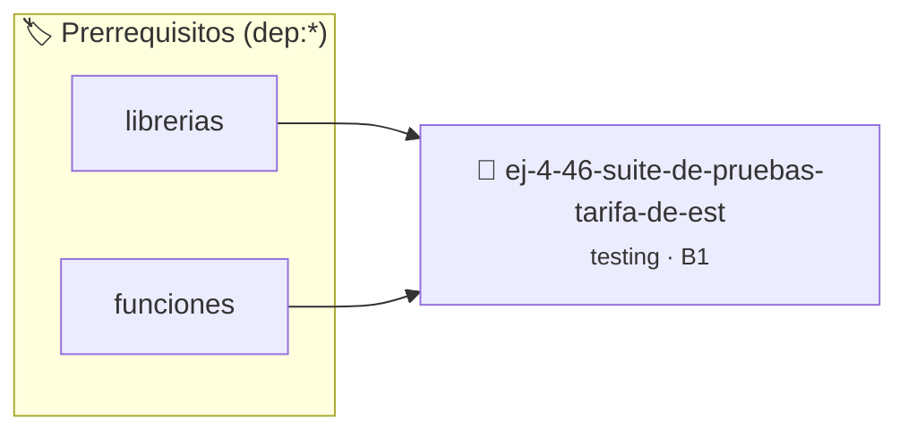

# Suite de Pruebas: Tarifa de Estacionamiento
> **ID:** `ej-4-46-suite-de-pruebas-tarifa-de-est` · **Unidad:** 5 (Ingeniería de Software y Calidad en C)
 · **Tema:** `testing` / `aserciones_defensivas`
 · **Bloom:** B1 (Recordar) · **Dificultad:** Inicial
 · **Carga:** ~10 min · **Tipo:** Concepto
>
> **🏷️ Prerrequisitos temáticos (tags):** `dep:librerias`, `dep:funciones`
>
> **Etiquetas conceptuales:** `aserciones`, `fundamentos`, `pruebas`, `estacionamiento`, `suite`


::: {admonition} 📦 Paquete de Verificación Local (Ripley)
:class: tip

Para compilar, resolver y autoevaluar tu entrega con pruebas unitarias en tu máquina:

- [📥 **Descargar paquete `ej-4-46-suite-de-pruebas-tarifa-de-est.ripkg`**](../../paquetes/ej-4-46-suite-de-pruebas-tarifa-de-est.ripkg)

Ejecución con el asistente de cátedra:
```bash
ripley run ej-4-46-suite-de-pruebas-tarifa-de-est.ripkg
```
:::


### 🗺️ Itinerario Pedagógico




## 📖 Consigna

:::{exercise}
:label: ej-test-suite-estacionamiento
Una playa de estacionamiento cobra según las siguientes reglas:
- Primera hora o fracción: $200 (tarifa base).
- Cada hora adicional: $150.
- Si el tiempo supera las 6 horas, se aplica un descuento del 10% sobre el
  total.
- Máximo cobro diario: $1200.

Implementá la función pura `double calcular_estacionamiento(int minutos)` y
diseñá su suite de pruebas exhaustiva.

-   **[*plus ultra*]:** Validar que `minutos <= 0` retorne `0.0`.
-   **[*plus ultra*]:** Testear los minutos frontera: 0, 30, 60, 61, 360, 361,
    1440.

:::

:::{solution} ej-test-suite-estacionamiento
:class: dropdown
```{code-block} c
:linenos:
#include <assert.h>
#include <math.h>
#include <stdbool.h>

double calcular_estacionamiento(int minutos)
{
    if (minutos <= 0)
    {
        return 0.0;
    }
    int horas = (minutos + 59) / 60; // Redondeo hacia arriba a la hora siguiente
    double total = 200.0;
    if (horas > 1)
    {
        total += (horas - 1) * 150.0;
    }
    if (horas > 6)
    {
        total *= 0.90;
    }
    if (total > 1200.0)
    {
        total = 1200.0;
    }
    return total;
}

void test_estacionamiento_primera_hora(void)
{
    assert(calcular_estacionamiento(30) == 200.0);
    assert(calcular_estacionamiento(60) == 200.0);
}

void test_estacionamiento_horas_adicionales(void)
{
    assert(calcular_estacionamiento(61) == 350.0); // 2 horas
    assert(calcular_estacionamiento(180) == 500.0); // 3 horas
}

void test_estacionamiento_descuento_larga_estadia(void)
{
    // 7 horas = 200 + 6*150 = 1100. Con 10% desc = 990.
    assert(calcular_estacionamiento(420) == 990.0);
}

void test_estacionamiento_tope_maximo(void)
{
    assert(calcular_estacionamiento(1440) == 1200.0);
}

```

:::

---

### 📋 Contrato de las Funciones

```c
/*
 * Operación calcular_estacionamiento
 * Precondiciones: Parámetros dentro del dominio válido de la operación.
 * Postcondiciones: Retorna el valor procesado.
 */
double calcular_estacionamiento(int minutos);

/*
 * Operación test_estacionamiento_primera_hora
 * Precondiciones: Parámetros dentro del dominio válido de la operación.
 * Postcondiciones: Retorna el valor procesado.
 */
void test_estacionamiento_primera_hora(void);

/*
 * Operación test_estacionamiento_horas_adicionales
 * Precondiciones: Parámetros dentro del dominio válido de la operación.
 * Postcondiciones: Retorna el valor procesado.
 */
void test_estacionamiento_horas_adicionales(void);

/*
 * Operación test_estacionamiento_descuento_larga_estadia
 * Precondiciones: Parámetros dentro del dominio válido de la operación.
 * Postcondiciones: Retorna el valor procesado.
 */
void test_estacionamiento_descuento_larga_estadia(void);

/*
 * Operación test_estacionamiento_tope_maximo
 * Precondiciones: Parámetros dentro del dominio válido de la operación.
 * Postcondiciones: Retorna el valor procesado.
 */
void test_estacionamiento_tope_maximo(void);

```

### 🧪 Ejemplos de Ejecución

::::{tab-set}
:::{tab-item} Valor positivo
```text
Entrada: 1
Salida / Retorno: 2
```
:::
::::

### ⚠️ Precondiciones y Casos Borde

1. **Valores fuera de rango:** Verificar siempre que los datos de entrada cumplan con los rangos admisibles antes de operar.
6. **Casos vacíos o neutros:** Contemplar adecuadamente entradas con longitud cero o valores neutros según corresponda.

### 🎯 Criterios de Aceptación

- [ ] El código compila limpiamente bajo estándar C11 sin warnings con flags estrictos (`-Wall -Wextra -Werror`).
- [ ] Se satisfacen todas las pruebas unitarias y casos de prueba provistos.
- [ ] Las funciones validan exhaustivamente sus precondiciones y gestionan casos borde de forma robusta.


## 📋 Prototipos y Cabecera (`ej-4-46-suite-de-pruebas-tarifa-de-est.h`)

```{code-block} c
#ifndef EJERCICIO_EJ_4_46_SUITE_DE_PRUEBAS_TARIFA_DE_EST_H
#define EJERCICIO_EJ_4_46_SUITE_DE_PRUEBAS_TARIFA_DE_EST_H

#include <stddef.h>
#include <stdbool.h>
#include <stdint.h>

/* Operación calcular_estacionamiento */
double calcular_estacionamiento(int minutos);
/* Operación test_estacionamiento_primera_hora */
void test_estacionamiento_primera_hora(void);
/* Operación test_estacionamiento_horas_adicionales */
void test_estacionamiento_horas_adicionales(void);
/* Operación test_estacionamiento_descuento_larga_estadia */
void test_estacionamiento_descuento_larga_estadia(void);
/* Operación test_estacionamiento_tope_maximo */
void test_estacionamiento_tope_maximo(void);

#endif /* EJERCICIO_EJ_4_46_SUITE_DE_PRUEBAS_TARIFA_DE_EST_H */
```


## ⚙️ Especificación de Funciones

| Función | Retorno | Parámetros | Descripción |
| :--- | :--- | :--- | :--- |

| `calcular_estacionamiento` | `double` | `int minutos` | Operación calcular_estacionamiento |

| `test_estacionamiento_primera_hora` | `void` | `void` | Operación test_estacionamiento_primera_hora |

| `test_estacionamiento_horas_adicionales` | `void` | `void` | Operación test_estacionamiento_horas_adicionales |

| `test_estacionamiento_descuento_larga_estadia` | `void` | `void` | Operación test_estacionamiento_descuento_larga_estadia |

| `test_estacionamiento_tope_maximo` | `void` | `void` | Operación test_estacionamiento_tope_maximo |


## 🧪 Casos de Prueba

| Prueba Unitaria | Función Objetivo | Verificación |
| :--- | :--- | :--- |

| **test_calcular_estacionamiento_1** | `calcular_estacionamiento` | `/* Verificación unitaria de calcular_estacionamiento */ double res = calcular_estacionamiento(1); (void)res; assert(true);` |

| **test_test_estacionamiento_primera_hora_2** | `test_estacionamiento_primera_hora` | `/* Verificación unitaria de test_estacionamiento_primera_hora */ test_estacionamiento_primera_hora(); assert(true);` |


## ✓ Solución Modelo de Cátedra

```{dropdown} 🔍 Revelar solución canónica en C
:open: false

```{code-block} c
#include <assert.h>
#include <math.h>
#include <stdbool.h>

double calcular_estacionamiento(int minutos)
{
    if (minutos <= 0)
    {
        return 0.0;
    }
    int horas = (minutos + 59) / 60; // Redondeo hacia arriba a la hora siguiente
    double total = 200.0;
    if (horas > 1)
    {
        total += (horas - 1) * 150.0;
    }
    if (horas > 6)
    {
        total *= 0.90;
    }
    if (total > 1200.0)
    {
        total = 1200.0;
    }
    return total;
}

void test_estacionamiento_primera_hora(void)
{
    assert(calcular_estacionamiento(30) == 200.0);
    assert(calcular_estacionamiento(60) == 200.0);
}

void test_estacionamiento_horas_adicionales(void)
{
    assert(calcular_estacionamiento(61) == 350.0); // 2 horas
    assert(calcular_estacionamiento(180) == 500.0); // 3 horas
}

void test_estacionamiento_descuento_larga_estadia(void)
{
    // 7 horas = 200 + 6*150 = 1100. Con 10% desc = 990.
    assert(calcular_estacionamiento(420) == 990.0);
}

void test_estacionamiento_tope_maximo(void)
{
    assert(calcular_estacionamiento(1440) == 1200.0);
}

int main(void)
{
    return 0;
}
```
```
