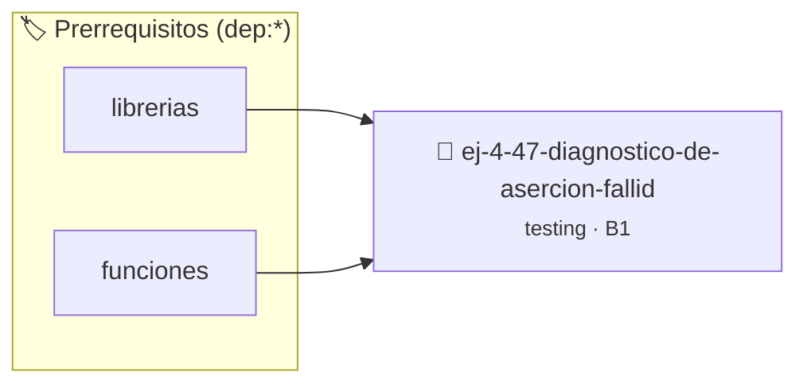

# Diagnóstico de Aserción Fallida
> **ID:** `ej-4-47-diagnostico-de-asercion-fallid` · **Unidad:** 5 (Ingeniería de Software y Calidad en C)
 · **Tema:** `testing` / `aserciones_defensivas`
 · **Bloom:** B1 (Recordar) · **Dificultad:** Inicial
 · **Carga:** ~10 min · **Tipo:** Concepto
>
> **🏷️ Prerrequisitos temáticos (tags):** `dep:librerias`, `dep:funciones`
>
> **Etiquetas conceptuales:** `aserciones`, `fallida`, `fundamentos`, `asercion`, `testing`


::: {admonition} 📦 Paquete de Verificación Local (Ripley)
:class: tip

Para compilar, resolver y autoevaluar tu entrega con pruebas unitarias en tu máquina:

- [📥 **Descargar paquete `ej-4-47-diagnostico-de-asercion-fallid.ripkg`**](../../paquetes/ej-4-47-diagnostico-de-asercion-fallid.ripkg)

Ejecución con el asistente de cátedra:
```bash
ripley run ej-4-47-diagnostico-de-asercion-fallid.ripkg
```
:::


### 🗺️ Itinerario Pedagógico




## 📖 Consigna

### Ejercicio 4.47 - Diagnóstico de Aserción Fallida ⭐⭐☆☆☆

:::{exercise}
:label: ej-test-diagnostico-fallo
Al ejecutar una suite de pruebas, la terminal reporta el siguiente mensaje:

```
assertion failed: mcd(0, 5) == 5, file tests.c, line 42, function test_mcd_cero
Aborted (core dumped)
```

Analizá la causa raíz del fallo en la función `mcd(a, b)` y corregila:

``` c
int mcd(int a, int b)
{
    if (b == 0) return a;
    return mcd(b, a % b); // ¿Qué ocurre si a=0 y b=5 en la primera llamada?
}
```
<!-- c -->

-   **[*plus ultra*]:** Explicar por qué `0 % 5 == 0` y la siguiente llamada es
    `mcd(5, 0)` retornando `5`.
-   **[*plus ultra*]:** Asegurar que la función maneje argumentos negativos
    convirtiéndolos a valor absoluto.

:::
<!-- {exercise} -->

:::{solution} ej-test-diagnostico-fallo
:class: dropdown
Si se pasa `a = 0` y `b = 5`, la primera llamada no entra en `b == 0`. Llama a
`mcd(5, 0 % 5)` que es `mcd(5, 0)`, el cual entra en `b == 0` y retorna `5`.

Si la función original no contempla `a < 0` o `b < 0`, los módulos con signo en
C pueden generar números negativos. La corrección robusta es:

```{code-block} c
:linenos:
#include <assert.h>
#include <stdlib.h>

int mcd(int a, int b)
{
    a = abs(a);
    b = abs(b);
    while (b != 0)
    {
        int temp = b;
        b = a % b;
        a = temp;
    }
    return a;
}

```
<!-- {code-block} c -->

:::
<!-- {solution} ej-test-diagnostico-fallo -->

---


## 📋 Prototipos y Cabecera (`ej-4-47-diagnostico-de-asercion-fallid.h`)

```{code-block} c
#ifndef EJERCICIO_EJ_4_47_DIAGNOSTICO_DE_ASERCION_FALLID_H
#define EJERCICIO_EJ_4_47_DIAGNOSTICO_DE_ASERCION_FALLID_H

#include <stddef.h>
#include <stdbool.h>
#include <stdint.h>

/* Operación mcd */
int mcd(int a, int b);

#endif /* EJERCICIO_EJ_4_47_DIAGNOSTICO_DE_ASERCION_FALLID_H */
```


## ⚙️ Especificación de Funciones

| Función | Retorno | Parámetros | Descripción |
| :--- | :--- | :--- | :--- |

| `mcd` | `int` | `int a, int b` | Operación mcd |


## 🧪 Casos de Prueba

| Prueba Unitaria | Función Objetivo | Verificación |
| :--- | :--- | :--- |

| **test_mcd_1** | `mcd` | `/* Verificación unitaria de mcd */ int res = mcd(1, 2); (void)res; assert(true);` |


## ✓ Solución Modelo de Cátedra

```{dropdown} 🔍 Revelar solución canónica en C
:open: false

```{code-block} c
#include <assert.h>
#include <stdlib.h>

int mcd(int a, int b)
{
    a = abs(a);
    b = abs(b);
    while (b != 0)
    {
        int temp = b;
        b = a % b;
        a = temp;
    }
    return a;
}

int main(void)
{
    return 0;
}
```
```
