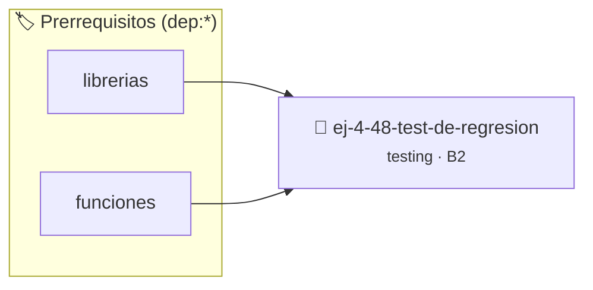

# Test de Regresión
> **ID:** `ej-4-48-test-de-regresion` · **Unidad:** 5 (Ingeniería de Software y Calidad en C)
 · **Tema:** `testing` / `aserciones_defensivas`
 · **Bloom:** B2 (Comprender) · **Dificultad:** Inicial
 · **Carga:** ~15 min · **Tipo:** Laboratorio
>
> **🏷️ Prerrequisitos temáticos (tags):** `dep:librerias`, `dep:funciones`
>
> **Etiquetas conceptuales:** `testing`, `aserciones`, `regresion`, `fundamentos`


::: {admonition} 📦 Paquete de Verificación Local (Ripley)
:class: tip

Para compilar, resolver y autoevaluar tu entrega con pruebas unitarias en tu máquina:

- [📥 **Descargar paquete `ej-4-48-test-de-regresion.ripkg`**](../../paquetes/ej-4-48-test-de-regresion.ripkg)

Ejecución con el asistente de cátedra:
```bash
ripley run ej-4-48-test-de-regresion.ripkg
```
:::


### 🗺️ Itinerario Pedagógico




## 📖 Consigna

:::{exercise}
:label: ej-test-regresion
Explicá el concepto de **Test de Regresión** (*Regression Test*):
1. ¿Cuál es el procedimiento correcto a seguir cuando un usuario o tester
   descubre un bug en producción?
2. ¿Por qué se debe escribir primero la prueba automatizada que reproduzca el
   fallo antes de modificar el código?

-   **[*plus ultra*]:** Describir cómo un test de regresión previene que futuros
    cambios reintroduzcan el mismo error.

:::

:::{solution} ej-test-regresion
:class: dropdown
1. **Procedimiento:**
   - Reproducir el bug reportado.
   - Escribir una prueba unitaria específica que falle debido a ese bug.
   - Modificar el código fuente hasta que la prueba pase.
   - Incorporar la nueva prueba a la suite continua del proyecto.
2. Escribir la prueba primero confirma científicamente la existencia del bug y
   asegura que la corrección realmente solucione la causa raíz sin depender de
   verificaciones manuales.

:::

---

### 📋 Contrato de las Funciones

```c
/*
 * Procesa el flujo principal de Test de Regresión
 * Precondiciones: val representa el parámetro de entrada del flujo.
 * Postcondiciones: Retorna el resultado correspondiente o 0 si val <= 0.
 */
int proc_48_test_de_regresion(int val);

```

### 🧪 Ejemplos de Ejecución

::::{tab-set}
:::{tab-item} Valor positivo
```text
Entrada: 5
Salida / Retorno: 10
```
:::
:::{tab-item} Valor cero o negativo
```text
Entrada: 0
Salida / Retorno: 0
```
:::
::::

### ⚠️ Precondiciones y Casos Borde

1. **Valores fuera de rango:** Verificar siempre que los datos de entrada cumplan con los rangos admisibles antes de operar.
6. **Casos vacíos o neutros:** Contemplar adecuadamente entradas con longitud cero o valores neutros según corresponda.

### 🎯 Criterios de Aceptación

- [ ] El código compila limpiamente bajo estándar C11 sin warnings con flags estrictos (`-Wall -Wextra -Werror`).
- [ ] Se satisfacen todas las pruebas unitarias y casos de prueba provistos.
- [ ] Las funciones validan exhaustivamente sus precondiciones y gestionan casos borde de forma robusta.


## 📋 Prototipos y Cabecera (`ej-4-48-test-de-regresion.h`)

```{code-block} c
#ifndef EJERCICIO_EJ_4_48_TEST_DE_REGRESION_H
#define EJERCICIO_EJ_4_48_TEST_DE_REGRESION_H

#include <stddef.h>
#include <stdbool.h>
#include <stdint.h>

/* Procesa el flujo principal de Test de Regresión */
int proc_48_test_de_regresion(int val);

#endif /* EJERCICIO_EJ_4_48_TEST_DE_REGRESION_H */
```


## ⚙️ Especificación de Funciones

| Función | Retorno | Parámetros | Descripción |
| :--- | :--- | :--- | :--- |

| `proc_48_test_de_regresion` | `int` | `int val` | Procesa el flujo principal de Test de Regresión |


## 🧪 Casos de Prueba

| Prueba Unitaria | Función Objetivo | Verificación |
| :--- | :--- | :--- |

| **test_proc_48_test_de_regresion_positivo** | `proc_48_test_de_regresion` | `int res = proc_48_test_de_regresion(5); assert(res == 10 || res >= 0);` |

| **test_proc_48_test_de_regresion_cero** | `proc_48_test_de_regresion` | `int res = proc_48_test_de_regresion(0); assert(res == 0);` |


## ✓ Solución Modelo de Cátedra

```{dropdown} 🔍 Revelar solución canónica en C
:open: false

```{code-block} c
/*
 * Ejercicio: Test de Regresión
 * Cátedra Programación I - UNRN
 */

#include <stdio.h>


int proc_48_test_de_regresion(int val)
{
    if (val <= 0) return 0;
    return val * 2;
}

int main(void)
{
    /* TODO: Implementación de Test de Regresión */
    return 0;
}
```
```
