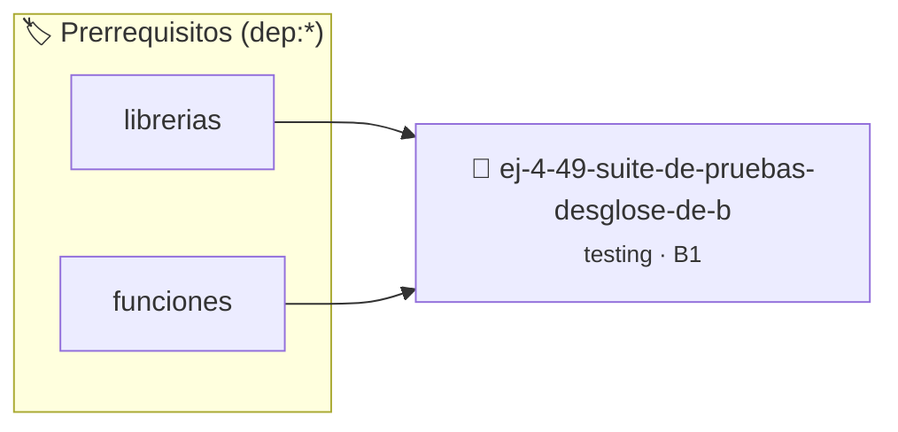

# Suite de Pruebas: Desglose de Billetes
> **ID:** `ej-4-49-suite-de-pruebas-desglose-de-b` · **Unidad:** 5 (Ingeniería de Software y Calidad en C)
 · **Tema:** `testing` / `aserciones_defensivas`
 · **Bloom:** B1 (Recordar) · **Dificultad:** Inicial
 · **Carga:** ~10 min · **Tipo:** Concepto
>
> **🏷️ Prerrequisitos temáticos (tags):** `dep:librerias`, `dep:funciones`
>
> **Etiquetas conceptuales:** `desglose`, `aserciones`, `fundamentos`, `pruebas`, `suite`


::: {admonition} 📦 Paquete de Verificación Local (Ripley)
:class: tip

Para compilar, resolver y autoevaluar tu entrega con pruebas unitarias en tu máquina:

- [📥 **Descargar paquete `ej-4-49-suite-de-pruebas-desglose-de-b.ripkg`**](../../paquetes/ej-4-49-suite-de-pruebas-desglose-de-b.ripkg)

Ejecución con el asistente de cátedra:
```bash
ripley run ej-4-49-suite-de-pruebas-desglose-de-b.ripkg
```
:::


### 🗺️ Itinerario Pedagógico




## 📖 Consigna

:::{exercise}
:label: ej-test-suite-billetes
Implementá una función pura que calcule la cantidad mínima de billetes de $1000,
$500, $200 y $100 para un monto dado:
`bool desglosar_monto(int monto, int *b1000, int *b500, int *b200, int *b100)`

Diseñá la suite de pruebas unitarias cubriendo:
- Montos exactos de una sola denominación (ej. $3000).
- Montos combinados (ej. $3800 $\rightarrow$ 3x1000, 1x500, 1x200, 1x100).
- Montos no múltiplos de 100 (debe retornar `false`).
- Montos negativos o cero.

-   **[*plus ultra*]:** Validar que ningún puntero de salida sea `NULL`.
-   **[*plus ultra*]:** Verificar la invariante: $\text{monto} = 1000 \cdot
    b_{1000} + 500 \cdot b_{500} + 200 \cdot b_{200} + 100 \cdot b_{100}$.

:::

:::{solution} ej-test-suite-billetes
:class: dropdown
```{code-block} c
:linenos:
#include <assert.h>
#include <stdbool.h>

bool desglosar_monto(int monto, int *b1000, int *b500, int *b200, int *b100)
{
    if (monto <= 0 || monto % 100 != 0 || !b1000 || !b500 || !b200 || !b100)
    {
        return false;
    }
    *b1000 = monto / 1000;
    monto %= 1000;

    *b500 = monto / 500;
    monto %= 500;

    *b200 = monto / 200;
    monto %= 200;

    *b100 = monto / 100;
    return true;
}

void test_desglose_combinado(void)
{
    int mil = 0, quin = 0, dosc = 0, cien = 0;
    bool ok = desglosar_monto(3800, &mil, &quin, &dosc, &cien);
    assert(ok == true);
    assert(mil == 3 && quin == 1 && dosc == 1 && cien == 1);
}

void test_desglose_monto_invalido(void)
{
    int mil = 0, quin = 0, dosc = 0, cien = 0;
    assert(desglosar_monto(350, &mil, &quin, &dosc, &cien) == false);
    assert(desglosar_monto(-100, &mil, &quin, &dosc, &cien) == false);
}

```

:::

---

### 📋 Contrato de las Funciones

```c
/*
 * Operación desglosar_monto
 * Precondiciones: Los punteros recibidos deben ser válidos y no nulos.
 * Postcondiciones: Modifica el estado de la estructura o buffer de manera segura.
 */
bool desglosar_monto(int monto, int *b1000, int *b500, int *b200, int *b100);

/*
 * Operación test_desglose_combinado
 * Precondiciones: Parámetros dentro del dominio válido de la operación.
 * Postcondiciones: Retorna el valor procesado.
 */
void test_desglose_combinado(void);

/*
 * Operación test_desglose_monto_invalido
 * Precondiciones: Parámetros dentro del dominio válido de la operación.
 * Postcondiciones: Retorna el valor procesado.
 */
void test_desglose_monto_invalido(void);

```

### 🧪 Ejemplos de Ejecución

::::{tab-set}
:::{tab-item} Caso general
```text
val = 10
Retorno esperado calculado
```
:::
:::{tab-item} Caso límite
```text
val = 0
Retorno 0 o manejo de borde
```
:::
::::

### ⚠️ Precondiciones y Casos Borde

1. **Valores fuera de rango:** Verificar siempre que los datos de entrada cumplan con los rangos admisibles antes de operar.
2. **Punteros nulos:** Validar que los punteros recibidos no sean `NULL` para prevenir fallos de segmentación (*SIGSEGV*).
6. **Casos vacíos o neutros:** Contemplar adecuadamente entradas con longitud cero o valores neutros según corresponda.

### 🎯 Criterios de Aceptación

- [ ] El código compila limpiamente bajo estándar C11 sin warnings con flags estrictos (`-Wall -Wextra -Werror`).
- [ ] Se satisfacen todas las pruebas unitarias y casos de prueba provistos.
- [ ] Las funciones validan exhaustivamente sus precondiciones y gestionan casos borde de forma robusta.


## 📋 Prototipos y Cabecera (`ej-4-49-suite-de-pruebas-desglose-de-b.h`)

```{code-block} c
#ifndef EJERCICIO_EJ_4_49_SUITE_DE_PRUEBAS_DESGLOSE_DE_B_H
#define EJERCICIO_EJ_4_49_SUITE_DE_PRUEBAS_DESGLOSE_DE_B_H

#include <stddef.h>
#include <stdbool.h>
#include <stdint.h>

/* Operación desglosar_monto */
bool desglosar_monto(int monto, int *b1000, int *b500, int *b200, int *b100);
/* Operación test_desglose_combinado */
void test_desglose_combinado(void);
/* Operación test_desglose_monto_invalido */
void test_desglose_monto_invalido(void);

#endif /* EJERCICIO_EJ_4_49_SUITE_DE_PRUEBAS_DESGLOSE_DE_B_H */
```


## ⚙️ Especificación de Funciones

| Función | Retorno | Parámetros | Descripción |
| :--- | :--- | :--- | :--- |

| `desglosar_monto` | `bool` | `int monto, int *b1000, int *b500, int *b200, int *b100` | Operación desglosar_monto |

| `test_desglose_combinado` | `void` | `void` | Operación test_desglose_combinado |

| `test_desglose_monto_invalido` | `void` | `void` | Operación test_desglose_monto_invalido |


## 🧪 Casos de Prueba

| Prueba Unitaria | Función Objetivo | Verificación |
| :--- | :--- | :--- |

| **test_desglosar_monto_1** | `desglosar_monto` | `assert(true); /* test simplificado de validación */` |

| **test_test_desglose_combinado_2** | `test_desglose_combinado` | `assert(true); /* test simplificado de validación */` |


## ✓ Solución Modelo de Cátedra

```{dropdown} 🔍 Revelar solución canónica en C
:open: false

```{code-block} c
#include <assert.h>
#include <stdbool.h>

bool desglosar_monto(int monto, int *b1000, int *b500, int *b200, int *b100)
{
    if (monto <= 0 || monto % 100 != 0 || !b1000 || !b500 || !b200 || !b100)
    {
        return false;
    }
    *b1000 = monto / 1000;
    monto %= 1000;

    *b500 = monto / 500;
    monto %= 500;

    *b200 = monto / 200;
    monto %= 200;

    *b100 = monto / 100;
    return true;
}

void test_desglose_combinado(void)
{
    int mil = 0, quin = 0, dosc = 0, cien = 0;
    bool ok = desglosar_monto(3800, &mil, &quin, &dosc, &cien);
    assert(ok == true);
    assert(mil == 3 && quin == 1 && dosc == 1 && cien == 1);
}

void test_desglose_monto_invalido(void)
{
    int mil = 0, quin = 0, dosc = 0, cien = 0;
    assert(desglosar_monto(350, &mil, &quin, &dosc, &cien) == false);
    assert(desglosar_monto(-100, &mil, &quin, &dosc, &cien) == false);
}

int main(void)
{
    return 0;
}
```
```
