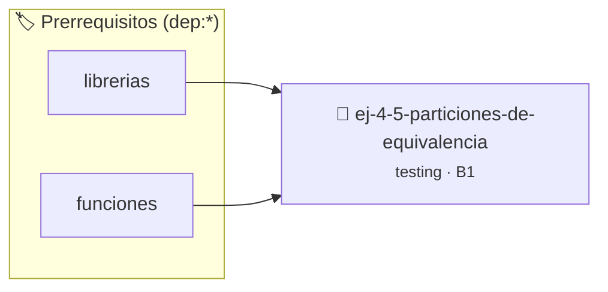

# Particiones de Equivalencia
> **ID:** `ej-4-5-particiones-de-equivalencia` · **Unidad:** 5 (Ingeniería de Software y Calidad en C)
 · **Tema:** `testing` / `aserciones_defensivas`
 · **Bloom:** B1 (Recordar) · **Dificultad:** Inicial
 · **Carga:** ~10 min · **Tipo:** Concepto
>
> **🏷️ Prerrequisitos temáticos (tags):** `dep:librerias`, `dep:funciones`
>
> **Etiquetas conceptuales:** `aserciones`, `fundamentos`, `equivalencia`, `particiones`, `testing`


::: {admonition} 📦 Paquete de Verificación Local (Ripley)
:class: tip

Para compilar, resolver y autoevaluar tu entrega con pruebas unitarias en tu máquina:

- [📥 **Descargar paquete `ej-4-5-particiones-de-equivalencia.ripkg`**](../../paquetes/ej-4-5-particiones-de-equivalencia.ripkg)

Ejecución con el asistente de cátedra:
```bash
ripley run ej-4-5-particiones-de-equivalencia.ripkg
```
:::


### 🗺️ Itinerario Pedagógico




## 📖 Consigna

:::{exercise}
:label: ej-test-particiones-equivalencia
Dada la siguiente especificación de la función `clasificar_edad`:
- Entrada: `edad` (entero).
- Retorno:
  - `1`: Menor de edad (`edad < 18`)
  - `2`: Adulto (`18 <= edad <= 64`)
  - `3`: Adulto mayor (`edad >= 65`)
  - `-1`: Edad inválida (`edad < 0` o `edad > 130`)

Diseñá el conjunto mínimo de valores de prueba para cubrir todas las
**particiones de equivalencia** válidas e inválidas.

-   **[*plus ultra*]:** Implementar la función `int clasificar_edad(int edad)` y
    su suite de tests correspondiente.
-   **[*plus ultra*]:** Documentar la función con etiquetas de contrato (`@pre`,
    `@returns`).

:::

:::{solution} ej-test-particiones-equivalencia
:class: dropdown
Las particiones de equivalencia mínimas son:
1. **Inválida negativa:** `edad = -5` $\rightarrow$ Esperado: `-1`
2. **Menor de edad:** `edad = 10` $\rightarrow$ Esperado: `1`
3. **Adulto:** `edad = 30` $\rightarrow$ Esperado: `2`
4. **Adulto mayor:** `edad = 70` $\rightarrow$ Esperado: `3`
5. **Inválida excesiva:** `edad = 150` $\rightarrow$ Esperado: `-1`

```{code-block} c
:linenos:
#include <assert.h>

int clasificar_edad(int edad)
{
    if (edad < 0 || edad > 130)
    {
        return -1;
    }
    if (edad < 18)
    {
        return 1;
    }
    if (edad <= 64)
    {
        return 2;
    }
    return 3;
}

```

:::

---

### 📋 Contrato de las Funciones

```c
/*
 * Operación clasificar_edad
 * Precondiciones: Parámetros dentro del dominio válido de la operación.
 * Postcondiciones: Retorna el valor procesado.
 */
int clasificar_edad(int edad);

```

### 🧪 Ejemplos de Ejecución

::::{tab-set}
:::{tab-item} Valor positivo
```text
Entrada: 1
Salida / Retorno: 2
```
:::
::::

### ⚠️ Precondiciones y Casos Borde

1. **Valores fuera de rango:** Verificar siempre que los datos de entrada cumplan con los rangos admisibles antes de operar.
6. **Casos vacíos o neutros:** Contemplar adecuadamente entradas con longitud cero o valores neutros según corresponda.

### 🎯 Criterios de Aceptación

- [ ] El código compila limpiamente bajo estándar C11 sin warnings con flags estrictos (`-Wall -Wextra -Werror`).
- [ ] Se satisfacen todas las pruebas unitarias y casos de prueba provistos.
- [ ] Las funciones validan exhaustivamente sus precondiciones y gestionan casos borde de forma robusta.


## 📋 Prototipos y Cabecera (`ej-4-5-particiones-de-equivalencia.h`)

```{code-block} c
#ifndef EJERCICIO_EJ_4_5_PARTICIONES_DE_EQUIVALENCIA_H
#define EJERCICIO_EJ_4_5_PARTICIONES_DE_EQUIVALENCIA_H

#include <stddef.h>
#include <stdbool.h>
#include <stdint.h>

/* Operación clasificar_edad */
int clasificar_edad(int edad);

#endif /* EJERCICIO_EJ_4_5_PARTICIONES_DE_EQUIVALENCIA_H */
```


## ⚙️ Especificación de Funciones

| Función | Retorno | Parámetros | Descripción |
| :--- | :--- | :--- | :--- |

| `clasificar_edad` | `int` | `int edad` | Operación clasificar_edad |


## 🧪 Casos de Prueba

| Prueba Unitaria | Función Objetivo | Verificación |
| :--- | :--- | :--- |

| **test_clasificar_edad_1** | `clasificar_edad` | `/* Verificación unitaria de clasificar_edad */ int res = clasificar_edad(1); (void)res; assert(true);` |


## ✓ Solución Modelo de Cátedra

```{dropdown} 🔍 Revelar solución canónica en C
:open: false

```{code-block} c
#include <assert.h>

int clasificar_edad(int edad)
{
    if (edad < 0 || edad > 130)
    {
        return -1;
    }
    if (edad < 18)
    {
        return 1;
    }
    if (edad <= 64)
    {
        return 2;
    }
    return 3;
}

int main(void)
{
    return 0;
}
```
```
