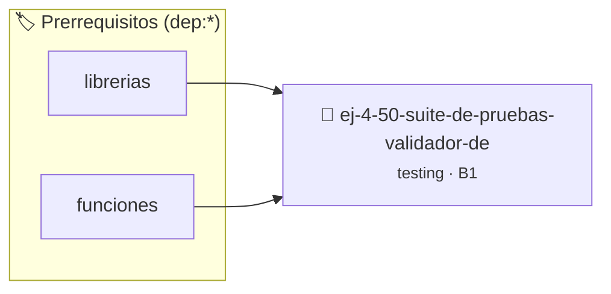

# Suite de Pruebas: Validador de Números Primos
> **ID:** `ej-4-50-suite-de-pruebas-validador-de`
 · **Tema:** `testing`
 · **Bloom:** B1 (Recordar)
 · **Carga:** ~10 min
>
> **🏷️ Prerrequisitos temáticos (tags):** `dep:librerias`, `dep:funciones`
>
> **Etiquetas conceptuales:** `aserciones`, `fundamentos`, `pruebas`, `suite`, `primos`


::: {admonition} 📦 Paquete de Verificación Local (Ripley)
:class: tip

Para compilar, resolver y autoevaluar tu entrega con pruebas unitarias en tu máquina:

- [📥 **Descargar paquete `ej-4-50-suite-de-pruebas-validador-de.ripkg`**](../../paquetes/ej-4-50-suite-de-pruebas-validador-de.ripkg)

Ejecución con el asistente de cátedra:
```bash
ripley run ej-4-50-suite-de-pruebas-validador-de.ripkg
```
:::


### 🗺️ Itinerario Pedagógico




## 📖 Consigna

### Ejercicio 4.50 - Suite de Pruebas: Validador de Números Primos ⭐⭐⭐☆☆

:::{exercise}
:label: ej-test-suite-primos
Implementá la función pura `bool es_primo(int n)` con optimización hasta
$\sqrt{n}$ y diseñá su suite de pruebas con `assert()`:
- Casos no primos menores o iguales a 1 ($0, 1, -7$).
- Primer número primo ($2$).
- Primos pares e impares pequeños ($2, 3, 5, 7, 11, 13$).
- Compuestos impares que aparentan ser primos ($9, 15, 21, 25, 27, 49$).
- Primos grandes conocidos ($997$).

-   **[*plus ultra*]:** Escribir una función de prueba específica para cada
    categoría.
-   **[*plus ultra*]:** Documentar las precondiciones con `@pre` y
    postcondiciones con `@post`.

:::
<!-- {exercise} -->

:::{solution} ej-test-suite-primos
:class: dropdown
```{code-block} c
:linenos:
#include <assert.h>
#include <stdbool.h>

bool es_primo(int n)
{
    if (n <= 1)
    {
        return false;
    }
    if (n == 2)
    {
        return true;
    }
    if (n % 2 == 0)
    {
        return false;
    }
    for (int i = 3; i * i <= n; i += 2)
    {
        if (n % i == 0)
        {
            return false;
        }
    }
    return true;
}

void test_primos_menores_o_iguales_uno(void)
{
    assert(es_primo(0) == false);
    assert(es_primo(1) == false);
    assert(es_primo(-7) == false);
}

void test_primos_basicos(void)
{
    assert(es_primo(2) == true);
    assert(es_primo(3) == true);
    assert(es_primo(13) == true);
    assert(es_primo(997) == true);
}

void test_compuestos_impares(void)
{
    assert(es_primo(9) == false);
    assert(es_primo(25) == false);
    assert(es_primo(49) == false);
}

```
<!-- {code-block} c -->

:::
<!-- {solution} ej-test-suite-primos -->

---


## 📋 Prototipos y Cabecera (`ej-4-50-suite-de-pruebas-validador-de.h`)

```{code-block} c
#ifndef EJERCICIO_EJ_4_50_SUITE_DE_PRUEBAS_VALIDADOR_DE_H
#define EJERCICIO_EJ_4_50_SUITE_DE_PRUEBAS_VALIDADOR_DE_H

#include <stddef.h>
#include <stdbool.h>
#include <stdint.h>

/* Operación es_primo */
bool es_primo(int n);
/* Operación test_primos_menores_o_iguales_uno */
void test_primos_menores_o_iguales_uno(void);
/* Operación test_primos_basicos */
void test_primos_basicos(void);
/* Operación test_compuestos_impares */
void test_compuestos_impares(void);

#endif /* EJERCICIO_EJ_4_50_SUITE_DE_PRUEBAS_VALIDADOR_DE_H */
```


## ⚙️ Especificación de Funciones

| Función | Retorno | Parámetros | Descripción |
| :--- | :--- | :--- | :--- |

| `es_primo` | `bool` | `int n` | Operación es_primo |

| `test_primos_menores_o_iguales_uno` | `void` | `void` | Operación test_primos_menores_o_iguales_uno |

| `test_primos_basicos` | `void` | `void` | Operación test_primos_basicos |

| `test_compuestos_impares` | `void` | `void` | Operación test_compuestos_impares |


## 🧪 Casos de Prueba

| Prueba Unitaria | Función Objetivo | Verificación |
| :--- | :--- | :--- |

| **test_es_primo_1** | `es_primo` | `/* Verificación unitaria de es_primo */ bool ok = es_primo(1); (void)ok; assert(true);` |

| **test_test_primos_menores_o_iguales_uno_2** | `test_primos_menores_o_iguales_uno` | `/* Verificación unitaria de test_primos_menores_o_iguales_uno */ test_primos_menores_o_iguales_uno(); assert(true);` |


## ✓ Solución Modelo de Cátedra

```{dropdown} 🔍 Revelar solución canónica en C
:open: false

```{code-block} c
#include <math.h>

#include <assert.h>
#include <stdbool.h>

bool es_primo(int n)
{
    if (n <= 1)
    {
        return false;
    }
    if (n == 2)
    {
        return true;
    }
    if (n % 2 == 0)
    {
        return false;
    }
    for (int i = 3; i * i <= n; i += 2)
    {
        if (n % i == 0)
        {
            return false;
        }
    }
    return true;
}

void test_primos_menores_o_iguales_uno(void)
{
    assert(es_primo(0) == false);
    assert(es_primo(1) == false);
    assert(es_primo(-7) == false);
}

void test_primos_basicos(void)
{
    assert(es_primo(2) == true);
    assert(es_primo(3) == true);
    assert(es_primo(13) == true);
    assert(es_primo(997) == true);
}

void test_compuestos_impares(void)
{
    assert(es_primo(9) == false);
    assert(es_primo(25) == false);
    assert(es_primo(49) == false);
}

int main(void)
{
    return 0;
}
```
```
