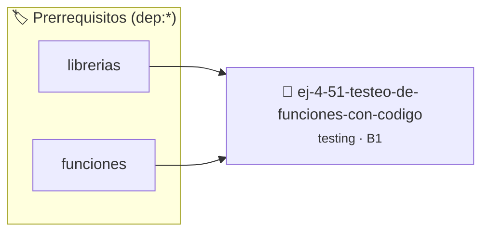

# Testeo de Funciones con Códigos de Error
> **ID:** `ej-4-51-testeo-de-funciones-con-codigo` · **Unidad:** 5 (Ingeniería de Software y Calidad en C)
 · **Tema:** `testing` / `aserciones_defensivas`
 · **Bloom:** B1 (Recordar) · **Dificultad:** Inicial
 · **Carga:** ~10 min · **Tipo:** Concepto
>
> **🏷️ Prerrequisitos temáticos (tags):** `dep:librerias`, `dep:funciones`
>
> **Etiquetas conceptuales:** `aserciones`, `codigos`, `fundamentos`, `error`, `testeo`


::: {admonition} 📦 Paquete de Verificación Local (Ripley)
:class: tip

Para compilar, resolver y autoevaluar tu entrega con pruebas unitarias en tu máquina:

- [📥 **Descargar paquete `ej-4-51-testeo-de-funciones-con-codigo.ripkg`**](../../paquetes/ej-4-51-testeo-de-funciones-con-codigo.ripkg)

Ejecución con el asistente de cátedra:
```bash
ripley run ej-4-51-testeo-de-funciones-con-codigo.ripkg
```
:::


### 🗺️ Itinerario Pedagógico




## 📖 Consigna

### Ejercicio 4.51 - Testeo de Funciones con Códigos de Error ⭐⭐⭐☆☆

:::{exercise}
:label: ej-test-codigos-error
Diseñá una función pura para calcular la velocidad promedio $v = d / t$:
`int calcular_velocidad(double distancia, double tiempo, double *velocidad)`

Códigos de retorno:
- `0`: Éxito.
- `1`: Distancia inválida (`distancia < 0`).
- `2`: Tiempo inválido (`tiempo <= 0`).
- `3`: Puntero `velocidad` nulo (`NULL`).

Escribí pruebas unitarias para cada uno de los 4 códigos posibles.

-   **[*plus ultra*]:** Asegurar que ante código de error, `*velocidad` no sea
    modificada.

:::
<!-- {exercise} -->

:::{solution} ej-test-codigos-error
:class: dropdown
```{code-block} c
:linenos:
#include <assert.h>
#include <stddef.h>

int calcular_velocidad(double distancia, double tiempo, double *velocidad)
{
    if (velocidad == NULL)
    {
        return 3;
    }
    if (distancia < 0.0)
    {
        return 1;
    }
    if (tiempo <= 0.0)
    {
        return 2;
    }
    *velocidad = distancia / tiempo;
    return 0;
}

void test_velocidad_exito(void)
{
    double v = 0.0;
    int codigo = calcular_velocidad(100.0, 2.0, &v);
    assert(codigo == 0);
    assert(v == 50.0);
}

void test_velocidad_distancia_invalida(void)
{
    double v = -99.0;
    int codigo = calcular_velocidad(-10.0, 2.0, &v);
    assert(codigo == 1);
    assert(v == -99.0);
}

void test_velocidad_tiempo_invalido(void)
{
    double v = -99.0;
    int codigo = calcular_velocidad(100.0, 0.0, &v);
    assert(codigo == 2);
    assert(v == -99.0);
}

void test_velocidad_puntero_nulo(void)
{
    int codigo = calcular_velocidad(100.0, 2.0, NULL);
    assert(codigo == 3);
}

```
<!-- {code-block} c -->

:::
<!-- {solution} ej-test-codigos-error -->

---


## 📋 Prototipos y Cabecera (`ej-4-51-testeo-de-funciones-con-codigo.h`)

```{code-block} c
#ifndef EJERCICIO_EJ_4_51_TESTEO_DE_FUNCIONES_CON_CODIGO_H
#define EJERCICIO_EJ_4_51_TESTEO_DE_FUNCIONES_CON_CODIGO_H

#include <stddef.h>
#include <stdbool.h>
#include <stdint.h>

/* Operación calcular_velocidad */
int calcular_velocidad(double distancia, double tiempo, double *velocidad);
/* Operación test_velocidad_exito */
void test_velocidad_exito(void);
/* Operación test_velocidad_distancia_invalida */
void test_velocidad_distancia_invalida(void);
/* Operación test_velocidad_tiempo_invalido */
void test_velocidad_tiempo_invalido(void);
/* Operación test_velocidad_puntero_nulo */
void test_velocidad_puntero_nulo(void);

#endif /* EJERCICIO_EJ_4_51_TESTEO_DE_FUNCIONES_CON_CODIGO_H */
```


## ⚙️ Especificación de Funciones

| Función | Retorno | Parámetros | Descripción |
| :--- | :--- | :--- | :--- |

| `calcular_velocidad` | `int` | `double distancia, double tiempo, double *velocidad` | Operación calcular_velocidad |

| `test_velocidad_exito` | `void` | `void` | Operación test_velocidad_exito |

| `test_velocidad_distancia_invalida` | `void` | `void` | Operación test_velocidad_distancia_invalida |

| `test_velocidad_tiempo_invalido` | `void` | `void` | Operación test_velocidad_tiempo_invalido |

| `test_velocidad_puntero_nulo` | `void` | `void` | Operación test_velocidad_puntero_nulo |


## 🧪 Casos de Prueba

| Prueba Unitaria | Función Objetivo | Verificación |
| :--- | :--- | :--- |

| **test_calcular_velocidad_1** | `calcular_velocidad` | `/* Verificación unitaria de calcular_velocidad */ assert(true);` |

| **test_test_velocidad_exito_2** | `test_velocidad_exito` | `/* Verificación unitaria de test_velocidad_exito */ test_velocidad_exito(); assert(true);` |


## ✓ Solución Modelo de Cátedra

```{dropdown} 🔍 Revelar solución canónica en C
:open: false

```{code-block} c
#include <assert.h>
#include <stddef.h>

int calcular_velocidad(double distancia, double tiempo, double *velocidad)
{
    if (velocidad == NULL)
    {
        return 3;
    }
    if (distancia < 0.0)
    {
        return 1;
    }
    if (tiempo <= 0.0)
    {
        return 2;
    }
    *velocidad = distancia / tiempo;
    return 0;
}

void test_velocidad_exito(void)
{
    double v = 0.0;
    int codigo = calcular_velocidad(100.0, 2.0, &v);
    assert(codigo == 0);
    assert(v == 50.0);
}

void test_velocidad_distancia_invalida(void)
{
    double v = -99.0;
    int codigo = calcular_velocidad(-10.0, 2.0, &v);
    assert(codigo == 1);
    assert(v == -99.0);
}

void test_velocidad_tiempo_invalido(void)
{
    double v = -99.0;
    int codigo = calcular_velocidad(100.0, 0.0, &v);
    assert(codigo == 2);
    assert(v == -99.0);
}

void test_velocidad_puntero_nulo(void)
{
    int codigo = calcular_velocidad(100.0, 2.0, NULL);
    assert(codigo == 3);
}

int main(void)
{
    return 0;
}
```
```
