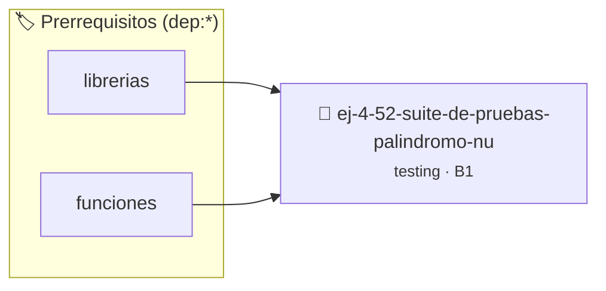

# Suite de Pruebas: Palíndromo Numérico
> **ID:** `ej-4-52-suite-de-pruebas-palindromo-nu`
 · **Tema:** `testing`
 · **Bloom:** B1 (Recordar)
 · **Carga:** ~10 min
>
> **🏷️ Prerrequisitos temáticos (tags):** `dep:librerias`, `dep:funciones`
>
> **Etiquetas conceptuales:** `aserciones`, `palindromo`, `fundamentos`, `pruebas`, `suite`


::: {admonition} 📦 Paquete de Verificación Local (Ripley)
:class: tip

Para compilar, resolver y autoevaluar tu entrega con pruebas unitarias en tu máquina:

- [📥 **Descargar paquete `ej-4-52-suite-de-pruebas-palindromo-nu.ripkg`**](../../paquetes/ej-4-52-suite-de-pruebas-palindromo-nu.ripkg)

Ejecución con el asistente de cátedra:
```bash
ripley run ej-4-52-suite-de-pruebas-palindromo-nu.ripkg
```
:::


### 🗺️ Itinerario Pedagógico




## 📖 Consigna

### Ejercicio 4.52 - Suite de Pruebas: Palíndromo Numérico ⭐⭐☆☆☆

:::{exercise}
:label: ej-test-suite-palindromo
Implementá `bool es_numero_capicua(int n)` mediante funciones auxiliares puras
(`invertir_numero`) y construí su suite de pruebas:
- Números de 1 solo dígito (siempre son capicúas: `0, 1, 7`).
- Números pares capicúas (`1221`, `44`).
- Números impares capicúas (`12321`, `505`).
- Números no capicúas (`123`, `100`).
- Números negativos (por convención, retornan `false`).

-   **[*plus ultra*]:** Validar que no se produzca desbordamiento entero al
    invertir.

:::
<!-- {exercise} -->

:::{solution} ej-test-suite-palindromo
:class: dropdown
```{code-block} c
:linenos:
#include <assert.h>
#include <stdbool.h>

int invertir_entero(int n)
{
    int invertido = 0;
    while (n > 0)
    {
        invertido = (invertido * 10) + (n % 10);
        n /= 10;
    }
    return invertido;
}

bool es_numero_capicua(int n)
{
    if (n < 0)
    {
        return false;
    }
    if (n < 10)
    {
        return true;
    }
    return n == invertir_entero(n);
}

void test_capicua_un_digito(void)
{
    assert(es_numero_capicua(0) == true);
    assert(es_numero_capicua(7) == true);
}

void test_capicua_multiples_digitos(void)
{
    assert(es_numero_capicua(1221) == true);
    assert(es_numero_capicua(12321) == true);
    assert(es_numero_capicua(123) == false);
    assert(es_numero_capicua(-121) == false);
}

```
<!-- {code-block} c -->

:::
<!-- {solution} ej-test-suite-palindromo -->

---


## 📋 Prototipos y Cabecera (`ej-4-52-suite-de-pruebas-palindromo-nu.h`)

```{code-block} c
#ifndef EJERCICIO_EJ_4_52_SUITE_DE_PRUEBAS_PALINDROMO_NU_H
#define EJERCICIO_EJ_4_52_SUITE_DE_PRUEBAS_PALINDROMO_NU_H

#include <stddef.h>
#include <stdbool.h>
#include <stdint.h>

/* Operación invertir_entero */
int invertir_entero(int n);
/* Operación es_numero_capicua */
bool es_numero_capicua(int n);
/* Operación test_capicua_un_digito */
void test_capicua_un_digito(void);
/* Operación test_capicua_multiples_digitos */
void test_capicua_multiples_digitos(void);

#endif /* EJERCICIO_EJ_4_52_SUITE_DE_PRUEBAS_PALINDROMO_NU_H */
```


## ⚙️ Especificación de Funciones

| Función | Retorno | Parámetros | Descripción |
| :--- | :--- | :--- | :--- |

| `invertir_entero` | `int` | `int n` | Operación invertir_entero |

| `es_numero_capicua` | `bool` | `int n` | Operación es_numero_capicua |

| `test_capicua_un_digito` | `void` | `void` | Operación test_capicua_un_digito |

| `test_capicua_multiples_digitos` | `void` | `void` | Operación test_capicua_multiples_digitos |


## 🧪 Casos de Prueba

| Prueba Unitaria | Función Objetivo | Verificación |
| :--- | :--- | :--- |

| **test_invertir_entero_1** | `invertir_entero` | `/* Verificación unitaria de invertir_entero */ int res = invertir_entero(1); (void)res; assert(true);` |

| **test_es_numero_capicua_2** | `es_numero_capicua` | `/* Verificación unitaria de es_numero_capicua */ bool ok = es_numero_capicua(1); (void)ok; assert(true);` |


## ✓ Solución Modelo de Cátedra

```{dropdown} 🔍 Revelar solución canónica en C
:open: false

```{code-block} c
#include <assert.h>
#include <stdbool.h>

int invertir_entero(int n)
{
    int invertido = 0;
    while (n > 0)
    {
        invertido = (invertido * 10) + (n % 10);
        n /= 10;
    }
    return invertido;
}

bool es_numero_capicua(int n)
{
    if (n < 0)
    {
        return false;
    }
    if (n < 10)
    {
        return true;
    }
    return n == invertir_entero(n);
}

void test_capicua_un_digito(void)
{
    assert(es_numero_capicua(0) == true);
    assert(es_numero_capicua(7) == true);
}

void test_capicua_multiples_digitos(void)
{
    assert(es_numero_capicua(1221) == true);
    assert(es_numero_capicua(12321) == true);
    assert(es_numero_capicua(123) == false);
    assert(es_numero_capicua(-121) == false);
}

int main(void)
{
    return 0;
}
```
```
