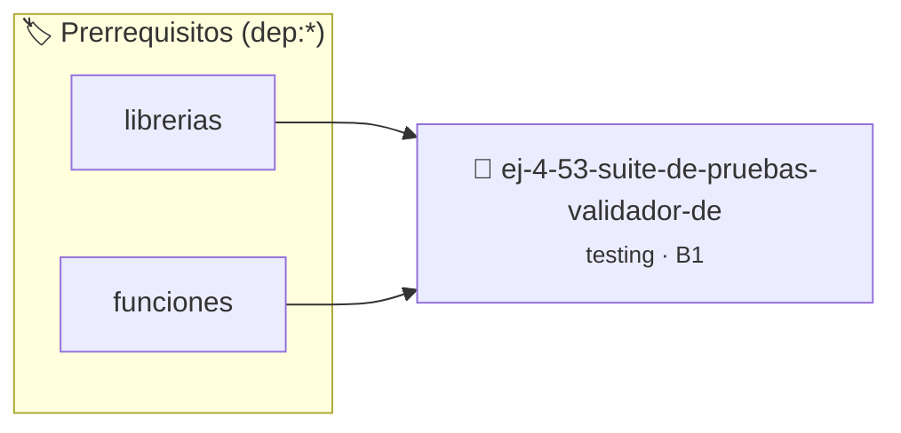

# Suite de Pruebas: Validador de Triángulo
> **ID:** `ej-4-53-suite-de-pruebas-validador-de`
 · **Tema:** `testing`
 · **Bloom:** B1 (Recordar)
 · **Carga:** ~10 min
>
> **🏷️ Prerrequisitos temáticos (tags):** `dep:librerias`, `dep:funciones`
>
> **Etiquetas conceptuales:** `aserciones`, `fundamentos`, `pruebas`, `triangulo`, `suite`


::: {admonition} 📦 Paquete de Verificación Local (Ripley)
:class: tip

Para compilar, resolver y autoevaluar tu entrega con pruebas unitarias en tu máquina:

- [📥 **Descargar paquete `ej-4-53-suite-de-pruebas-validador-de.ripkg`**](../../paquetes/ej-4-53-suite-de-pruebas-validador-de.ripkg)

Ejecución con el asistente de cátedra:
```bash
ripley run ej-4-53-suite-de-pruebas-validador-de.ripkg
```
:::


### 🗺️ Itinerario Pedagógico




## 📖 Consigna

### Ejercicio 4.53 - Suite de Pruebas: Validador de Triángulo ⭐⭐⭐☆☆

:::{exercise}
:label: ej-test-suite-triangulo
Implementá `int clasificar_triangulo(double a, double b, double c)`:
- `0`: No es triángulo válido (viola desigualdad triangular o lados $\le 0$).
- `1`: Equilátero (3 lados iguales).
- `2`: Isósceles (2 lados iguales).
- `3`: Escaleno (3 lados distintos).

Diseñá la suite de pruebas unitarias verificando cada clase y casos degenerados
($a + b = c$).

-   **[*plus ultra*]:** Usar comparación con tolerancia `son_cercanos` para los
    lados.

:::
<!-- {exercise} -->

:::{solution} ej-test-suite-triangulo
:class: dropdown
```{code-block} c
:linenos:
#include <assert.h>
#include <math.h>
#include <stdbool.h>

bool lados_cercanos(double x, double y)
{
    return fabs(x - y) < 1e-6;
}

int clasificar_triangulo(double a, double b, double c)
{
    if (a <= 0.0 || b <= 0.0 || c <= 0.0)
    {
        return 0;
    }
    if (a + b <= c || a + c <= b || b + c <= a)
    {
        return 0; // Desigualdad triangular violada
    }
    if (lados_cercanos(a, b) && lados_cercanos(b, c))
    {
        return 1; // Equilátero
    }
    if (lados_cercanos(a, b) || lados_cercanos(a, c) || lados_cercanos(b, c))
    {
        return 2; // Isósceles
    }
    return 3; // Escaleno
}

void test_triangulo_invalido(void)
{
    assert(clasificar_triangulo(1.0, 2.0, 3.0) == 0); // Degenerado
    assert(clasificar_triangulo(-1.0, 2.0, 2.0) == 0);
}

void test_triangulo_tipos(void)
{
    assert(clasificar_triangulo(5.0, 5.0, 5.0) == 1);
    assert(clasificar_triangulo(5.0, 5.0, 8.0) == 2);
    assert(clasificar_triangulo(3.0, 4.0, 5.0) == 3);
}

```
<!-- {code-block} c -->

:::
<!-- {solution} ej-test-suite-triangulo -->

---


## 📋 Prototipos y Cabecera (`ej-4-53-suite-de-pruebas-validador-de.h`)

```{code-block} c
#ifndef EJERCICIO_EJ_4_53_SUITE_DE_PRUEBAS_VALIDADOR_DE_H
#define EJERCICIO_EJ_4_53_SUITE_DE_PRUEBAS_VALIDADOR_DE_H

#include <stddef.h>
#include <stdbool.h>
#include <stdint.h>

/* Operación lados_cercanos */
bool lados_cercanos(double x, double y);
/* Operación clasificar_triangulo */
int clasificar_triangulo(double a, double b, double c);
/* Operación test_triangulo_invalido */
void test_triangulo_invalido(void);
/* Operación test_triangulo_tipos */
void test_triangulo_tipos(void);

#endif /* EJERCICIO_EJ_4_53_SUITE_DE_PRUEBAS_VALIDADOR_DE_H */
```


## ⚙️ Especificación de Funciones

| Función | Retorno | Parámetros | Descripción |
| :--- | :--- | :--- | :--- |

| `lados_cercanos` | `bool` | `double x, double y` | Operación lados_cercanos |

| `clasificar_triangulo` | `int` | `double a, double b, double c` | Operación clasificar_triangulo |

| `test_triangulo_invalido` | `void` | `void` | Operación test_triangulo_invalido |

| `test_triangulo_tipos` | `void` | `void` | Operación test_triangulo_tipos |


## 🧪 Casos de Prueba

| Prueba Unitaria | Función Objetivo | Verificación |
| :--- | :--- | :--- |

| **test_lados_cercanos_1** | `lados_cercanos` | `/* Verificación unitaria de lados_cercanos */ bool ok = lados_cercanos(1, 2); (void)ok; assert(true);` |

| **test_clasificar_triangulo_2** | `clasificar_triangulo` | `/* Verificación unitaria de clasificar_triangulo */ int res = clasificar_triangulo(1, 2, 3); (void)res; assert(true);` |


## ✓ Solución Modelo de Cátedra

```{dropdown} 🔍 Revelar solución canónica en C
:open: false

```{code-block} c
#include <stdlib.h>

#include <assert.h>
#include <math.h>
#include <stdbool.h>

bool lados_cercanos(double x, double y)
{
    return fabs(x - y) < 1e-6;
}

int clasificar_triangulo(double a, double b, double c)
{
    if (a <= 0.0 || b <= 0.0 || c <= 0.0)
    {
        return 0;
    }
    if (a + b <= c || a + c <= b || b + c <= a)
    {
        return 0; // Desigualdad triangular violada
    }
    if (lados_cercanos(a, b) && lados_cercanos(b, c))
    {
        return 1; // Equilátero
    }
    if (lados_cercanos(a, b) || lados_cercanos(a, c) || lados_cercanos(b, c))
    {
        return 2; // Isósceles
    }
    return 3; // Escaleno
}

void test_triangulo_invalido(void)
{
    assert(clasificar_triangulo(1.0, 2.0, 3.0) == 0); // Degenerado
    assert(clasificar_triangulo(-1.0, 2.0, 2.0) == 0);
}

void test_triangulo_tipos(void)
{
    assert(clasificar_triangulo(5.0, 5.0, 5.0) == 1);
    assert(clasificar_triangulo(5.0, 5.0, 8.0) == 2);
    assert(clasificar_triangulo(3.0, 4.0, 5.0) == 3);
}

int main(void)
{
    return 0;
}
```
```
