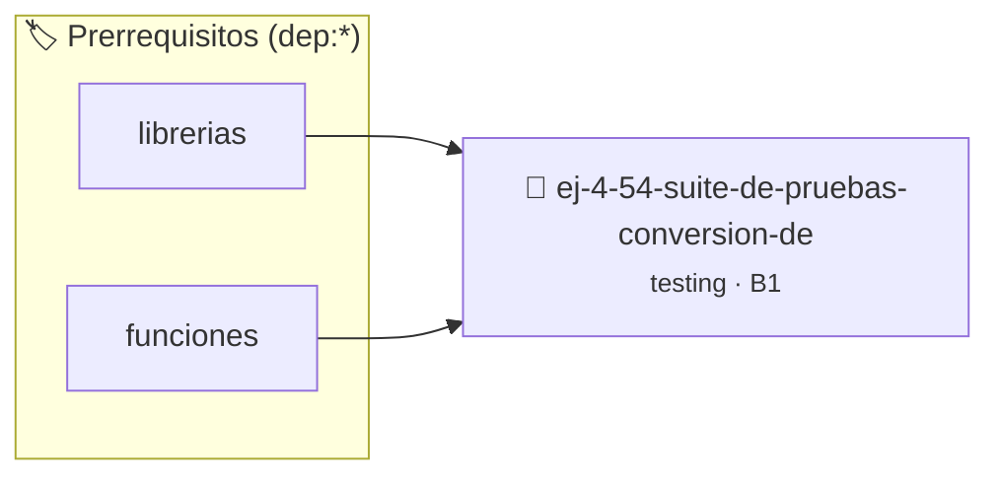

# Suite de Pruebas: Conversión de Segundos a Tiempo
> **ID:** `ej-4-54-suite-de-pruebas-conversion-de`
 · **Tema:** `testing`
 · **Bloom:** B1 (Recordar)
 · **Carga:** ~10 min
>
> **🏷️ Prerrequisitos temáticos (tags):** `dep:librerias`, `dep:funciones`
>
> **Etiquetas conceptuales:** `aserciones`, `tiempo`, `fundamentos`, `pruebas`, `conversion`


::: {admonition} 📦 Paquete de Verificación Local (Ripley)
:class: tip

Para compilar, resolver y autoevaluar tu entrega con pruebas unitarias en tu máquina:

- [📥 **Descargar paquete `ej-4-54-suite-de-pruebas-conversion-de.ripkg`**](../../paquetes/ej-4-54-suite-de-pruebas-conversion-de.ripkg)

Ejecución con el asistente de cátedra:
```bash
ripley run ej-4-54-suite-de-pruebas-conversion-de.ripkg
```
:::


### 🗺️ Itinerario Pedagógico




## 📖 Consigna

### Ejercicio 4.54 - Suite de Pruebas: Conversión de Segundos a Tiempo ⭐⭐☆☆☆

:::{exercise}
:label: ej-test-suite-segundos-tiempo
Implementá `bool segundos_a_tiempo(int total_segundos, int *horas, int *minutos,
int *segundos)` y diseñá su suite de pruebas con `assert()`:
- `total_segundos = 0` $\rightarrow$ `0h 0m 0s`.
- `total_segundos = 59` $\rightarrow$ `0h 0m 59s`.
- `total_segundos = 60` $\rightarrow$ `0h 1m 0s`.
- `total_segundos = 3661` $\rightarrow$ `1h 1m 1s`.
- `total_segundos = 86399` $\rightarrow$ `23h 59m 59s`.
- `total_segundos = -5` $\rightarrow$ `false`.

-   **[*plus ultra*]:** Verificar que la función retorne `false` si cualquier
    puntero recibido es `NULL`.

:::
<!-- {exercise} -->

:::{solution} ej-test-suite-segundos-tiempo
:class: dropdown
```{code-block} c
:linenos:
#include <assert.h>
#include <stdbool.h>
#include <stddef.h>

bool segundos_a_tiempo(int total_segundos, int *horas, int *minutos, int *segundos)
{
    if (total_segundos < 0 || !horas || !minutos || !segundos)
    {
        return false;
    }
    *horas = total_segundos / 3600;
    int resto = total_segundos % 3600;
    *minutos = resto / 60;
    *segundos = resto % 60;
    return true;
}

void test_segundos_a_tiempo_normal(void)
{
    int h = 0, m = 0, s = 0;
    bool ok = segundos_a_tiempo(3661, &h, &m, &s);
    assert(ok == true);
    assert(h == 1 && m == 1 && s == 1);
}

void test_segundos_a_tiempo_cero(void)
{
    int h = 0, m = 0, s = 0;
    bool ok = segundos_a_tiempo(0, &h, &m, &s);
    assert(ok == true);
    assert(h == 0 && m == 0 && s == 0);
}

void test_segundos_a_tiempo_invalido(void)
{
    int h = 0, m = 0, s = 0;
    assert(segundos_a_tiempo(-10, &h, &m, &s) == false);
    assert(segundos_a_tiempo(100, NULL, &m, &s) == false);
}

```
<!-- {code-block} c -->

:::
<!-- {solution} ej-test-suite-segundos-tiempo -->

---


## 📋 Prototipos y Cabecera (`ej-4-54-suite-de-pruebas-conversion-de.h`)

```{code-block} c
#ifndef EJERCICIO_EJ_4_54_SUITE_DE_PRUEBAS_CONVERSION_DE_H
#define EJERCICIO_EJ_4_54_SUITE_DE_PRUEBAS_CONVERSION_DE_H

#include <stddef.h>
#include <stdbool.h>
#include <stdint.h>

/* Operación segundos_a_tiempo */
bool segundos_a_tiempo(int total_segundos, int *horas, int *minutos, int *segundos);
/* Operación test_segundos_a_tiempo_normal */
void test_segundos_a_tiempo_normal(void);
/* Operación test_segundos_a_tiempo_cero */
void test_segundos_a_tiempo_cero(void);
/* Operación test_segundos_a_tiempo_invalido */
void test_segundos_a_tiempo_invalido(void);

#endif /* EJERCICIO_EJ_4_54_SUITE_DE_PRUEBAS_CONVERSION_DE_H */
```


## ⚙️ Especificación de Funciones

| Función | Retorno | Parámetros | Descripción |
| :--- | :--- | :--- | :--- |

| `segundos_a_tiempo` | `bool` | `int total_segundos, int *horas, int *minutos, int *segundos` | Operación segundos_a_tiempo |

| `test_segundos_a_tiempo_normal` | `void` | `void` | Operación test_segundos_a_tiempo_normal |

| `test_segundos_a_tiempo_cero` | `void` | `void` | Operación test_segundos_a_tiempo_cero |

| `test_segundos_a_tiempo_invalido` | `void` | `void` | Operación test_segundos_a_tiempo_invalido |


## 🧪 Casos de Prueba

| Prueba Unitaria | Función Objetivo | Verificación |
| :--- | :--- | :--- |

| **test_segundos_a_tiempo_1** | `segundos_a_tiempo` | `assert(true); /* test simplificado de validación */` |

| **test_test_segundos_a_tiempo_normal_2** | `test_segundos_a_tiempo_normal` | `assert(true); /* test simplificado de validación */` |


## ✓ Solución Modelo de Cátedra

```{dropdown} 🔍 Revelar solución canónica en C
:open: false

```{code-block} c
#include <assert.h>
#include <stdbool.h>
#include <stddef.h>

bool segundos_a_tiempo(int total_segundos, int *horas, int *minutos, int *segundos)
{
    if (total_segundos < 0 || !horas || !minutos || !segundos)
    {
        return false;
    }
    *horas = total_segundos / 3600;
    int resto = total_segundos % 3600;
    *minutos = resto / 60;
    *segundos = resto % 60;
    return true;
}

void test_segundos_a_tiempo_normal(void)
{
    int h = 0, m = 0, s = 0;
    bool ok = segundos_a_tiempo(3661, &h, &m, &s);
    assert(ok == true);
    assert(h == 1 && m == 1 && s == 1);
}

void test_segundos_a_tiempo_cero(void)
{
    int h = 0, m = 0, s = 0;
    bool ok = segundos_a_tiempo(0, &h, &m, &s);
    assert(ok == true);
    assert(h == 0 && m == 0 && s == 0);
}

void test_segundos_a_tiempo_invalido(void)
{
    int h = 0, m = 0, s = 0;
    assert(segundos_a_tiempo(-10, &h, &m, &s) == false);
    assert(segundos_a_tiempo(100, NULL, &m, &s) == false);
}

int main(void)
{
    return 0;
}
```
```
