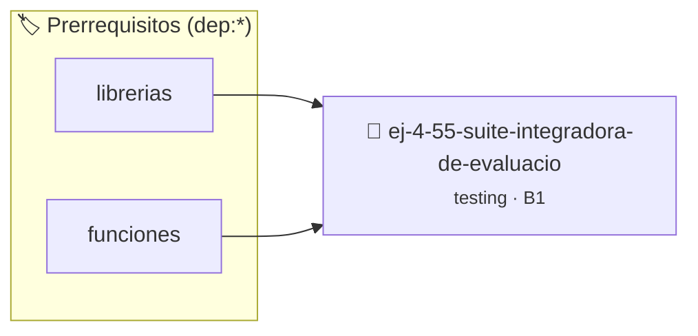

# Suite Integradora de Evaluación de Sistema de Calificaciones
> **ID:** `ej-4-55-suite-integradora-de-evaluacio` · **Unidad:** 5 (Ingeniería de Software y Calidad en C)
 · **Tema:** `testing` / `aserciones_defensivas`
 · **Bloom:** B1 (Recordar) · **Dificultad:** Inicial
 · **Carga:** ~10 min · **Tipo:** Concepto
>
> **🏷️ Prerrequisitos temáticos (tags):** `dep:librerias`, `dep:funciones`
>
> **Etiquetas conceptuales:** `aserciones`, `fundamentos`, `evaluacion`, `calificaciones`, `suite`


::: {admonition} 📦 Paquete de Verificación Local (Ripley)
:class: tip

Para compilar, resolver y autoevaluar tu entrega con pruebas unitarias en tu máquina:

- [📥 **Descargar paquete `ej-4-55-suite-integradora-de-evaluacio.ripkg`**](../../paquetes/ej-4-55-suite-integradora-de-evaluacio.ripkg)

Ejecución con el asistente de cátedra:
```bash
ripley run ej-4-55-suite-integradora-de-evaluacio.ripkg
```
:::


### 🗺️ Itinerario Pedagógico




## 📖 Consigna

:::{exercise}
:label: ej-test-suite-integradora
Diseñá una biblioteca modular completa para la gestión de notas de un curso con
las siguientes especificaciones:
1. `bool validar_nota(int nota)`: valida que la nota esté entre 1 y 10.
2. `double calcular_promedio_curso(const int notas[], int cantidad)`: calcula el
   promedio de notas válidas.
3. `int contar_aprobados(const int notas[], int cantidad, int nota_minima)`:
   cuenta cuántos alumnos superan o igualan la nota mínima.
4. `int estado_final_alumno(int parcial1, int parcial2, int recuperatorio)`:
   - Si `parcial1 >= 4` y `parcial2 >= 4`, la nota final es el promedio de
     ambos.
   - Si uno de los dos es $< 4$, se reemplaza la nota reprobada por la del
     `recuperatorio`. Si luego de esto ambas son $\ge 4$, aprueba.
   - Retorna `-1` si algún dato es inválido, `0` si reprueba, o la nota final
     entera.

Construí una suite integradora de pruebas unitarias automatizadas que cubra
todos los caminos y bordes con un runner central.

-   **[*plus ultra*]:** Verificar que todas las funciones sigan estrictamente el
    estilo Allman y no empleen variables globales.
-   **[*plus ultra*]:** Documentar cada función con etiquetas `@brief`,
    `@param`, `@pre`, `@returns` y `@post`.

:::

:::{solution} ej-test-suite-integradora
:class: dropdown
```{code-block} c
:linenos:
#include <assert.h>
#include <stdbool.h>
#include <stdio.h>

bool validar_nota(int nota)
{
    return (nota >= 1 && nota <= 10);
}

double calcular_promedio_curso(const int notas[], int cantidad)
{
    if (notas == NULL || cantidad <= 0)
    {
        return -1.0;
    }
    int suma = 0;
    for (int i = 0; i < cantidad; i++)
    {
        if (!validar_nota(notas[i]))
        {
            return -1.0;
        }
        suma += notas[i];
    }
    return (double)suma / cantidad;
}

int contar_aprobados(const int notas[], int cantidad, int nota_minima)
{
    if (notas == NULL || cantidad <= 0 || !validar_nota(nota_minima))
    {
        return -1;
    }
    int aprobados = 0;
    for (int i = 0; i < cantidad; i++)
    {
        if (notas[i] >= nota_minima)
        {
            aprobados++;
        }
    }
    return aprobados;
}

int estado_final_alumno(int p1, int p2, int rec)
{
    if (!validar_nota(p1) || !validar_nota(p2))
    {
        return -1;
    }
    if (p1 >= 4 && p2 >= 4)
    {
        return (p1 + p2) / 2;
    }
    if (!validar_nota(rec))
    {
        return 0; // Reprobado sin recuperatorio válido
    }
    if (p1 < 4 && rec >= 4 && p2 >= 4)
    {
        return (rec + p2) / 2;
    }
    if (p2 < 4 && rec >= 4 && p1 >= 4)
    {
        return (p1 + rec) / 2;
    }
    return 0;
}

void test_sistema_calificaciones(void)
{
    int notas[] = {7, 8, 4, 10, 6};
    assert(calcular_promedio_curso(notas, 5) == 7.0);
    assert(contar_aprobados(notas, 5, 6) == 4);

    // Caso directo aprobado
    assert(estado_final_alumno(8, 6, 0) == 7);

    // Caso recupera primer parcial
    assert(estado_final_alumno(2, 8, 6) == 7);

    // Caso recupera segundo parcial
    assert(estado_final_alumno(7, 3, 5) == 6);

    // Caso reprueba recuperatorio
    assert(estado_final_alumno(2, 8, 3) == 0);

    // Caso notas inválidas
    assert(estado_final_alumno(12, 8, 5) == -1);
}

int main(void)
{
    test_sistema_calificaciones();
    printf("¡Suite integradora ejecutada con 100%% de éxito!\n");
    return 0;
}

```

:::

---

## Notas Finales

:::{tip} Buenas Prácticas para Testing en C

- **Funciones puras:** Diseñá funciones que dependan únicamente de sus
  parámetros y retornen su resultado sin alterar variables externas.
- **Sin variables globales:** Eliminá completamente el estado global para
  garantizar que tus pruebas sean reproducibles y corran en cualquier orden.
- **Aserciones específicas:** Una aserción por función de prueba para que los
  reportes de error identifiquen exactamente el escenario fallido.
- **Cobertura exhaustiva:** Asegurate de contemplar casos normales, casos de
  borde y entradas inválidas.

:::

### 📋 Contrato de las Funciones

```c
/*
 * Operación validar_nota
 * Precondiciones: Parámetros dentro del dominio válido de la operación.
 * Postcondiciones: Retorna el valor procesado.
 */
bool validar_nota(int nota);

/*
 * Operación calcular_promedio_curso
 * Precondiciones: Parámetros dentro del dominio válido de la operación.
 * Postcondiciones: Retorna el valor procesado.
 */
double calcular_promedio_curso(const int notas[], int cantidad);

/*
 * Operación contar_aprobados
 * Precondiciones: Parámetros dentro del dominio válido de la operación.
 * Postcondiciones: Retorna el valor procesado.
 */
int contar_aprobados(const int notas[], int cantidad, int nota_minima);

/*
 * Operación estado_final_alumno
 * Precondiciones: Parámetros dentro del dominio válido de la operación.
 * Postcondiciones: Retorna el valor procesado.
 */
int estado_final_alumno(int p1, int p2, int rec);

/*
 * Operación test_sistema_calificaciones
 * Precondiciones: Parámetros dentro del dominio válido de la operación.
 * Postcondiciones: Retorna el valor procesado.
 */
void test_sistema_calificaciones(void);

```

### 🧪 Ejemplos de Ejecución

::::{tab-set}
:::{tab-item} Valor positivo
```text
Entrada: 1
Salida / Retorno: 2
```
:::
::::

### ⚠️ Precondiciones y Casos Borde

1. **Valores fuera de rango:** Verificar siempre que los datos de entrada cumplan con los rangos admisibles antes de operar.
6. **Casos vacíos o neutros:** Contemplar adecuadamente entradas con longitud cero o valores neutros según corresponda.

### 🎯 Criterios de Aceptación

- [ ] El código compila limpiamente bajo estándar C11 sin warnings con flags estrictos (`-Wall -Wextra -Werror`).
- [ ] Se satisfacen todas las pruebas unitarias y casos de prueba provistos.
- [ ] Las funciones validan exhaustivamente sus precondiciones y gestionan casos borde de forma robusta.

:::{hint} Consideraciones Didácticas
- **Funciones puras:** Diseñá funciones que dependan únicamente de sus parámetros y retornen su resultado sin alterar variables externas.
- **Sin variables globales:** Eliminá completamente el estado global para garantizar que tus pruebas sean reproducibles y corran en cualquier orden.
- **Aserciones específicas:** Una aserción por función de prueba para que los reportes de error identifiquen exactamente el escenario fallido.
- **Cobertura exhaustiva:** Asegurate de contemplar casos normales, casos de borde y entradas inválidas.
:::


## 📋 Prototipos y Cabecera (`ej-4-55-suite-integradora-de-evaluacio.h`)

```{code-block} c
#ifndef EJERCICIO_EJ_4_55_SUITE_INTEGRADORA_DE_EVALUACIO_H
#define EJERCICIO_EJ_4_55_SUITE_INTEGRADORA_DE_EVALUACIO_H

#include <stddef.h>
#include <stdbool.h>
#include <stdint.h>

/* Operación validar_nota */
bool validar_nota(int nota);
/* Operación calcular_promedio_curso */
double calcular_promedio_curso(const int notas[], int cantidad);
/* Operación contar_aprobados */
int contar_aprobados(const int notas[], int cantidad, int nota_minima);
/* Operación estado_final_alumno */
int estado_final_alumno(int p1, int p2, int rec);
/* Operación test_sistema_calificaciones */
void test_sistema_calificaciones(void);

#endif /* EJERCICIO_EJ_4_55_SUITE_INTEGRADORA_DE_EVALUACIO_H */
```


## ⚙️ Especificación de Funciones

| Función | Retorno | Parámetros | Descripción |
| :--- | :--- | :--- | :--- |

| `validar_nota` | `bool` | `int nota` | Operación validar_nota |

| `calcular_promedio_curso` | `double` | `const int notas[], int cantidad` | Operación calcular_promedio_curso |

| `contar_aprobados` | `int` | `const int notas[], int cantidad, int nota_minima` | Operación contar_aprobados |

| `estado_final_alumno` | `int` | `int p1, int p2, int rec` | Operación estado_final_alumno |

| `test_sistema_calificaciones` | `void` | `void` | Operación test_sistema_calificaciones |


## 💡 Pistas Progresivas

````{tab-set}

```{tab-item} Pista 1
**Funciones puras:** Diseñá funciones que dependan únicamente de sus parámetros y retornen su resultado sin alterar variables externas.
```

```{tab-item} Pista 2
**Sin variables globales:** Eliminá completamente el estado global para garantizar que tus pruebas sean reproducibles y corran en cualquier orden.
```

```{tab-item} Pista 3
**Aserciones específicas:** Una aserción por función de prueba para que los reportes de error identifiquen exactamente el escenario fallido.
```

```{tab-item} Pista 4
**Cobertura exhaustiva:** Asegurate de contemplar casos normales, casos de borde y entradas inválidas.
```

````


## 🧪 Casos de Prueba

| Prueba Unitaria | Función Objetivo | Verificación |
| :--- | :--- | :--- |

| **test_validar_nota_1** | `validar_nota` | `/* Verificación unitaria de validar_nota */ bool ok = validar_nota(1); (void)ok; assert(true);` |

| **test_calcular_promedio_curso_2** | `calcular_promedio_curso` | `/* Verificación unitaria de calcular_promedio_curso */ int arr[] = {1, 2, 3, 4}; double res = calcular_promedio_curso(arr, 4); (void)res; assert(true);` |


## ✓ Solución Modelo de Cátedra

```{dropdown} 🔍 Revelar solución canónica en C
:open: false

```{code-block} c
#include <assert.h>
#include <stdbool.h>
#include <stdio.h>

bool validar_nota(int nota)
{
    return (nota >= 1 && nota <= 10);
}

double calcular_promedio_curso(const int notas[], int cantidad)
{
    if (notas == NULL || cantidad <= 0)
    {
        return -1.0;
    }
    int suma = 0;
    for (int i = 0; i < cantidad; i++)
    {
        if (!validar_nota(notas[i]))
        {
            return -1.0;
        }
        suma += notas[i];
    }
    return (double)suma / cantidad;
}

int contar_aprobados(const int notas[], int cantidad, int nota_minima)
{
    if (notas == NULL || cantidad <= 0 || !validar_nota(nota_minima))
    {
        return -1;
    }
    int aprobados = 0;
    for (int i = 0; i < cantidad; i++)
    {
        if (notas[i] >= nota_minima)
        {
            aprobados++;
        }
    }
    return aprobados;
}

int estado_final_alumno(int p1, int p2, int rec)
{
    if (!validar_nota(p1) || !validar_nota(p2))
    {
        return -1;
    }
    if (p1 >= 4 && p2 >= 4)
    {
        return (p1 + p2) / 2;
    }
    if (!validar_nota(rec))
    {
        return 0; // Reprobado sin recuperatorio válido
    }
    if (p1 < 4 && rec >= 4 && p2 >= 4)
    {
        return (rec + p2) / 2;
    }
    if (p2 < 4 && rec >= 4 && p1 >= 4)
    {
        return (p1 + rec) / 2;
    }
    return 0;
}

void test_sistema_calificaciones(void)
{
    int notas[] = {7, 8, 4, 10, 6};
    assert(calcular_promedio_curso(notas, 5) == 7.0);
    assert(contar_aprobados(notas, 5, 6) == 4);

    // Caso directo aprobado
    assert(estado_final_alumno(8, 6, 0) == 7);

    // Caso recupera primer parcial
    assert(estado_final_alumno(2, 8, 6) == 7);

    // Caso recupera segundo parcial
    assert(estado_final_alumno(7, 3, 5) == 6);

    // Caso reprueba recuperatorio
    assert(estado_final_alumno(2, 8, 3) == 0);

    // Caso notas inválidas
    assert(estado_final_alumno(12, 8, 5) == -1);
}

int main(void)
{
    test_sistema_calificaciones();
    printf("¡Suite integradora ejecutada con 100%% de éxito!\n");
    return 0;
}
```
```
