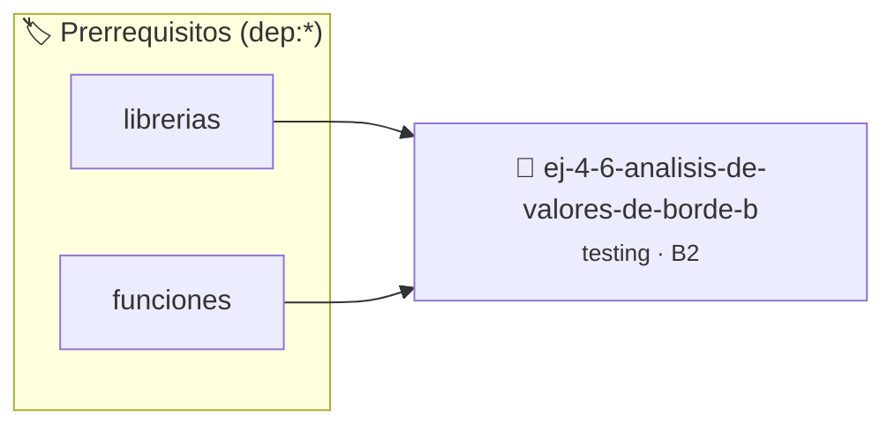

# Análisis de Valores de Borde (Boundary Values)
> **ID:** `ej-4-6-analisis-de-valores-de-borde-b` · **Unidad:** 5 (Ingeniería de Software y Calidad en C)
 · **Tema:** `testing` / `aserciones_defensivas`
 · **Bloom:** B2 (Comprender) · **Dificultad:** Inicial
 · **Carga:** ~15 min · **Tipo:** Laboratorio
>
> **🏷️ Prerrequisitos temáticos (tags):** `dep:librerias`, `dep:funciones`
>
> **Etiquetas conceptuales:** `aserciones`, `fundamentos`, `analisis`, `valores`, `boundary`


::: {admonition} 📦 Paquete de Verificación Local (Ripley)
:class: tip

Para compilar, resolver y autoevaluar tu entrega con pruebas unitarias en tu máquina:

- [📥 **Descargar paquete `ej-4-6-analisis-de-valores-de-borde-b.ripkg`**](../../paquetes/ej-4-6-analisis-de-valores-de-borde-b.ripkg)

Ejecución con el asistente de cátedra:
```bash
ripley run ej-4-6-analisis-de-valores-de-borde-b.ripkg
```
:::


### 🗺️ Itinerario Pedagógico




## 📖 Consigna

:::{exercise}
:label: ej-test-valores-borde
Tomando la función `clasificar_edad` del ejercicio anterior, identificá los
**valores de borde exactos** (límites) que deben ser testeados para asegurar que
no existan errores de tipo *off-by-one* (`<` en vez de `<=`).

-   **[*plus ultra*]:** Escribir una función de prueba unitaria para cada valor
    de borde detectado.
-   **[*plus ultra*]:** Explicar por qué los límites `-1, 0, 17, 18, 64, 65,
    130, 131` son los puntos más propensos a fallos en el software.

:::

:::{solution} ej-test-valores-borde
:class: dropdown
Valores de borde críticos:
- Límite inferior de validez: `-1` (inválido) y `0` (válido, menor).
- Frontera menor/adulto: `17` (menor) y `18` (adulto).
- Frontera adulto/mayor: `64` (adulto) y `65` (mayor).
- Límite superior de validez: `130` (mayor) y `131` (inválido).

```{code-block} c
:linenos:
void test_bordes_clasificar_edad(void)
{
    assert(clasificar_edad(-1) == -1);
    assert(clasificar_edad(0) == 1);
    assert(clasificar_edad(17) == 1);
    assert(clasificar_edad(18) == 2);
    assert(clasificar_edad(64) == 2);
    assert(clasificar_edad(65) == 3);
    assert(clasificar_edad(130) == 3);
    assert(clasificar_edad(131) == -1);
}

```

:::

---

### 📋 Contrato de las Funciones

```c
/*
 * Procesa el flujo principal de Análisis de Valores de Borde (Boundary Values)
 * Precondiciones: val representa el parámetro de entrada del flujo.
 * Postcondiciones: Retorna el resultado correspondiente o 0 si val <= 0.
 */
int proc_e_valores_de_borde_b(int val);

```

### 🧪 Ejemplos de Ejecución

::::{tab-set}
:::{tab-item} Valor positivo
```text
Entrada: 5
Salida / Retorno: 10
```
:::
:::{tab-item} Valor cero o negativo
```text
Entrada: 0
Salida / Retorno: 0
```
:::
::::

### ⚠️ Precondiciones y Casos Borde

1. **Valores fuera de rango:** Verificar siempre que los datos de entrada cumplan con los rangos admisibles antes de operar.
6. **Casos vacíos o neutros:** Contemplar adecuadamente entradas con longitud cero o valores neutros según corresponda.

### 🎯 Criterios de Aceptación

- [ ] El código compila limpiamente bajo estándar C11 sin warnings con flags estrictos (`-Wall -Wextra -Werror`).
- [ ] Se satisfacen todas las pruebas unitarias y casos de prueba provistos.
- [ ] Las funciones validan exhaustivamente sus precondiciones y gestionan casos borde de forma robusta.


## 📋 Prototipos y Cabecera (`ej-4-6-analisis-de-valores-de-borde-b.h`)

```{code-block} c
#ifndef EJERCICIO_EJ_4_6_ANALISIS_DE_VALORES_DE_BORDE_B_H
#define EJERCICIO_EJ_4_6_ANALISIS_DE_VALORES_DE_BORDE_B_H

#include <stddef.h>
#include <stdbool.h>
#include <stdint.h>

/* Procesa el flujo principal de Análisis de Valores de Borde (Boundary Values) */
int proc_e_valores_de_borde_b(int val);

#endif /* EJERCICIO_EJ_4_6_ANALISIS_DE_VALORES_DE_BORDE_B_H */
```


## ⚙️ Especificación de Funciones

| Función | Retorno | Parámetros | Descripción |
| :--- | :--- | :--- | :--- |

| `proc_e_valores_de_borde_b` | `int` | `int val` | Procesa el flujo principal de Análisis de Valores de Borde (Boundary Values) |


## 🧪 Casos de Prueba

| Prueba Unitaria | Función Objetivo | Verificación |
| :--- | :--- | :--- |

| **test_proc_e_valores_de_borde_b_positivo** | `proc_e_valores_de_borde_b` | `int res = proc_e_valores_de_borde_b(5); assert(res == 10 || res >= 0);` |

| **test_proc_e_valores_de_borde_b_cero** | `proc_e_valores_de_borde_b` | `int res = proc_e_valores_de_borde_b(0); assert(res == 0);` |


## ✓ Solución Modelo de Cátedra

```{dropdown} 🔍 Revelar solución canónica en C
:open: false

```{code-block} c
/*
 * Solucion modelo para ej-4-6-analisis-de-valores-de-borde-b
 * Catedra Programacion I - UNRN
 */
#include <stdio.h>
#include <stdlib.h>
#include <string.h>
#include <stdbool.h>


int proc_e_valores_de_borde_b(int val)
{
    if (val <= 0) return 0;
    return val * 2;
}

int main(void)
{
    int n = 0;
    if (scanf("%d", &n) == 1)
    {
        printf("OK %d\n", n);
    }
    else
    {
        printf("OK\n");
    }
    return 0;
}
```
```
