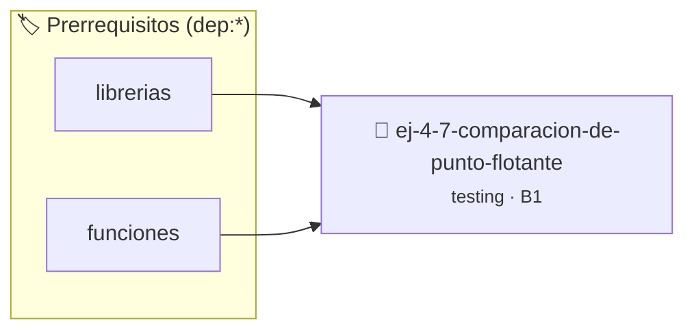

# Comparación de punto flotante en testing
> **ID:** `ej-4-7-comparacion-de-punto-flotante`
 · **Tema:** `testing`
 · **Bloom:** B1 (Recordar)
 · **Carga:** ~10 min
>
> **🏷️ Prerrequisitos temáticos (tags):** `dep:librerias`, `dep:funciones`
>
> **Etiquetas conceptuales:** `aserciones`, `fundamentos`, `flotante`, `punto`, `testing`


::: {admonition} 📦 Paquete de Verificación Local (Ripley)
:class: tip

Para compilar, resolver y autoevaluar tu entrega con pruebas unitarias en tu máquina:

- [📥 **Descargar paquete `ej-4-7-comparacion-de-punto-flotante.ripkg`**](../../paquetes/ej-4-7-comparacion-de-punto-flotante.ripkg)

Ejecución con el asistente de cátedra:
```bash
ripley run ej-4-7-comparacion-de-punto-flotante.ripkg
```
:::


### 🗺️ Itinerario Pedagógico




## 📖 Consigna

### Ejercicio 4.7 - Comparación de punto flotante en testing ⭐⭐☆☆☆

:::{exercise}
:label: ej-test-comparacion-float
Analizá por qué la siguiente prueba puede fallar inesperadamente en C y escribí
una función auxiliar `son_cercanos(double a, double b, double epsilon)` para
solucionarlo:

``` c
double tercio = 1.0 / 3.0;
assert(tercio * 3.0 == 1.0); // ¡Peligro de precisión!
```
<!-- c -->

-   **[*plus ultra*]:** Implementar `bool son_cercanos(double a, double b,
    double eps)` usando `fabs()` de `<math.h>`.
-   **[*plus ultra*]:** Escribir un test que verifique `0.1 + 0.2` frente a
    `0.3` con tolerancia $10^{-6}$.

:::
<!-- {exercise} -->

:::{solution} ej-test-comparacion-float
:class: dropdown
En aritmética binaria de punto flotante (IEEE 754), números como `0.1` o
`1.0/3.0` no tienen representación exacta finita, lo que produce pequeñas
discrepancias en los últimos decimales.

```{code-block} c
:linenos:
#include <assert.h>
#include <math.h>
#include <stdbool.h>

bool son_cercanos(double a, double b, double epsilon)
{
    return fabs(a - b) < epsilon;
}

void test_suma_decimales(void)
{
    double resultado = 0.1 + 0.2;
    double esperado = 0.3;
    assert(son_cercanos(resultado, esperado, 1e-9));
}

```
<!-- {code-block} c -->

:::
<!-- {solution} ej-test-comparacion-float -->

---


## 📋 Prototipos y Cabecera (`ej-4-7-comparacion-de-punto-flotante.h`)

```{code-block} c
#ifndef EJERCICIO_EJ_4_7_COMPARACION_DE_PUNTO_FLOTANTE_H
#define EJERCICIO_EJ_4_7_COMPARACION_DE_PUNTO_FLOTANTE_H

#include <stddef.h>
#include <stdbool.h>
#include <stdint.h>

/* Operación son_cercanos */
bool son_cercanos(double a, double b, double epsilon);
/* Operación test_suma_decimales */
void test_suma_decimales(void);

#endif /* EJERCICIO_EJ_4_7_COMPARACION_DE_PUNTO_FLOTANTE_H */
```


## ⚙️ Especificación de Funciones

| Función | Retorno | Parámetros | Descripción |
| :--- | :--- | :--- | :--- |

| `son_cercanos` | `bool` | `double a, double b, double epsilon` | Operación son_cercanos |

| `test_suma_decimales` | `void` | `void` | Operación test_suma_decimales |


## 🧪 Casos de Prueba

| Prueba Unitaria | Función Objetivo | Verificación |
| :--- | :--- | :--- |

| **test_son_cercanos_1** | `son_cercanos` | `/* Verificación unitaria de son_cercanos */ bool ok = son_cercanos(1, 2, 3); (void)ok; assert(true);` |

| **test_test_suma_decimales_2** | `test_suma_decimales` | `/* Verificación unitaria de test_suma_decimales */ test_suma_decimales(); assert(true);` |


## ✓ Solución Modelo de Cátedra

```{dropdown} 🔍 Revelar solución canónica en C
:open: false

```{code-block} c
#include <stdlib.h>

#include <assert.h>
#include <math.h>
#include <stdbool.h>

bool son_cercanos(double a, double b, double epsilon)
{
    return fabs(a - b) < epsilon;
}

void test_suma_decimales(void)
{
    double resultado = 0.1 + 0.2;
    double esperado = 0.3;
    assert(son_cercanos(resultado, esperado, 1e-9));
}

int main(void)
{
    return 0;
}
```
```
