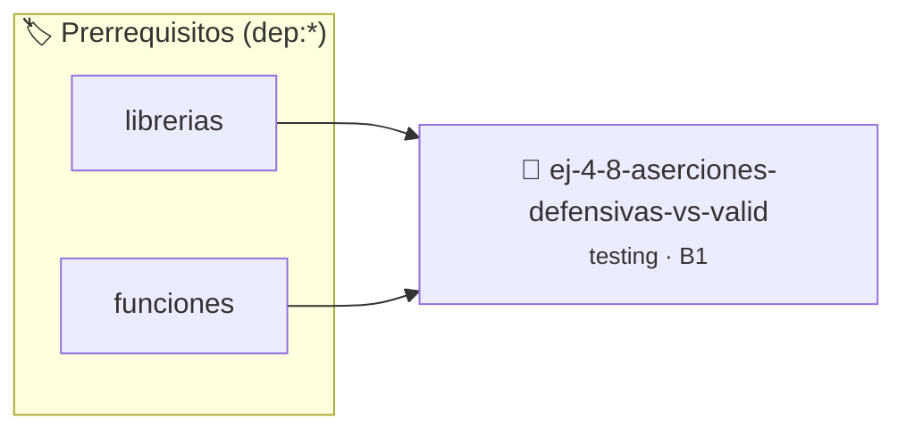

# Aserciones defensivas vs Validación de Usuario
> **ID:** `ej-4-8-aserciones-defensivas-vs-valid` · **Unidad:** 5 (Ingeniería de Software y Calidad en C)
 · **Tema:** `testing` / `aserciones_defensivas`
 · **Bloom:** B1 (Recordar) · **Dificultad:** Inicial
 · **Carga:** ~10 min · **Tipo:** Concepto
>
> **🏷️ Prerrequisitos temáticos (tags):** `dep:librerias`, `dep:funciones`
>
> **Etiquetas conceptuales:** `aserciones`, `fundamentos`, `validacion`, `defensivas`, `testing`


::: {admonition} 📦 Paquete de Verificación Local (Ripley)
:class: tip

Para compilar, resolver y autoevaluar tu entrega con pruebas unitarias en tu máquina:

- [📥 **Descargar paquete `ej-4-8-aserciones-defensivas-vs-valid.ripkg`**](../../paquetes/ej-4-8-aserciones-defensivas-vs-valid.ripkg)

Ejecución con el asistente de cátedra:
```bash
ripley run ej-4-8-aserciones-defensivas-vs-valid.ripkg
```
:::


### 🗺️ Itinerario Pedagógico




## 📖 Consigna

### Ejercicio 4.8 - Aserciones defensivas vs Validación de Usuario ⭐☆☆☆☆

:::{exercise}
:label: ej-test-defensiva-vs-usuario
Explicá con claridad la diferencia conceptual entre:
1. Validar datos ingresados por el usuario por teclado con `scanf` y
   condicionales `if`.
2. Validar precondiciones internas del programador con `assert()`.

-   **[*plus ultra*]:** Dar un ejemplo de cuándo usar `if (...) return
    CODIGO_ERROR;` y cuándo usar `assert(divisor != 0);`.
-   **[*plus ultra*]:** Explicar por qué un programa de producción nunca debe
    abortar con `assert` si el usuario escribe una letra en lugar de un número.

:::
<!-- {exercise} -->

:::{solution} ej-test-defensiva-vs-usuario
:class: dropdown
1. **Validación de Usuario (`if` / manejo de errores):** Es obligatoria para
   entradas externas incontrolables (teclado, archivos, red). El programa debe
   manejar el error con gracia, avisar al usuario y recuperarse.
2. **Aserciones (`assert`):** Son herramientas de depuración para detectar bugs
   de lógica del programador (violaciones de contrato que "nunca deberían
   ocurrir" si el código estuviera bien escrito).

:::
<!-- {solution} ej-test-defensiva-vs-usuario -->

---


## 📋 Prototipos y Cabecera (`ej-4-8-aserciones-defensivas-vs-valid.h`)

```{code-block} c
#ifndef EJERCICIO_EJ_4_8_ASERCIONES_DEFENSIVAS_VS_VALID_H
#define EJERCICIO_EJ_4_8_ASERCIONES_DEFENSIVAS_VS_VALID_H

#include <stddef.h>
#include <stdbool.h>
#include <stdint.h>

/* Procesa el flujo principal de Aserciones defensivas vs Validación de Usuario */
int proc__defensivas_vs_valid(int val);

#endif /* EJERCICIO_EJ_4_8_ASERCIONES_DEFENSIVAS_VS_VALID_H */
```


## ⚙️ Especificación de Funciones

| Función | Retorno | Parámetros | Descripción |
| :--- | :--- | :--- | :--- |

| `proc__defensivas_vs_valid` | `int` | `int val` | Procesa el flujo principal de Aserciones defensivas vs Validación de Usuario |


## 🧪 Casos de Prueba

| Prueba Unitaria | Función Objetivo | Verificación |
| :--- | :--- | :--- |

| **test_proc__defensivas_vs_valid_positivo** | `proc__defensivas_vs_valid` | `int res = proc__defensivas_vs_valid(5); assert(res == 10 || res >= 0);` |

| **test_proc__defensivas_vs_valid_cero** | `proc__defensivas_vs_valid` | `int res = proc__defensivas_vs_valid(0); assert(res == 0);` |


## ✓ Solución Modelo de Cátedra

```{dropdown} 🔍 Revelar solución canónica en C
:open: false

```{code-block} c
/*
 * Ejercicio: Aserciones defensivas vs Validación de Usuario
 * Cátedra Programación I - UNRN
 */

#include <stdio.h>


int proc__defensivas_vs_valid(int val)
{
    if (val <= 0) return 0;
    return val * 2;
}

int main(void)
{
    /* TODO: Implementación de Aserciones defensivas vs Validación de Usuario */
    return 0;
}
```
```
