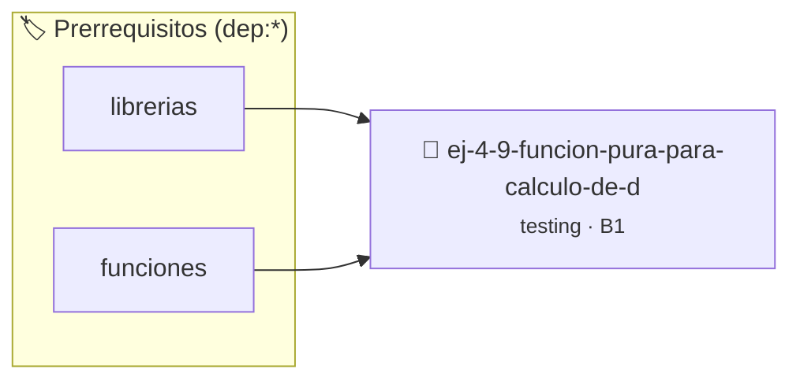

# Función pura para cálculo de descuento
> **ID:** `ej-4-9-funcion-pura-para-calculo-de-d` · **Unidad:** 5 (Ingeniería de Software y Calidad en C)
 · **Tema:** `testing` / `aserciones_defensivas`
 · **Bloom:** B1 (Recordar) · **Dificultad:** Inicial
 · **Carga:** ~10 min · **Tipo:** Concepto
>
> **🏷️ Prerrequisitos temáticos (tags):** `dep:librerias`, `dep:funciones`
>
> **Etiquetas conceptuales:** `aserciones`, `fundamentos`, `calculo`, `funcion`, `descuento`


::: {admonition} 📦 Paquete de Verificación Local (Ripley)
:class: tip

Para compilar, resolver y autoevaluar tu entrega con pruebas unitarias en tu máquina:

- [📥 **Descargar paquete `ej-4-9-funcion-pura-para-calculo-de-d.ripkg`**](../../paquetes/ej-4-9-funcion-pura-para-calculo-de-d.ripkg)

Ejecución con el asistente de cátedra:
```bash
ripley run ej-4-9-funcion-pura-para-calculo-de-d.ripkg
```
:::


### 🗺️ Itinerario Pedagógico




## 📖 Consigna

### Ejercicio 4.9 - Función pura para cálculo de descuento ⭐⭐☆☆☆

:::{exercise}
:label: ej-test-calculo-descuento
Diseñá una función pura `double aplicar_descuento(double precio_base, double
porcentaje)` que:
- Si `precio_base < 0` o `porcentaje < 0` o `porcentaje > 100`, retorne `-1.0`.
- De lo contrario, retorne el precio final descontado.

Escribí su suite completa de pruebas unitarias cubriendo casos normales, bordes
e inválidos.

-   **[*plus ultra*]:** Documentar la función con `@param`, `@pre`, `@returns` y
    `@post`.
-   **[*plus ultra*]:** Validar que `aplicar_descuento(100.0, 0.0)` retorne
    `100.0` y `aplicar_descuento(100.0, 100.0)` retorne `0.0`.

:::
<!-- {exercise} -->

:::{solution} ej-test-calculo-descuento
:class: dropdown
```{code-block} c
:linenos:
#include <assert.h>
#include <stdbool.h>

double aplicar_descuento(double precio_base, double porcentaje)
{
    if (precio_base < 0.0 || porcentaje < 0.0 || porcentaje > 100.0)
    {
        return -1.0;
    }
    return precio_base * (1.0 - (porcentaje / 100.0));
}

void test_descuento_normal(void)
{
    assert(aplicar_descuento(200.0, 25.0) == 150.0);
}

void test_descuento_cero(void)
{
    assert(aplicar_descuento(100.0, 0.0) == 100.0);
}

void test_descuento_total(void)
{
    assert(aplicar_descuento(100.0, 100.0) == 0.0);
}

void test_descuento_precio_invalido(void)
{
    assert(aplicar_descuento(-50.0, 10.0) == -1.0);
}

void test_descuento_porcentaje_invalido(void)
{
    assert(aplicar_descuento(100.0, 150.0) == -1.0);
}

```
<!-- {code-block} c -->

:::
<!-- {solution} ej-test-calculo-descuento -->

---


## 📋 Prototipos y Cabecera (`ej-4-9-funcion-pura-para-calculo-de-d.h`)

```{code-block} c
#ifndef EJERCICIO_EJ_4_9_FUNCION_PURA_PARA_CALCULO_DE_D_H
#define EJERCICIO_EJ_4_9_FUNCION_PURA_PARA_CALCULO_DE_D_H

#include <stddef.h>
#include <stdbool.h>
#include <stdint.h>

/* Operación aplicar_descuento */
double aplicar_descuento(double precio_base, double porcentaje);
/* Operación test_descuento_normal */
void test_descuento_normal(void);
/* Operación test_descuento_cero */
void test_descuento_cero(void);
/* Operación test_descuento_total */
void test_descuento_total(void);
/* Operación test_descuento_precio_invalido */
void test_descuento_precio_invalido(void);
/* Operación test_descuento_porcentaje_invalido */
void test_descuento_porcentaje_invalido(void);

#endif /* EJERCICIO_EJ_4_9_FUNCION_PURA_PARA_CALCULO_DE_D_H */
```


## ⚙️ Especificación de Funciones

| Función | Retorno | Parámetros | Descripción |
| :--- | :--- | :--- | :--- |

| `aplicar_descuento` | `double` | `double precio_base, double porcentaje` | Operación aplicar_descuento |

| `test_descuento_normal` | `void` | `void` | Operación test_descuento_normal |

| `test_descuento_cero` | `void` | `void` | Operación test_descuento_cero |

| `test_descuento_total` | `void` | `void` | Operación test_descuento_total |

| `test_descuento_precio_invalido` | `void` | `void` | Operación test_descuento_precio_invalido |

| `test_descuento_porcentaje_invalido` | `void` | `void` | Operación test_descuento_porcentaje_invalido |


## 🧪 Casos de Prueba

| Prueba Unitaria | Función Objetivo | Verificación |
| :--- | :--- | :--- |

| **test_aplicar_descuento_1** | `aplicar_descuento` | `/* Verificación unitaria de aplicar_descuento */ double res = aplicar_descuento(1, 2); (void)res; assert(true);` |

| **test_test_descuento_normal_2** | `test_descuento_normal` | `/* Verificación unitaria de test_descuento_normal */ test_descuento_normal(); assert(true);` |


## ✓ Solución Modelo de Cátedra

```{dropdown} 🔍 Revelar solución canónica en C
:open: false

```{code-block} c
#include <assert.h>
#include <stdbool.h>

double aplicar_descuento(double precio_base, double porcentaje)
{
    if (precio_base < 0.0 || porcentaje < 0.0 || porcentaje > 100.0)
    {
        return -1.0;
    }
    return precio_base * (1.0 - (porcentaje / 100.0));
}

void test_descuento_normal(void)
{
    assert(aplicar_descuento(200.0, 25.0) == 150.0);
}

void test_descuento_cero(void)
{
    assert(aplicar_descuento(100.0, 0.0) == 100.0);
}

void test_descuento_total(void)
{
    assert(aplicar_descuento(100.0, 100.0) == 0.0);
}

void test_descuento_precio_invalido(void)
{
    assert(aplicar_descuento(-50.0, 10.0) == -1.0);
}

void test_descuento_porcentaje_invalido(void)
{
    assert(aplicar_descuento(100.0, 150.0) == -1.0);
}

int main(void)
{
    return 0;
}
```
```
