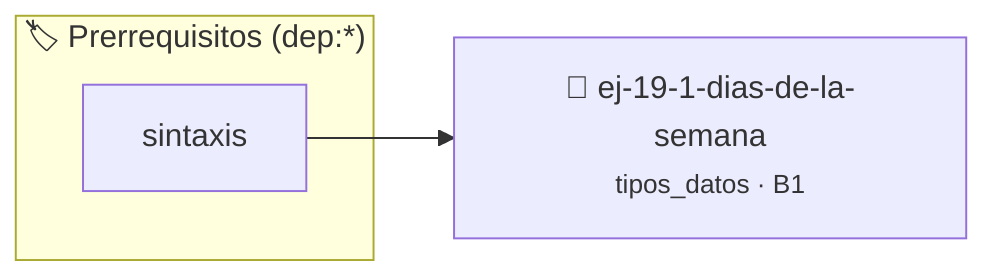

# Días de la semana
> **ID:** `ej-19-1-dias-de-la-semana`
 · **Tema:** `tipos_datos`
 · **Bloom:** B1 (Recordar)
 · **Carga:** ~10 min
>
> **🏷️ Prerrequisitos temáticos (tags):** `dep:sintaxis`
>
> **Etiquetas conceptuales:** `alias`, `semana`, `typedef`, `memoria`


::: {admonition} 📦 Paquete de Verificación Local (Ripley)
:class: tip

Para compilar, resolver y autoevaluar tu entrega con pruebas unitarias en tu máquina:

- [📥 **Descargar paquete `ej-19-1-dias-de-la-semana.ripkg`**](../../paquetes/ej-19-1-dias-de-la-semana.ripkg)

Ejecución con el asistente de cátedra:
```bash
ripley run ej-19-1-dias-de-la-semana.ripkg
```
:::


### 🗺️ Itinerario Pedagógico




## 📖 Consigna

### Ejercicio 19.1 - Días de la semana ⭐⭐☆☆☆

:::{exercise}
:label: enum_basico
:enumerator: enums-1

Definí una enumeración para representar los días de la semana.
Escribí una función que reciba un día y retorne si es día laboral
o fin de semana. Incluí validación para valores inválidos.

-   **[*plus ultra*]:** Garantizar la terminación con `\0` y prevenir
    desbordamientos de búfer validando la capacidad máxima.
-   **[*plus ultra*]:** Soportar la lectura de cadenas con espacios y múltiples
    líneas de manera robusta.

:::
<!-- {exercise} -->

::::{solution} enum_basico
:class: dropdown

:::{code-block}c
:linenos:
#include <stdbool.h>
#include <stdio.h>
typedef enum
{
    LUNES,
    MARTES,
    MIERCOLES,
    JUEVES,
    VIERNES,
    SABADO,
    DOMINGO,
    DIA_INVALIDO
} dia_semana_t;
typedef enum
{
    DIA_LABORAL,
    FIN_DE_SEMANA,
    ERROR_DIA_INVALIDO
} tipo_dia_t;
tipo_dia_t clasificar_dia(dia_semana_t dia)
{
    switch (dia)
    {
    case LUNES:
    case MARTES:
    case MIERCOLES:
    case JUEVES:
    case VIERNES:
        return DIA_LABORAL;
    case SABADO:
    case DOMINGO:
        return FIN_DE_SEMANA;
    default:
        return ERROR_DIA_INVALIDO;
    }
}
const char *dia_a_string(dia_semana_t dia)
{
    static const char *nombres[] = {"Lunes",   "Martes", "Miércoles", "Jueves",
                                    "Viernes", "Sábado", "Domingo"};
    if (dia < 0 || dia >= DIA_INVALIDO)
    {
        return "Día inválido";
    }
    return nombres[dia];
}
int main()
{
    for (int i = LUNES; i <= DOMINGO; i++)
    {
        dia_semana_t dia = (dia_semana_t)i;
        tipo_dia_t tipo = clasificar_dia(dia);
        printf("%s: ", dia_a_string(dia));
        switch (tipo)
        {
        case DIA_LABORAL:
            printf("Día laboral\n");
            break;
        case FIN_DE_SEMANA:
            printf("Fin de semana\n");
            break;
        case ERROR_DIA_INVALIDO:
            printf("Error: día inválido\n");
            break;
        }
    }
    // Probar con valor inválido
    dia_semana_t dia_malo = (dia_semana_t)42;
    tipo_dia_t resultado = clasificar_dia(dia_malo);
    if (resultado == ERROR_DIA_INVALIDO)
    {
        printf("Detección correcta de día inválido: %d\n", dia_malo);
    }
    return 0;
}
:::
<!-- {code-block}c -->

::::
<!-- {solution} enum_basico -->


## 📋 Prototipos y Cabecera (`ej-19-1-dias-de-la-semana.h`)

```{code-block} c
#ifndef EJERCICIO_EJ_19_1_DIAS_DE_LA_SEMANA_H
#define EJERCICIO_EJ_19_1_DIAS_DE_LA_SEMANA_H

#include <stddef.h>
#include <stdbool.h>
#include <stdint.h>

/* Procesa el flujo principal de Días de la semana */
int proc__1_dias_de_la_semana(int val);

#endif /* EJERCICIO_EJ_19_1_DIAS_DE_LA_SEMANA_H */
```


## ⚙️ Especificación de Funciones

| Función | Retorno | Parámetros | Descripción |
| :--- | :--- | :--- | :--- |

| `proc__1_dias_de_la_semana` | `int` | `int val` | Procesa el flujo principal de Días de la semana |


## 🧪 Casos de Prueba

| Prueba Unitaria | Función Objetivo | Verificación |
| :--- | :--- | :--- |

| **test_proc__1_dias_de_la_semana_positivo** | `proc__1_dias_de_la_semana` | `int res = proc__1_dias_de_la_semana(5); assert(res == 10 || res >= 0);` |

| **test_proc__1_dias_de_la_semana_cero** | `proc__1_dias_de_la_semana` | `int res = proc__1_dias_de_la_semana(0); assert(res == 0);` |


## ✓ Solución Modelo de Cátedra

```{dropdown} 🔍 Revelar solución canónica en C
:open: false

```{code-block} c
/*
 * Ejercicio: Días de la semana
 * Cátedra Programación I - UNRN
 */

#include <stdio.h>


int proc__1_dias_de_la_semana(int val)
{
    if (val <= 0) return 0;
    return val * 2;
}

int main(void)
{
    /* TODO: Implementación de Días de la semana */
    return 0;
}
```
```
