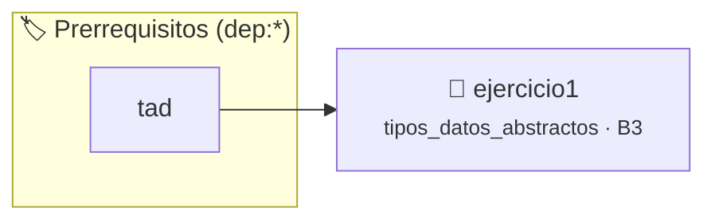

# TDA Fracción (fraccion_t) — Invariantes y Normalización
> **ID:** `ejercicio1`
 · **Tema:** `tipos_datos_abstractos`
 · **Bloom:** B3 (Aplicar)
 · **Carga:** ~40 min
>
> **🏷️ Prerrequisitos temáticos (tags):** `dep:tad`
>
> **Etiquetas conceptuales:** `tda`, `fraccion`, `invariantes`, `encapsulamiento_opaco`, `mcd`


::: {admonition} 📦 Paquete de Verificación Local (Ripley)
:class: tip

Para compilar, resolver y autoevaluar tu entrega con pruebas unitarias en tu máquina:

- [📥 **Descargar paquete `ejercicio1.ripkg`**](../../paquetes/ejercicio1.ripkg)

Ejecución con el asistente de cátedra:
```bash
ripley run ejercicio1.ripkg
```
:::


### 🗺️ Itinerario Pedagógico




## 📖 Consigna

# Ejercicio 1: TDA Fracción (`fraccion_t`) — Invariantes y Normalización

Se desea modelar un Tipo de Dato Abstracto para operar con números racionales exactos $\left(\frac{\text{numerador}}{\text{denominador}}\right)$.

## 1. El Invariante de Representación

En `fraccion.c`, una fracción válida debe cumplir siempre las siguientes condiciones en su función `static bool fraccion_invariante(const fraccion_t *f)`:

1. El puntero `f` no es `NULL`.
2. El denominador es estrictamente mayor que cero ($\text{denominador} > 0$). Si la fracción es negativa, el signo debe residir únicamente en el numerador.
3. La fracción se encuentra simplificada a su mínima expresión (irreductible): el Máximo Común Divisor entre $|\text{numerador}|$ y $\text{denominador}$ es $1$. Si el numerador es $0$, el denominador debe ser obligatoriamente $1$.

## 2. Interfaz requerida (`fraccion.h`)

- **Constructor:** `fraccion_t *fraccion_crear(int numerador, int denominador);` (retorna `NULL` si `denominador == 0` o si falla memoria; simplifica y normaliza signo).
- **Destructor:** `void fraccion_destruir(fraccion_t *f);` (libera en heap, tolera `NULL`).
- **Selectores:**
  - `int fraccion_numerador(const fraccion_t *f);`
  - `int fraccion_denominador(const fraccion_t *f);`
- **Consultores:**
  - `bool fraccion_es_entera(const fraccion_t *f);`
  - `int fraccion_comparar(const fraccion_t *f1, const fraccion_t *f2);`
- **Operaciones:**
  - `fraccion_t *fraccion_sumar(const fraccion_t *f1, const fraccion_t *f2);`
  - `fraccion_t *fraccion_multiplicar(const fraccion_t *f1, const fraccion_t *f2);`
- **Conversores:**
  - `double fraccion_a_real(const fraccion_t *f);`
  - `char *fraccion_a_cadena(const fraccion_t *f);` (debe liberarse con `free()`).


## 📋 Prototipos y Cabecera (`fraccion.h`)

```{code-block} c
/**
 * @file fraccion.h
 * @brief TDA Fracción (números racionales exactos) con invariantes y tipos opacos.
 *
 * Trabajo Práctico 6 - Programación 1
 * Universidad Nacional de Río Negro - Ingeniería en Computación
 */

#ifndef FRACCION_H
#define FRACCION_H

#include <stdbool.h>

/**
 * @brief Tipo opaco que representa una fracción matemática irreductible.
 */
typedef struct fraccion fraccion_t;

/**
 * @brief Crea e inicializa una nueva fracción matemática.
 *
 * Reserva memoria dinámica para una fracción a partir de un numerador y un
 * denominador dados. La fracción resultante se simplifica automáticamente a su
 * forma irreducible (utilizando el MCD) y se normaliza el signo para que este
 * resida únicamente en el numerador.
 *
 * @param numerador Entero que representa el numerador de la fracción.
 * @param denominador Entero que representa el denominador de la fracción.
 *
 * @return Puntero a la nueva instancia de fraccion_t, o NULL si el denominador
 *         es 0, si ocurre un error en la reserva de memoria dinámica, o si no cumple con invariantes.
 *
 * @pre El denominador no debe ser igual a 0.
 * @post Si la función no retorna NULL, la fracción devuelta es irreducible y
 *       satisface el invariante de representación (denominador > 0).
 */
fraccion_t *fraccion_crear(int numerador, int denominador);

/**
 * @brief Libera la memoria reservada para una fracción.
 *
 * Libera la memoria dinámica asignada a la instancia de fraccion_t dada.
 * Esta función es tolerante a punteros nulos: si recibe NULL, no realiza
 * ninguna operación ni produce fallos de segmento.
 *
 * @param f Puntero a la fracción a destruir. Puede ser NULL.
 *
 * @pre Ninguna.
 * @post La memoria asignada a la fracción es devuelta al sistema.
 */
void fraccion_destruir(fraccion_t *f);

/**
 * @brief Obtiene el numerador de la fracción.
 *
 * @param f Puntero a la fracción a consultar.
 *
 * @return Entero que representa el numerador de la fracción, o 0 si f es NULL.
 *
 * @pre El puntero f no debe ser NULL.
 * @post La fracción permanece inalterada.
 */
int fraccion_numerador(const fraccion_t *f);

/**
 * @brief Obtiene el denominador de la fracción.
 *
 * @param f Puntero a la fracción a consultar.
 *
 * @return Entero positivo que representa el denominador de la fracción, o 0 si f es NULL.
 *
 * @pre El puntero f no debe ser NULL.
 * @post La fracción permanece inalterada y el valor retornado es siempre > 0.
 */
int fraccion_denominador(const fraccion_t *f);

/**
 * @brief Consulta si la fracción representa un número entero.
 *
 * Determina si la fracción simplificada tiene como denominador el valor 1.
 *
 * @param f Puntero a la fracción a consultar.
 *
 * @return true si el denominador es igual a 1, false en caso contrario o si f es NULL.
 *
 * @pre El puntero f no debe ser NULL.
 * @post La fracción permanece inalterada.
 */
bool fraccion_es_entera(const fraccion_t *f);

/**
 * @brief Compara dos fracciones matemáticas para determinar su orden.
 *
 * Compara f1 y f2 utilizando el producto cruzado para evitar divisiones
 * de punto flotante y mantener la precisión exacta.
 *
 * @param f1 Puntero a la primera fracción.
 * @param f2 Puntero a la segunda fracción.
 *
 * @return Un entero menor que 0 si f1 < f2, 0 si f1 == f2, o mayor que 0 si f1 > f2.
 *         Si alguno de los punteros es NULL, retorna 0 como caso defensivo.
 *
 * @pre Ni f1 ni f2 deben ser NULL.
 * @post Ambas fracciones permanecen inalteradas.
 */
int fraccion_comparar(const fraccion_t *f1, const fraccion_t *f2);

/**
 * @brief Suma dos fracciones y genera una nueva fracción con el resultado.
 *
 * Realiza la suma exacta entre f1 y f2. La fracción resultante se devuelve
 * simplificada e irreducible.
 *
 * @param f1 Puntero a la primera fracción sumando.
 * @param f2 Puntero a la segunda fracción sumando.
 *
 * @return Puntero a una nueva instancia de fraccion_t con el resultado de la suma,
 *         o NULL si alguno de los parámetros es NULL o si falla la asignación de memoria.
 *
 * @pre Ni f1 ni f2 deben ser NULL.
 * @post Las fracciones originales f1 y f2 permanecen inalteradas.
 */
fraccion_t *fraccion_sumar(const fraccion_t *f1, const fraccion_t *f2);

/**
 * @brief Multiplica dos fracciones y genera una nueva fracción con el resultado.
 *
 * Realiza el producto exacto entre f1 y f2. La fracción resultante se devuelve
 * simplificada e irreducible.
 *
 * @param f1 Puntero a la primera fracción factor.
 * @param f2 Puntero a la segunda fracción factor.
 *
 * @return Puntero a una nueva instancia de fraccion_t con el resultado del producto,
 *         o NULL si alguno de los parámetros es NULL o si falla la asignación de memoria.
 *
 * @pre Ni f1 ni f2 deben ser NULL.
 * @post Las fracciones originales f1 y f2 permanecen inalteradas.
 */
fraccion_t *fraccion_multiplicar(const fraccion_t *f1, const fraccion_t *f2);

/**
 * @brief Convierte la fracción a su representación numérica en coma flotante.
 *
 * Calcula el valor real equivalente dividiendo el numerador por el denominador
 * mediante casteo explícito a double para mantener la precisión.
 *
 * @param f Puntero a la fracción a convertir.
 *
 * @return El valor real de la fracción como double, o 0.0 si f es NULL.
 *
 * @pre El puntero f no debe ser NULL.
 * @post La fracción permanece inalterada.
 */
double fraccion_a_real(const fraccion_t *f);

/**
 * @brief Genera una representación en cadena de texto de la fracción.
 *
 * Reserva memoria dinámica en el heap para una cadena con el formato "num/den".
 * Es responsabilidad del llamador liberar la memoria retornada utilizando free().
 *
 * @param f Puntero a la fracción a convertir.
 *
 * @return Puntero a la cadena de caracteres creada dinámicamente, o NULL si f
 *         es NULL o si falla la asignación de memoria.
 *
 * @pre El puntero f no debe ser NULL.
 * @post La fracción permanece inalterada. El llamador asume la propiedad de la
 *       memoria de la cadena retornada.
 */
char *fraccion_a_cadena(const fraccion_t *f);

#endif /* FRACCION_H */
```


## ⚙️ Especificación de Funciones

| Función | Retorno | Parámetros | Descripción |
| :--- | :--- | :--- | :--- |

| `fraccion_crear` | `fraccion_t *` | `int numerador, int denominador` | Constructor con normalización de signo y simplificación por MCD. |

| `fraccion_destruir` | `void` | `fraccion_t *f` | Destructor tolerante a NULL. |

| `fraccion_numerador` | `int` | `const fraccion_t *f` | Selector de numerador. |

| `fraccion_denominador` | `int` | `const fraccion_t *f` | Selector de denominador positivo. |

| `fraccion_es_entera` | `bool` | `const fraccion_t *f` | Retorna true si denominador es 1. |

| `fraccion_comparar` | `int` | `const fraccion_t *f1, const fraccion_t *f2` | Comparación por producto cruzado (< 0, 0, > 0). |

| `fraccion_sumar` | `fraccion_t *` | `const fraccion_t *f1, const fraccion_t *f2` | Suma exacta simplificada. |

| `fraccion_multiplicar` | `fraccion_t *` | `const fraccion_t *f1, const fraccion_t *f2` | Multiplicación exacta simplificada. |

| `fraccion_a_real` | `double` | `const fraccion_t *f` | Conversor a double. |

| `fraccion_a_cadena` | `char *` | `const fraccion_t *f` | Representación dinámica en formato num/den. |


## 💡 Pistas Progresivas

````{tab-set}

```{tab-item} Pista 1
En fraccion_crear, normalizá primero el signo para que el denominador sea positivo.
```

```{tab-item} Pista 2
Simplificá dividiendo numerador y denominador por su MCD (algoritmo de Euclides).
```

```{tab-item} Pista 3
Si el numerador es 0, el denominador simplificado debe ser 1 (0/1).
```

```{tab-item} Pista 4
En fraccion_comparar, utilizá producto cruzado para evitar pérdida de precisión con punto flotante.
```

````


## 🧪 Casos de Prueba

| Prueba Unitaria | Función Objetivo | Verificación |
| :--- | :--- | :--- |

| **test_fraccion_crear_normalizar** | `fraccion_crear` | `fraccion_t *f = fraccion_crear(6, 8); assert(f != NULL); assert(fraccion_numerador(f) == 3); assert(fraccion_denominador(f) == 4); fraccion_destruir(f);` |

| **test_fraccion_denominador_cero** | `fraccion_crear` | `fraccion_t *f = fraccion_crear(1, 0); assert(f == NULL);` |


## ✓ Solución Modelo de Cátedra

```{dropdown} 🔍 Revelar solución canónica en C
:open: false

```{code-block} c
/**
 * @file solucion.c
 * @brief Implementación de referencia canónica: TDA Fracción (fraccion_t).
 */

#include <stdio.h>
#include <stdlib.h>
#include <stdbool.h>
#include <string.h>
#include "fraccion.h"

struct fraccion
{
    int numerador;
    int denominador;
};

static int mcd(int a, int b)
{
    while (b != 0)
    {
        int temp = b;
        b = a % b;
        a = temp;
    }
    return a;
}

static bool fraccion_invariante(const fraccion_t *f)
{
    if (f == NULL)
    {
        return false;
    }
    if (f->denominador <= 0)
    {
        return false;
    }
    int a = abs(f->numerador);
    int b = f->denominador;
    return mcd(a, b) == 1;
}

fraccion_t *fraccion_crear(int numerador, int denominador)
{
    if (denominador == 0)
    {
        return NULL;
    }

    if (denominador < 0)
    {
        numerador = -numerador;
        denominador = -denominador;
    }

    if (numerador == 0)
    {
        denominador = 1;
    }
    else
    {
        int divisor = mcd(abs(numerador), denominador);
        numerador = numerador / divisor;
        denominador = denominador / divisor;
    }

    fraccion_t *f = (fraccion_t *)malloc(sizeof(struct fraccion));
    if (f == NULL)
    {
        return NULL;
    }

    f->numerador = numerador;
    f->denominador = denominador;

    if (!fraccion_invariante(f))
    {
        free(f);
        return NULL;
    }

    return f;
}

void fraccion_destruir(fraccion_t *f)
{
    if (f != NULL)
    {
        free(f);
    }
}

int fraccion_numerador(const fraccion_t *f)
{
    if (f == NULL)
    {
        return 0;
    }
    return f->numerador;
}

int fraccion_denominador(const fraccion_t *f)
{
    if (f == NULL)
    {
        return 0;
    }
    return f->denominador;
}

bool fraccion_es_entera(const fraccion_t *f)
{
    if (f == NULL)
    {
        return false;
    }
    return f->denominador == 1;
}

int fraccion_comparar(const fraccion_t *f1, const fraccion_t *f2)
{
    if (f1 == NULL || f2 == NULL)
    {
        return 0;
    }
    long prod1 = (long)f1->numerador * f2->denominador;
    long prod2 = (long)f2->numerador * f1->denominador;
    if (prod1 < prod2)
    {
        return -1;
    }
    if (prod1 > prod2)
    {
        return 1;
    }
    return 0;
}

fraccion_t *fraccion_sumar(const fraccion_t *f1, const fraccion_t *f2)
{
    if (f1 == NULL || f2 == NULL)
    {
        return NULL;
    }
    int num = (f1->numerador * f2->denominador) + (f2->numerador * f1->denominador);
    int den = f1->denominador * f2->denominador;
    return fraccion_crear(num, den);
}

fraccion_t *fraccion_multiplicar(const fraccion_t *f1, const fraccion_t *f2)
{
    if (f1 == NULL || f2 == NULL)
    {
        return NULL;
    }
    int num = f1->numerador * f2->numerador;
    int den = f1->denominador * f2->denominador;
    return fraccion_crear(num, den);
}

double fraccion_a_real(const fraccion_t *f)
{
    if (f == NULL || f->denominador == 0)
    {
        return 0.0;
    }
    return (double)f->numerador / (double)f->denominador;
}

char *fraccion_a_cadena(const fraccion_t *f)
{
    if (f == NULL)
    {
        return NULL;
    }
    int largo = snprintf(NULL, 0, "%d/%d", f->numerador, f->denominador);
    if (largo < 0)
    {
        return NULL;
    }
    char *cadena = (char *)malloc((size_t)largo + 1);
    if (cadena == NULL)
    {
        return NULL;
    }
    snprintf(cadena, (size_t)largo + 1, "%d/%d", f->numerador, f->denominador);
    return cadena;
}

int main(void)
{
    char cmd[32];
    while (scanf("%31s", cmd) == 1)
    {
        if (strcmp(cmd, "CREAR") == 0)
        {
            int num = 0;
            int den = 0;
            if (scanf("%d %d", &num, &den) == 2)
            {
                fraccion_t *f = fraccion_crear(num, den);
                if (f != NULL)
                {
                    char *str = fraccion_a_cadena(f);
                    printf("OK %s\n", str);
                    free(str);
                    fraccion_destruir(f);
                }
                else
                {
                    printf("ERROR\n");
                }
            }
        }
        else if (strcmp(cmd, "SUMAR") == 0)
        {
            int n1 = 0;
            int d1 = 0;
            int n2 = 0;
            int d2 = 0;
            if (scanf("%d %d %d %d", &n1, &d1, &n2, &d2) == 4)
            {
                fraccion_t *f1 = fraccion_crear(n1, d1);
                fraccion_t *f2 = fraccion_crear(n2, d2);
                fraccion_t *res = fraccion_sumar(f1, f2);
                if (res != NULL)
                {
                    char *str = fraccion_a_cadena(res);
                    printf("%s\n", str);
                    free(str);
                    fraccion_destruir(res);
                }
                else
                {
                    printf("ERROR\n");
                }
                fraccion_destruir(f1);
                fraccion_destruir(f2);
            }
        }
        else if (strcmp(cmd, "MULT") == 0)
        {
            int n1 = 0;
            int d1 = 0;
            int n2 = 0;
            int d2 = 0;
            if (scanf("%d %d %d %d", &n1, &d1, &n2, &d2) == 4)
            {
                fraccion_t *f1 = fraccion_crear(n1, d1);
                fraccion_t *f2 = fraccion_crear(n2, d2);
                fraccion_t *res = fraccion_multiplicar(f1, f2);
                if (res != NULL)
                {
                    char *str = fraccion_a_cadena(res);
                    printf("%s\n", str);
                    free(str);
                    fraccion_destruir(res);
                }
                else
                {
                    printf("ERROR\n");
                }
                fraccion_destruir(f1);
                fraccion_destruir(f2);
            }
        }
        else if (strcmp(cmd, "COMP") == 0)
        {
            int n1 = 0;
            int d1 = 0;
            int n2 = 0;
            int d2 = 0;
            if (scanf("%d %d %d %d", &n1, &d1, &n2, &d2) == 4)
            {
                fraccion_t *f1 = fraccion_crear(n1, d1);
                fraccion_t *f2 = fraccion_crear(n2, d2);
                int cmp = fraccion_comparar(f1, f2);
                printf("%d\n", cmp);
                fraccion_destruir(f1);
                fraccion_destruir(f2);
            }
        }
        else if (strcmp(cmd, "REAL") == 0)
        {
            int n1 = 0;
            int d1 = 0;
            if (scanf("%d %d", &n1, &d1) == 2)
            {
                fraccion_t *f1 = fraccion_crear(n1, d1);
                if (f1 != NULL)
                {
                    printf("%.4f\n", fraccion_a_real(f1));
                    fraccion_destruir(f1);
                }
                else
                {
                    printf("ERROR\n");
                }
            }
        }
        else if (strcmp(cmd, "ENTERA") == 0)
        {
            int n1 = 0;
            int d1 = 0;
            if (scanf("%d %d", &n1, &d1) == 2)
            {
                fraccion_t *f1 = fraccion_crear(n1, d1);
                if (f1 != NULL)
                {
                    printf("%s\n", fraccion_es_entera(f1) ? "true" : "false");
                    fraccion_destruir(f1);
                }
                else
                {
                    printf("ERROR\n");
                }
            }
        }
        else if (strcmp(cmd, "SALIR") == 0)
        {
            break;
        }
    }
    return 0;
}
```
```
