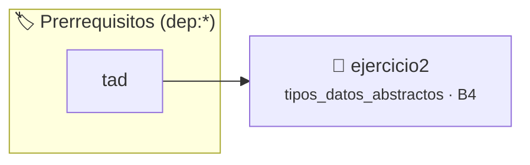

# TDA Duración (tiempo_t) — Cambio de Implementación
> **ID:** `ejercicio2` · **Unidad:** 4 (Tipos Abstractos y Algorítmica)
 · **Tema:** `tipos_datos_abstractos` / `tda`
 · **Bloom:** B4 (Analizar) · **Dificultad:** Avanzada
 · **Carga:** ~45 min · **Tipo:** Practica Guiada
>
> **🏷️ Prerrequisitos temáticos (tags):** `dep:tad`
>
> **Etiquetas conceptuales:** `tda`, `tiempo`, `duracion`, `invariantes`, `encapsulamiento_opaco`, `intercambiabilidad`


::: {admonition} 📦 Paquete de Verificación Local (Ripley)
:class: tip

Para compilar, resolver y autoevaluar tu entrega con pruebas unitarias en tu máquina:

- [📥 **Descargar paquete `ejercicio2.ripkg`**](../../paquetes/ejercicio2.ripkg)

Ejecución con el asistente de cátedra:
```bash
ripley run ejercicio2.ripkg
```
:::


### 🗺️ Itinerario Pedagógico




## 📖 Consigna

Para demostrar en la práctica que la interfaz independiza al cliente de la representación en memoria, se implementan dos variantes para un mismo archivo de cabecera `tiempo.h`.


- **Constructor:** `tiempo_t *tiempo_crear(unsigned int horas, unsigned int minutos, unsigned int segundos);` (admite excesos y los normaliza).
- **Destructor:** `void tiempo_destruir(tiempo_t *t);`
- **Selectores:**
  - `unsigned int tiempo_horas(const tiempo_t *t);`
  - `unsigned int tiempo_minutos(const tiempo_t *t);` (garantizado en $[0, 59]$).
  - `unsigned int tiempo_segundos(const tiempo_t *t);` (garantizado en $[0, 59]$).
- **Consultor:**
  - `unsigned long tiempo_en_segundos(const tiempo_t *t);`
- **Mutador:**
  - `void tiempo_incrementar(tiempo_t *t, unsigned int segundos_extra);`


1. **Implementación A (`tiempo_hms.c`):** Estructura desglosada en campos `horas`, `minutos` y `segundos`. Invariante: `t != NULL && t->minutos < 60 && t->segundos < 60`.
2. **Implementación B (`tiempo_seg.c`):** Estructura compacta almacenando únicamente `unsigned long seg_totales`. Invariante: `t != NULL`. Los selectores calculan su valor al vuelo con `/` y `%`.

### 📋 Contrato de las Funciones

```c
/*
 * Constructor con normalización de excesos.
 * Precondiciones: Parámetros dentro del dominio válido de la operación.
 * Postcondiciones: Retorna el valor procesado.
 */
tiempo_t * tiempo_crear(unsigned int horas, unsigned int minutos, unsigned int segundos);

/*
 * Destructor tolerante a NULL.
 * Precondiciones: Los punteros recibidos deben ser válidos y no nulos.
 * Postcondiciones: Modifica el estado de la estructura o buffer de manera segura.
 */
void tiempo_destruir(tiempo_t *t);

/*
 * Selector de cantidad de horas.
 * Precondiciones: Los punteros recibidos deben ser válidos y no nulos.
 * Postcondiciones: Modifica el estado de la estructura o buffer de manera segura.
 */
unsigned int tiempo_horas(const tiempo_t *t);

/*
 * Selector de cantidad de minutos en rango [0, 59].
 * Precondiciones: Los punteros recibidos deben ser válidos y no nulos.
 * Postcondiciones: Modifica el estado de la estructura o buffer de manera segura.
 */
unsigned int tiempo_minutos(const tiempo_t *t);

/*
 * Selector de cantidad de segundos en rango [0, 59].
 * Precondiciones: Los punteros recibidos deben ser válidos y no nulos.
 * Postcondiciones: Modifica el estado de la estructura o buffer de manera segura.
 */
unsigned int tiempo_segundos(const tiempo_t *t);

/*
 * Consultor de tiempo total acumulado en segundos.
 * Precondiciones: Los punteros recibidos deben ser válidos y no nulos.
 * Postcondiciones: Modifica el estado de la estructura o buffer de manera segura.
 */
unsigned long tiempo_en_segundos(const tiempo_t *t);

/*
 * Mutador que suma segundos extra y renormaliza.
 * Precondiciones: Los punteros recibidos deben ser válidos y no nulos.
 * Postcondiciones: Modifica el estado de la estructura o buffer de manera segura.
 */
void tiempo_incrementar(tiempo_t *t, unsigned int segundos_extra);

```

### 🧪 Ejemplos de Ejecución

::::{tab-set}
:::{tab-item} Operación típica
```text
ADD 10, ADD 20
Estructura con 2 elementos
```
:::
:::{tab-item} Colección vacía
```text
Consulta sobre estructura recién inicializada
Retorno seguro / estado vacío
```
:::
::::

### ⚠️ Precondiciones y Casos Borde

1. **Valores fuera de rango:** Verificar siempre que los datos de entrada cumplan con los rangos admisibles antes de operar.
2. **Punteros nulos:** Validar que los punteros recibidos no sean `NULL` para prevenir fallos de segmentación (*SIGSEGV*).
3. **Gestión de memoria:** Toda memoria solicitada mediante `malloc`/`calloc` debe ser validada y eventualmente liberada con `free`.
6. **Casos vacíos o neutros:** Contemplar adecuadamente entradas con longitud cero o valores neutros según corresponda.

### 🎯 Criterios de Aceptación

- [ ] El código compila limpiamente bajo estándar C11 sin warnings con flags estrictos (`-Wall -Wextra -Werror`).
- [ ] Se satisfacen todas las pruebas unitarias y casos de prueba provistos.
- [ ] Las funciones validan exhaustivamente sus precondiciones y gestionan casos borde de forma robusta.

:::{hint} Consideraciones Didácticas
- En tiempo_crear, normalizá excesos acumulando segundos hacia minutos y minutos hacia horas.
- Los selectores de minutos y segundos deben garantizar valores en el rango [0, 59].
- Para la implementación compacta tiempo_seg.c, calculá las componentes con división entera y módulo al vuelo.
- En tiempo_destruir, asegurate de tolerar punteros NULL sin fallar.
:::


## 📋 Prototipos y Cabecera (`tiempo.h`)

```{code-block} c
/**
 * @file tiempo.h
 * @brief TDA Duración de Tiempo con interfaz desacoplada de la representación.
 *
 * Trabajo Práctico 6 - Programación 1
 * Universidad Nacional de Río Negro - Ingeniería en Computación
 */

#ifndef TIEMPO_H
#define TIEMPO_H

#include <stdbool.h>

/**
 * @brief Tipo opaco que representa una duración temporal.
 */
typedef struct tiempo tiempo_t;

/**
 * @brief Crea una nueva instancia de tiempo_t.
 *
 * Reserva memoria dinámica e inicializa el objeto. Recibe horas, minutos
 * y segundos, normalizando internamente cualquier exceso (por ejemplo, 70 minutos
 * se convierten en 1 hora y 10 minutos).
 *
 * @param horas Cantidad inicial de horas.
 * @param minutos Cantidad inicial de minutos (admite valores >= 60).
 * @param segundos Cantidad inicial de segundos (admite valores >= 60).
 *
 * @return Puntero a la instancia tiempo_t creada dinámicamente en el heap,
 *         o NULL si falla la asignación de memoria o la validación del invariante.
 */
tiempo_t *tiempo_crear(unsigned int horas, unsigned int minutos, unsigned int segundos);

/**
 * @brief Libera la memoria reservada para una instancia de tiempo_t.
 *
 * @param t Puntero al tiempo a destruir. Si es NULL, la función no realiza ninguna acción.
 */
void tiempo_destruir(tiempo_t *t);

/**
 * @brief Obtiene la cantidad de horas de la duración.
 *
 * @param t Puntero a la estructura tiempo a consultar.
 *
 * @pre El puntero t no debe ser NULL.
 * @post La estructura t permanece inalterada.
 *
 * @return Cantidad de horas, o 0 si t es NULL.
 */
unsigned int tiempo_horas(const tiempo_t *t);

/**
 * @brief Obtiene la cantidad de minutos de la duración.
 *
 * @param t Puntero a la estructura tiempo a consultar.
 *
 * @return Cantidad de minutos en el rango garantizado [0, 59], o 0 si t es NULL.
 *
 * @pre El puntero t no debe ser NULL.
 * @post La estructura t permanece inalterada.
 */
unsigned int tiempo_minutos(const tiempo_t *t);

/**
 * @brief Obtiene la cantidad de segundos de la duración.
 *
 * @param t Puntero a la estructura tiempo a consultar.
 *
 * @return Cantidad de segundos en el rango garantizado [0, 59], o 0 si t es NULL.
 *
 * @pre El puntero t no debe ser NULL.
 * @post La estructura t permanece inalterada.
 */
unsigned int tiempo_segundos(const tiempo_t *t);

/**
 * @brief Calcula la duración total expresada íntegramente en segundos.
 *
 * @param t Puntero a la estructura tiempo a consultar.
 *
 * @return Total de segundos equivalentes a la duración, o 0 si t es NULL.
 *
 * @pre El puntero t no debe ser NULL.
 * @post La estructura t permanece inalterada.
 */
unsigned long tiempo_en_segundos(const tiempo_t *t);

/**
 * @brief Incrementa la duración sumando una cantidad dada de segundos.
 *
 * Suma los segundos recibidos y normaliza la estructura resultante para
 * garantizar que los minutos y segundos se mantengan dentro del rango [0, 59].
 *
 * @param t Puntero al tiempo a modificar.
 * @param segundos_extra Cantidad de segundos a incrementar.
 *
 * @pre El puntero t no debe ser NULL.
 * @post Si t no es NULL, la estructura t queda actualizada y mantiene su invariante.
 */
void tiempo_incrementar(tiempo_t *t, unsigned int segundos_extra);

#endif /* TIEMPO_H */
```


## ⚙️ Especificación de Funciones

| Función | Retorno | Parámetros | Descripción |
| :--- | :--- | :--- | :--- |

| `tiempo_crear` | `tiempo_t *` | `unsigned int horas, unsigned int minutos, unsigned int segundos` | Constructor con normalización de excesos. |

| `tiempo_destruir` | `void` | `tiempo_t *t` | Destructor tolerante a NULL. |

| `tiempo_horas` | `unsigned int` | `const tiempo_t *t` | Selector de cantidad de horas. |

| `tiempo_minutos` | `unsigned int` | `const tiempo_t *t` | Selector de cantidad de minutos en rango [0, 59]. |

| `tiempo_segundos` | `unsigned int` | `const tiempo_t *t` | Selector de cantidad de segundos en rango [0, 59]. |

| `tiempo_en_segundos` | `unsigned long` | `const tiempo_t *t` | Consultor de tiempo total acumulado en segundos. |

| `tiempo_incrementar` | `void` | `tiempo_t *t, unsigned int segundos_extra` | Mutador que suma segundos extra y renormaliza. |


## 💡 Pistas Progresivas

````{tab-set}

```{tab-item} Pista 1
En tiempo_crear, normalizá excesos acumulando segundos hacia minutos y minutos hacia horas.
```

```{tab-item} Pista 2
Los selectores de minutos y segundos deben garantizar valores en el rango [0, 59].
```

```{tab-item} Pista 3
Para la implementación compacta tiempo_seg.c, calculá las componentes con división entera y módulo al vuelo.
```

```{tab-item} Pista 4
En tiempo_destruir, asegurate de tolerar punteros NULL sin fallar.
```

````


## 🧪 Casos de Prueba

| Prueba Unitaria | Función Objetivo | Verificación |
| :--- | :--- | :--- |

| **test_tiempo_crear_normalizar** | `tiempo_crear` | `tiempo_t *t = tiempo_crear(1, 70, 90); assert(t != NULL); assert(tiempo_horas(t) == 2); assert(tiempo_minutos(t) == 11); assert(tiempo_segundos(t) == 30); tiempo_destruir(t);` |

| **test_tiempo_incrementar** | `tiempo_incrementar` | `tiempo_t *t = tiempo_crear(1, 59, 50); assert(t != NULL); tiempo_incrementar(t, 20); assert(tiempo_horas(t) == 2); assert(tiempo_minutos(t) == 0); assert(tiempo_segundos(t) == 10); tiempo_destruir(t);` |


## ✓ Solución Modelo de Cátedra

```{dropdown} 🔍 Revelar solución canónica en C
:open: false

```{code-block} c
/**
 * @file solucion.c
 * @brief Implementación de referencia canónica: TDA Duración (tiempo_t).
 */

#include <stdio.h>
#include <stdlib.h>
#include <stdbool.h>
#include <string.h>
#include "tiempo.h"

struct tiempo
{
    unsigned int horas;
    unsigned int minutos;
    unsigned int segundos;
};

static bool tiempo_invariante(const tiempo_t *t)
{
    if (t == NULL)
    {
        return false;
    }
    return (t->minutos < 60) && (t->segundos < 60);
}

tiempo_t *tiempo_crear(unsigned int horas, unsigned int minutos, unsigned int segundos)
{
    tiempo_t *t = (tiempo_t *)malloc(sizeof(struct tiempo));
    if (t == NULL)
    {
        return NULL;
    }

    minutos += segundos / 60;
    segundos = segundos % 60;
    horas += minutos / 60;
    minutos = minutos % 60;

    t->horas = horas;
    t->minutos = minutos;
    t->segundos = segundos;

    if (!tiempo_invariante(t))
    {
        free(t);
        return NULL;
    }

    return t;
}

void tiempo_destruir(tiempo_t *t)
{
    if (t != NULL)
    {
        free(t);
    }
}

unsigned int tiempo_horas(const tiempo_t *t)
{
    if (t == NULL)
    {
        return 0;
    }
    return t->horas;
}

unsigned int tiempo_minutos(const tiempo_t *t)
{
    if (t == NULL)
    {
        return 0;
    }
    return t->minutos;
}

unsigned int tiempo_segundos(const tiempo_t *t)
{
    if (t == NULL)
    {
        return 0;
    }
    return t->segundos;
}

unsigned long tiempo_en_segundos(const tiempo_t *t)
{
    if (t == NULL)
    {
        return 0;
    }
    return ((unsigned long)t->horas * 3600) + ((unsigned long)t->minutos * 60) + t->segundos;
}

void tiempo_incrementar(tiempo_t *t, unsigned int segundos_extra)
{
    if (t != NULL)
    {
        t->segundos += segundos_extra;
        t->minutos += t->segundos / 60;
        t->segundos = t->segundos % 60;
        t->horas += t->minutos / 60;
        t->minutos = t->minutos % 60;
    }
}

int main(void)
{
    char cmd[32];
    while (scanf("%31s", cmd) == 1)
    {
        if (strcmp(cmd, "CREAR") == 0)
        {
            unsigned int h = 0;
            unsigned int m = 0;
            unsigned int s = 0;
            if (scanf("%u %u %u", &h, &m, &s) == 3)
            {
                tiempo_t *t = tiempo_crear(h, m, s);
                if (t != NULL)
                {
                    printf("OK %02u:%02u:%02u (total: %lu s)\n",
                           tiempo_horas(t), tiempo_minutos(t), tiempo_segundos(t),
                           tiempo_en_segundos(t));
                    tiempo_destruir(t);
                }
                else
                {
                    printf("ERROR\n");
                }
            }
        }
        else if (strcmp(cmd, "INC") == 0)
        {
            unsigned int h = 0;
            unsigned int m = 0;
            unsigned int s = 0;
            unsigned int extra = 0;
            if (scanf("%u %u %u %u", &h, &m, &s, &extra) == 4)
            {
                tiempo_t *t = tiempo_crear(h, m, s);
                if (t != NULL)
                {
                    tiempo_incrementar(t, extra);
                    printf("OK %02u:%02u:%02u (total: %lu s)\n",
                           tiempo_horas(t), tiempo_minutos(t), tiempo_segundos(t),
                           tiempo_en_segundos(t));
                    tiempo_destruir(t);
                }
                else
                {
                    printf("ERROR\n");
                }
            }
        }
        else if (strcmp(cmd, "SALIR") == 0)
        {
            break;
        }
    }
    return 0;
}
```
```
