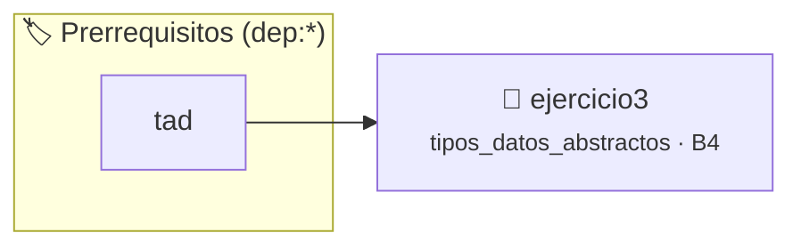

# TDA Conjunto de Enteros (conjunto_t) — Invariante de Unicidad
> **ID:** `ejercicio3` · **Unidad:** 4 (Tipos Abstractos y Algorítmica)
 · **Tema:** `tipos_datos_abstractos` / `tda`
 · **Bloom:** B4 (Analizar) · **Dificultad:** Avanzada
 · **Carga:** ~45 min · **Tipo:** Practica Guiada
>
> **🏷️ Prerrequisitos temáticos (tags):** `dep:tad`
>
> **Etiquetas conceptuales:** `tda`, `conjunto`, `invariantes`, `unicidad`, `idempotencia`, `encapsulamiento_opaco`


::: {admonition} 📦 Paquete de Verificación Local (Ripley)
:class: tip

Para compilar, resolver y autoevaluar tu entrega con pruebas unitarias en tu máquina:

- [📥 **Descargar paquete `ejercicio3.ripkg`**](../../paquetes/ejercicio3.ripkg)

Ejecución con el asistente de cátedra:
```bash
ripley run ejercicio3.ripkg
```
:::


### 🗺️ Itinerario Pedagógico




## 📖 Consigna

# Ejercicio 3: TDA Conjunto de Enteros (`conjunto_t`) — Invariante de Unicidad

Implementar un Tipo de Dato Abstracto que modele un conjunto matemático finito de números enteros con capacidad máxima establecida al crearse. En un conjunto no existen elementos repetidos ni importa el orden de inserción.

## 1. El Invariante de Representación

En `conjunto.c`, la función `static bool conjunto_invariante(const conjunto_t *c)` debe verificar:
1. `c != NULL`.
2. `c->elementos != NULL`.
3. `c->cardinal <= c->capacidad`.
4. Invariante de unicidad: para todo par de índices válidos $0 \le i < j < \text{cardinal}$, se cumple que `c->elementos[i] != c->elementos[j]`.

## 2. Interfaz requerida (`conjunto.h`)

- **Constructor:** `conjunto_t *conjunto_crear(size_t capacidad);`
- **Destructor:** `void conjunto_destruir(conjunto_t *c);`
- **Consultores:**
  - `size_t conjunto_cardinal(const conjunto_t *c);`
  - `bool conjunto_esta_vacio(const conjunto_t *c);`
  - `bool conjunto_pertenece(const conjunto_t *c, int elemento);`
  - `bool conjunto_es_subconjunto(const conjunto_t *a, const conjunto_t *b);`
- **Mutadores:**
  - `bool conjunto_agregar(conjunto_t *c, int elemento);` (idempotente: si ya existe retorna true sin duplicar; retorna false si está lleno).
  - `bool conjunto_eliminar(conjunto_t *c, int elemento);` (mantiene contigüidad por corrimiento).
- **Operaciones:**
  - `conjunto_t *conjunto_union(const conjunto_t *a, const conjunto_t *b);`
  - `conjunto_t *conjunto_interseccion(const conjunto_t *a, const conjunto_t *b);`


## 📋 Prototipos y Cabecera (`conjunto.h`)

```{code-block} c
/**
 * @file conjunto.h
 * @brief TDA Conjunto Finito de Enteros con invariante de unicidad.
 *
 * Trabajo Práctico 6 - Programación 1
 * Universidad Nacional de Río Negro - Ingeniería en Computación
 */

#ifndef CONJUNTO_H
#define CONJUNTO_H

#include <stdbool.h>
#include <stddef.h>

/**
 * @brief Tipo opaco que representa un conjunto matemático finito de números enteros.
 */
typedef struct conjunto conjunto_t;

/**
 * @brief Crea una nueva instancia de un conjunto matemático de enteros.
 *
 * Reserva memoria dinámica tanto para la estructura del conjunto como para su
 * arreglo interno de elementos con la capacidad especificada.
 *
 * @param capacidad Capacidad máxima de elementos que podrá almacenar el conjunto.
 *
 * @return Puntero a la instancia conjunto_t creada en memoria dinámica,
 *         o NULL si falla la asignación de memoria o si la capacidad es 0.
 */
conjunto_t *conjunto_crear(size_t capacidad);

/**
 * @brief Libera toda la memoria dinámica asociada a un conjunto.
 *
 * Libera tanto el arreglo dinámico interno como la estructura principal del conjunto.
 * Si c es NULL, no realiza ninguna acción.
 *
 * @param c Puntero al conjunto a destruir.
 */
void conjunto_destruir(conjunto_t *c);

/**
 * @brief Obtiene la cantidad actual de elementos en el conjunto.
 *
 * @param c Puntero al conjunto a consultar.
 *
 * @return Cantidad de elementos almacenados (cardinal), o 0 si c es NULL.
 */
size_t conjunto_cardinal(const conjunto_t *c);

/**
 * @brief Determina si el conjunto no contiene elementos.
 *
 * @param c Puntero al conjunto a consultar.
 *
 * @return true si el conjunto tiene cardinal 0; false si tiene al menos un elemento o si c es NULL.
 */
bool conjunto_esta_vacio(const conjunto_t *c);

/**
 * @brief Consulta la presencia de un elemento dentro del conjunto.
 *
 * @param c Puntero al conjunto a consultar.
 * @param elemento Valor entero a buscar.
 *
 * @return true si el elemento pertenece al conjunto; false en caso contrario o si c es NULL.
 */
bool conjunto_pertenece(const conjunto_t *c, int elemento);

/**
 * @brief Evalúa si el conjunto a es subconjunto del conjunto b (A ⊆ B).
 *
 * Verifica si cada uno de los elementos almacenados en a pertenece también a b.
 *
 * @param a Puntero al conjunto candidato a subconjunto.
 * @param b Puntero al conjunto contenedor.
 *
 * @return true si todos los elementos de a pertenecen a b; false en caso contrario
 *         o si alguno de los punteros es NULL.
 */
bool conjunto_es_subconjunto(const conjunto_t *a, const conjunto_t *b);

/**
 * @brief Agrega un elemento al conjunto respetando el invariante de unicidad.
 *
 * Si el elemento ya pertenece al conjunto, la operación tiene éxito sin duplicarlo.
 * Si el elemento no estaba, se inserta en la posición actual del cardinal.
 *
 * @param c Puntero al conjunto a modificar.
 * @param elemento Valor entero a insertar.
 *
 * @return true si el elemento ya pertenecía o si fue agregado con éxito;
 *         false si c es NULL o si el conjunto alcanzó su capacidad máxima.
 */
bool conjunto_agregar(conjunto_t *c, int elemento);

/**
 * @brief Elimina un elemento del conjunto manteniendo los elementos restantes contiguos.
 *
 * Si el elemento pertenece al conjunto, realiza un corrimiento a la izquierda
 * de los elementos posteriores para evitar dejar huecos en la memoria.
 *
 * @param c Puntero al conjunto a modificar.
 * @param elemento Valor entero a eliminar.
 *
 * @return true si el elemento fue eliminado; false si c es NULL o si el elemento no pertenecía.
 */
bool conjunto_eliminar(conjunto_t *c, int elemento);

/**
 * @brief Construye un nuevo conjunto resultado de la unión entre a y b (A ∪ B).
 *
 * Crea una nueva instancia de conjunto_t con capacidad suficiente para albergar
 * todos los elementos posibles e inserta sin duplicar los elementos de a y b.
 *
 * @param a Puntero al primer conjunto.
 * @param b Puntero al segundo conjunto.
 *
 * @return Puntero a la nueva instancia conjunto_t con la unión, o NULL si falla
 *         la reserva de memoria o si alguno de los parámetros es NULL.
 */
conjunto_t *conjunto_union(const conjunto_t *a, const conjunto_t *b);

/**
 * @brief Construye un nuevo conjunto resultado de la intersección entre a y b (A ∩ B).
 *
 * Crea una nueva instancia con los elementos presentes simultáneamente en a y b.
 *
 * @param a Puntero al primer conjunto.
 * @param b Puntero al segundo conjunto.
 *
 * @return Puntero a la nueva instancia conjunto_t con la intersección, o NULL
 *         si falla la asignación de memoria o si alguno de los parámetros es NULL.
 */
conjunto_t *conjunto_interseccion(const conjunto_t *a, const conjunto_t *b);

#endif /* CONJUNTO_H */
```


## ⚙️ Especificación de Funciones

| Función | Retorno | Parámetros | Descripción |
| :--- | :--- | :--- | :--- |

| `conjunto_crear` | `conjunto_t *` | `size_t capacidad` | Constructor de conjunto con capacidad máxima. |

| `conjunto_destruir` | `void` | `conjunto_t *c` | Destructor tolerante a NULL. |

| `conjunto_cardinal` | `size_t` | `const conjunto_t *c` | Consultor de cantidad actual de elementos únicos. |

| `conjunto_esta_vacio` | `bool` | `const conjunto_t *c` | Consultor booleano de conjunto vacío. |

| `conjunto_pertenece` | `bool` | `const conjunto_t *c, int elemento` | Consultor de pertenencia de elemento en el conjunto. |

| `conjunto_es_subconjunto` | `bool` | `const conjunto_t *a, const conjunto_t *b` | Consultor de inclusión A subconjunto B. |

| `conjunto_agregar` | `bool` | `conjunto_t *c, int elemento` | Mutador de inserción idempotente respetando unicidad. |

| `conjunto_eliminar` | `bool` | `conjunto_t *c, int elemento` | Mutador de eliminación manteniendo contigüidad. |

| `conjunto_union` | `conjunto_t *` | `const conjunto_t *a, const conjunto_t *b` | Constructor derivado de unión de conjuntos. |

| `conjunto_interseccion` | `conjunto_t *` | `const conjunto_t *a, const conjunto_t *b` | Constructor derivado de intersección de conjuntos. |


## 💡 Pistas Progresivas

````{tab-set}

```{tab-item} Pista 1
El invariante de representación exige verificar unicidad: ningún par de elementos distintos puede ser igual.
```

```{tab-item} Pista 2
En conjunto_agregar, si el elemento ya pertenece, la operación retorna true de forma idempotente sin duplicar.
```

```{tab-item} Pista 3
En conjunto_eliminar, al hallar el elemento se realiza un corrimiento a la izquierda para mantener la contigüidad.
```

```{tab-item} Pista 4
El conjunto vacío es subconjunto de cualquier conjunto, cumpliendo la definición matemática de inclusión.
```

````


## 🧪 Casos de Prueba

| Prueba Unitaria | Función Objetivo | Verificación |
| :--- | :--- | :--- |

| **test_conjunto_crear_agregar** | `conjunto_crear` | `conjunto_t *c = conjunto_crear(3); assert(c != NULL); assert(conjunto_esta_vacio(c)); assert(conjunto_agregar(c, 10)); assert(conjunto_agregar(c, 10)); assert(conjunto_cardinal(c) == 1); conjunto_destruir(c);` |

| **test_conjunto_eliminar** | `conjunto_eliminar` | `conjunto_t *c = conjunto_crear(3); assert(c != NULL); conjunto_agregar(c, 10); conjunto_agregar(c, 20); assert(conjunto_eliminar(c, 10)); assert(!conjunto_pertenece(c, 10)); assert(conjunto_cardinal(c) == 1); conjunto_destruir(c);` |


## ✓ Solución Modelo de Cátedra

```{dropdown} 🔍 Revelar solución canónica en C
:open: false

```{code-block} c
/**
 * @file solucion.c
 * @brief Implementación de referencia canónica: TDA Conjunto (conjunto_t).
 */

#include <stdio.h>
#include <stdlib.h>
#include <stdbool.h>
#include <string.h>
#include "conjunto.h"

struct conjunto
{
    int *elementos;
    size_t capacidad;
    size_t cardinal;
};

static bool verificar_unicidad(const int *elementos, size_t cardinal)
{
    if (elementos == NULL && cardinal > 0)
    {
        return false;
    }
    for (size_t i = 0; i < cardinal; i++)
    {
        for (size_t j = i + 1; j < cardinal; j++)
        {
            if (elementos[i] == elementos[j])
            {
                return false;
            }
        }
    }
    return true;
}

static bool conjunto_invariante(const conjunto_t *c)
{
    if (c == NULL || c->elementos == NULL || c->cardinal > c->capacidad)
    {
        return false;
    }
    return verificar_unicidad(c->elementos, c->cardinal);
}

conjunto_t *conjunto_crear(size_t capacidad)
{
    if (capacidad == 0)
    {
        return NULL;
    }

    conjunto_t *c = (conjunto_t *)malloc(sizeof(struct conjunto));
    if (c == NULL)
    {
        return NULL;
    }

    int *arreglo = (int *)malloc(capacidad * sizeof(int));
    if (arreglo == NULL)
    {
        free(c);
        return NULL;
    }

    c->elementos = arreglo;
    c->capacidad = capacidad;
    c->cardinal = 0;

    if (!conjunto_invariante(c))
    {
        free(arreglo);
        free(c);
        return NULL;
    }

    return c;
}

void conjunto_destruir(conjunto_t *c)
{
    if (c != NULL)
    {
        free(c->elementos);
        free(c);
    }
}

size_t conjunto_cardinal(const conjunto_t *c)
{
    if (c == NULL)
    {
        return 0;
    }
    return c->cardinal;
}

bool conjunto_esta_vacio(const conjunto_t *c)
{
    if (c == NULL)
    {
        return false;
    }
    return c->cardinal == 0;
}

bool conjunto_pertenece(const conjunto_t *c, int elemento)
{
    if (c == NULL || c->elementos == NULL)
    {
        return false;
    }
    for (size_t i = 0; i < c->cardinal; i++)
    {
        if (c->elementos[i] == elemento)
        {
            return true;
        }
    }
    return false;
}

bool conjunto_es_subconjunto(const conjunto_t *a, const conjunto_t *b)
{
    if (a == NULL || b == NULL)
    {
        return false;
    }
    if (a->cardinal > b->cardinal)
    {
        return false;
    }
    for (size_t i = 0; i < a->cardinal; i++)
    {
        if (!conjunto_pertenece(b, a->elementos[i]))
        {
            return false;
        }
    }
    return true;
}

bool conjunto_agregar(conjunto_t *c, int elemento)
{
    if (c == NULL || c->elementos == NULL)
    {
        return false;
    }
    if (conjunto_pertenece(c, elemento))
    {
        return true;
    }
    if (c->cardinal >= c->capacidad)
    {
        return false;
    }
    c->elementos[c->cardinal] = elemento;
    c->cardinal++;
    return true;
}

bool conjunto_eliminar(conjunto_t *c, int elemento)
{
    if (c == NULL || c->elementos == NULL)
    {
        return false;
    }
    size_t idx = 0;
    bool encontrado = false;
    for (size_t i = 0; i < c->cardinal; i++)
    {
        if (c->elementos[i] == elemento)
        {
            idx = i;
            encontrado = true;
            break;
        }
    }
    if (!encontrado)
    {
        return false;
    }
    for (size_t i = idx; i + 1 < c->cardinal; i++)
    {
        c->elementos[i] = c->elementos[i + 1];
    }
    c->cardinal--;
    return true;
}

conjunto_t *conjunto_union(const conjunto_t *a, const conjunto_t *b)
{
    if (a == NULL || b == NULL)
    {
        return NULL;
    }
    conjunto_t *u = conjunto_crear(a->capacidad + b->capacidad);
    if (u == NULL)
    {
        return NULL;
    }
    for (size_t i = 0; i < a->cardinal; i++)
    {
        conjunto_agregar(u, a->elementos[i]);
    }
    for (size_t i = 0; i < b->cardinal; i++)
    {
        conjunto_agregar(u, b->elementos[i]);
    }
    return u;
}

conjunto_t *conjunto_interseccion(const conjunto_t *a, const conjunto_t *b)
{
    if (a == NULL || b == NULL)
    {
        return NULL;
    }
    size_t cap = a->capacidad < b->capacidad ? a->capacidad : b->capacidad;
    if (cap == 0)
    {
        cap = 1;
    }
    conjunto_t *inter = conjunto_crear(cap);
    if (inter == NULL)
    {
        return NULL;
    }
    for (size_t i = 0; i < a->cardinal; i++)
    {
        if (conjunto_pertenece(b, a->elementos[i]))
        {
            conjunto_agregar(inter, a->elementos[i]);
        }
    }
    return inter;
}

int main(void)
{
    char cmd[32];
    conjunto_t *actual = NULL;

    while (scanf("%31s", cmd) == 1)
    {
        if (strcmp(cmd, "CREAR") == 0)
        {
            size_t cap = 0;
            if (scanf("%zu", &cap) == 1)
            {
                if (actual != NULL)
                {
                    conjunto_destruir(actual);
                }
                actual = conjunto_crear(cap);
                if (actual != NULL)
                {
                    printf("OK\n");
                }
                else
                {
                    printf("ERROR\n");
                }
            }
        }
        else if (strcmp(cmd, "AGREGAR") == 0)
        {
            int val = 0;
            if (scanf("%d", &val) == 1)
            {
                if (actual == NULL)
                {
                    printf("ERROR\n");
                }
                else if (conjunto_agregar(actual, val))
                {
                    printf("OK\n");
                }
                else
                {
                    printf("LLENO\n");
                }
            }
        }
        else if (strcmp(cmd, "ELIMINAR") == 0)
        {
            int val = 0;
            if (scanf("%d", &val) == 1)
            {
                if (actual == NULL)
                {
                    printf("ERROR\n");
                }
                else if (conjunto_eliminar(actual, val))
                {
                    printf("OK\n");
                }
                else
                {
                    printf("NO_EXISTE\n");
                }
            }
        }
        else if (strcmp(cmd, "PERTENECE") == 0)
        {
            int val = 0;
            if (scanf("%d", &val) == 1)
            {
                if (actual == NULL)
                {
                    printf("ERROR\n");
                }
                else
                {
                    printf("%s\n", conjunto_pertenece(actual, val) ? "SI" : "NO");
                }
            }
        }
        else if (strcmp(cmd, "CARDINAL") == 0)
        {
            if (actual == NULL)
            {
                printf("ERROR\n");
            }
            else
            {
                printf("%zu\n", conjunto_cardinal(actual));
            }
        }
        else if (strcmp(cmd, "VACIO") == 0)
        {
            if (actual == NULL)
            {
                printf("ERROR\n");
            }
            else
            {
                printf("%s\n", conjunto_esta_vacio(actual) ? "SI" : "NO");
            }
        }
        else if (strcmp(cmd, "SALIR") == 0)
        {
            break;
        }
    }

    if (actual != NULL)
    {
        conjunto_destruir(actual);
    }
    return 0;
}
```
```
