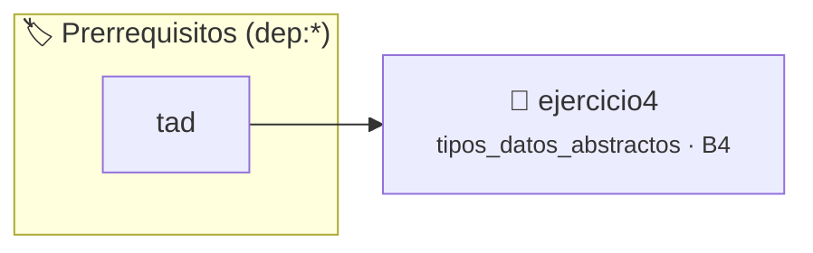

# TDA Secuencia (secuencia_t) — Arreglo Dinámico vs Lista Enlazada
> **ID:** `ejercicio4`
 · **Tema:** `tipos_datos_abstractos`
 · **Bloom:** B4 (Analizar)
 · **Carga:** ~60 min
>
> **🏷️ Prerrequisitos temáticos (tags):** `dep:tad`
>
> **Etiquetas conceptuales:** `tda`, `secuencia`, `lista_enlazada`, `arreglo_dinamico`, `intercambiabilidad`, `encapsulamiento_opaco`


::: {admonition} 📦 Paquete de Verificación Local (Ripley)
:class: tip

Para compilar, resolver y autoevaluar tu entrega con pruebas unitarias en tu máquina:

- [📥 **Descargar paquete `ejercicio4.ripkg`**](../../paquetes/ejercicio4.ripkg)

Ejecución con el asistente de cátedra:
```bash
ripley run ejercicio4.ripkg
```
:::


### 🗺️ Itinerario Pedagógico




## 📖 Consigna

# Ejercicio 4: TDA Secuencia (`secuencia_t`) — Intercambiabilidad Arreglo / Lista Enlazada

Se desea modelar un Tipo de Dato Abstracto general de secuencia lineal de enteros que permita acceso posicional e inserciones/eliminaciones intermedias.

## 1. Interfaz requerida (`secuencia.h`)

- **Constructor:** `secuencia_t *secuencia_crear(size_t capacidad);`
- **Destructor:** `void secuencia_destruir(secuencia_t *s);`
- **Selector:** `bool secuencia_obtener(const secuencia_t *sec, size_t indice, int *destino);`
- **Consultores:**
  - `size_t secuencia_largo(const secuencia_t *sec);`
  - `bool secuencia_esta_vacia(const secuencia_t *sec);`
- **Mutadores:**
  - `bool secuencia_insertar(secuencia_t *sec, size_t pos, int valor);`
  - `bool secuencia_eliminar(secuencia_t *sec, size_t pos, int *dato_extraido);`
- **Conversor:**
  - `char *secuencia_a_cadena(const secuencia_t *sec);` (formato `"[10, 20, 30]"` en heap, `free()` a cargo del llamador).

## 2. Dos implementaciones intercambiables

1. **Implementación sobre Arreglo Dinámico (`secuencia_arreglo.c`):** Almacena los datos en memoria contigua (`int *datos`, `size_t cantidad`, `size_t capacidad`). Invariante: `s != NULL && s->datos != NULL && s->capacidad > 0 && s->cantidad <= s->capacidad`.
2. **Implementación sobre Lista Enlazada (`secuencia_lista.c`):** Almacena los datos mediante una cadena de nodos simples (`struct nodo { int valor; struct nodo *siguiente; }`). Invariante: `s != NULL && s->capacidad > 0 && s->cantidad <= s->capacidad` y la cantidad de nodos coincide con `s->cantidad`.


## 📋 Prototipos y Cabecera (`secuencia.h`)

```{code-block} c
/**
 * @file secuencia.h
 * @brief TDA Secuencia Lineal Indexada con implementaciones intercambiables.
 *
 * Trabajo Práctico 6 - Programación 1
 * Universidad Nacional de Río Negro - Ingeniería en Computación
 */

#ifndef SECUENCIA_H
#define SECUENCIA_H

#include <stdbool.h>
#include <stddef.h>

/**
 * @brief Tipo opaco que representa una secuencia lineal finita de enteros.
 */
typedef struct secuencia secuencia_t;

/**
 * @brief Crea e inicializa una nueva secuencia en memoria dinámica.
 *
 * Reserva memoria para la estructura principal secuencia_t y para el arreglo contiguo de
 * enteros en el heap de acuerdo con la capacidad solicitada.
 *
 * @param capacidad Capacidad máxima de elementos que podrá albergar la secuencia.
 *
 * @return Puntero a la nueva secuencia creada, o NULL si la capacidad indicada es 0
 *         o si falla cualquier reserva de memoria dinámica.
 */
secuencia_t *secuencia_crear(size_t capacidad);

/**
 * @brief Libera toda la memoria dinámica ocupada por una secuencia.
 *
 * Libera el arreglo dinámico interno de elementos y la estructura contenedora de la secuencia.
 * Si el puntero recibido es NULL, la función no realiza ninguna acción.
 *
 * @param s Puntero a la secuencia a liberar.
 */
void secuencia_destruir(secuencia_t *s);

/**
 * @brief Lee el elemento almacenado en una posición específica de la secuencia sin modificarla.
 *
 * Comprueba que la posición consultada esté dentro del rango activo de la secuencia y copia
 * el valor encontrado en la dirección de memoria apuntada por destino.
 *
 * @param sec Puntero constante a la secuencia a consultar.
 * @param indice Índice a leer (debe ser estrictamente menor al largo actual).
 * @param destino Puntero a la variable entera donde se guardará el valor recuperado.
 *
 * @return true si el índice es válido y la copia fue exitosa; false si sec o destino son NULL
 *         o si el índice está fuera del rango válido.
 */
bool secuencia_obtener(const secuencia_t *sec, size_t indice, int *destino);

/**
 * @brief Obtiene la cantidad actual de elementos almacenados en la secuencia.
 *
 * @param sec Puntero constante a la secuencia a consultar.
 *
 * @return Cantidad de elementos almacenados actualmente (largo), o 0 si sec es NULL.
 */
size_t secuencia_largo(const secuencia_t *sec);

/**
 * @brief Evalúa si la secuencia carece de elementos.
 *
 * @param sec Puntero constante a la secuencia a consultar.
 *
 * @return true si el largo de la secuencia es 0; false si contiene al menos un elemento
 *         o si sec es NULL.
 */
bool secuencia_esta_vacia(const secuencia_t *sec);

/**
 * @brief Inserta un entero en la posición indicada desplazando los elementos preexistentes.
 *
 * Realiza un corrimiento hacia la derecha de los elementos a partir del índice pos para liberar
 * la celda e insertar el nuevo valor sin perder información.
 *
 * @param sec Puntero a la secuencia a modificar.
 * @param pos Índice donde se ubicará el nuevo elemento.
 * @param valor Entero a insertar.
 *
 * @return true si la inserción se completó con éxito; false si sec es NULL, si se alcanzó
 *         la capacidad máxima de la secuencia o si la posición supera el largo actual.
 *
 * @post Si la operación tiene éxito, la cantidad de elementos de la secuencia aumenta en 1.
 */
bool secuencia_insertar(secuencia_t *sec, size_t pos, int valor);

/**
 * @brief Extrae y elimina el elemento ubicado en una posición dada.
 *
 * Copia el valor del elemento removido en la dirección apuntada por dato_extraido y desplaza
 * a la izquierda todos los elementos posteriores para mantener la contigüidad de la memoria.
 *
 * @param sec Puntero a la secuencia a modificar.
 * @param pos Índice del elemento a eliminar.
 * @param dato_extraido Puntero a la variable donde se almacenará el valor removido.
 *
 * @return true si el elemento fue extraído y borrado; false si sec o dato_extraido son NULL
 *         o si pos está fuera del rango válido de elementos.
 */
bool secuencia_eliminar(secuencia_t *sec, size_t pos, int *dato_extraido);

/**
 * @brief Genera una representación de texto con los elementos de la secuencia.
 *
 * Formatea el contenido de la secuencia en una cadena de caracteres dinámica con la forma
 * "[10, 20, 30]". El llamador es responsable de liberar la memoria del string resultante.
 *
 * @param sec Puntero constante a la secuencia a convertir.
 *
 * @return Puntero a la cadena alojada en el heap, o NULL si sec es NULL o si falla malloc.
 */
char *secuencia_a_cadena(const secuencia_t *sec);

#endif /* SECUENCIA_H */
```


## ⚙️ Especificación de Funciones

| Función | Retorno | Parámetros | Descripción |
| :--- | :--- | :--- | :--- |

| `secuencia_crear` | `secuencia_t *` | `size_t capacidad` | Constructor de secuencia con capacidad máxima. |

| `secuencia_destruir` | `void` | `secuencia_t *s` | Destructor tolerante a NULL. |

| `secuencia_obtener` | `bool` | `const secuencia_t *sec, size_t indice, int *destino` | Selector por índice posicional. |

| `secuencia_largo` | `size_t` | `const secuencia_t *sec` | Consultor de cantidad actual de elementos. |

| `secuencia_esta_vacia` | `bool` | `const secuencia_t *sec` | Consultor booleano de secuencia vacía. |

| `secuencia_insertar` | `bool` | `secuencia_t *sec, size_t pos, int valor` | Mutador de inserción en posición específica. |

| `secuencia_eliminar` | `bool` | `secuencia_t *sec, size_t pos, int *dato_extraido` | Mutador de extracción y eliminación posicional. |

| `secuencia_a_cadena` | `char *` | `const secuencia_t *sec` | Conversor a representación textual en heap [10, 20, 30]. |


## 💡 Pistas Progresivas

````{tab-set}

```{tab-item} Pista 1
En secuencia_crear, una capacidad de 0 debe retornar NULL.
```

```{tab-item} Pista 2
En secuencia_insertar, recordá verificar que pos <= cantidad y que cantidad < capacidad.
```

```{tab-item} Pista 3
En secuencia_eliminar, extraé el valor y compactá hacia la izquierda o reconectá nodos según la representación.
```

```{tab-item} Pista 4
En secuencia_a_cadena, formateá la salida exacta como [10, 20, 30] en heap y devolvé [] para secuencias vacías.
```

````


## 🧪 Casos de Prueba

| Prueba Unitaria | Función Objetivo | Verificación |
| :--- | :--- | :--- |

| **test_secuencia_crear_insertar** | `secuencia_crear` | `secuencia_t *sec = secuencia_crear(3); assert(sec != NULL); assert(secuencia_esta_vacia(sec)); assert(secuencia_insertar(sec, 0, 10)); assert(secuencia_insertar(sec, 1, 20)); assert(secuencia_largo(sec) == 2); secuencia_destruir(sec);` |

| **test_secuencia_eliminar** | `secuencia_eliminar` | `secuencia_t *sec = secuencia_crear(3); assert(sec != NULL); secuencia_insertar(sec, 0, 10); secuencia_insertar(sec, 1, 20); int ext = 0; assert(secuencia_eliminar(sec, 0, &ext)); assert(ext == 10); assert(secuencia_largo(sec) == 1); secuencia_destruir(sec);` |


## ✓ Solución Modelo de Cátedra

```{dropdown} 🔍 Revelar solución canónica en C
:open: false

```{code-block} c
/**
 * @file solucion.c
 * @brief Implementación de referencia canónica: TDA Secuencia (secuencia_t).
 */

#include <stdio.h>
#include <stdlib.h>
#include <stdbool.h>
#include <string.h>
#include "secuencia.h"

struct secuencia
{
    int *datos;
    size_t cantidad;
    size_t capacidad;
};

static bool secuencia_invariante(const secuencia_t *s)
{
    return (s != NULL && s->datos != NULL && s->capacidad > 0 && s->cantidad <= s->capacidad);
}

secuencia_t *secuencia_crear(size_t capacidad)
{
    if (capacidad == 0)
    {
        return NULL;
    }
    secuencia_t *s = (secuencia_t *)malloc(sizeof(struct secuencia));
    if (s == NULL)
    {
        return NULL;
    }
    int *arreglo = (int *)malloc(capacidad * sizeof(int));
    if (arreglo == NULL)
    {
        free(s);
        return NULL;
    }
    s->datos = arreglo;
    s->capacidad = capacidad;
    s->cantidad = 0;
    if (!secuencia_invariante(s))
    {
        free(s->datos);
        free(s);
        return NULL;
    }
    return s;
}

void secuencia_destruir(secuencia_t *sec)
{
    if (sec != NULL)
    {
        free(sec->datos);
        free(sec);
    }
}

bool secuencia_obtener(const secuencia_t *sec, size_t indice, int *destino)
{
    if (sec == NULL || destino == NULL || indice >= sec->cantidad)
    {
        return false;
    }
    *destino = sec->datos[indice];
    return true;
}

size_t secuencia_largo(const secuencia_t *sec)
{
    if (sec == NULL)
    {
        return 0;
    }
    return sec->cantidad;
}

bool secuencia_esta_vacia(const secuencia_t *sec)
{
    if (sec == NULL)
    {
        return false;
    }
    return sec->cantidad == 0;
}

bool secuencia_insertar(secuencia_t *sec, size_t pos, int valor)
{
    if (sec == NULL || sec->datos == NULL || sec->cantidad >= sec->capacidad || pos > sec->cantidad)
    {
        return false;
    }
    for (size_t i = sec->cantidad; i > pos; i--)
    {
        sec->datos[i] = sec->datos[i - 1];
    }
    sec->datos[pos] = valor;
    sec->cantidad++;
    return true;
}

bool secuencia_eliminar(secuencia_t *sec, size_t pos, int *dato_extraido)
{
    if (sec == NULL || sec->datos == NULL || dato_extraido == NULL || pos >= sec->cantidad)
    {
        return false;
    }
    *dato_extraido = sec->datos[pos];
    for (size_t i = pos; i + 1 < sec->cantidad; i++)
    {
        sec->datos[i] = sec->datos[i + 1];
    }
    sec->cantidad--;
    return true;
}

char *secuencia_a_cadena(const secuencia_t *sec)
{
    if (sec == NULL || sec->datos == NULL)
    {
        return NULL;
    }
    size_t tam = 3;
    for (size_t i = 0; i < sec->cantidad; i++)
    {
        tam += (size_t)snprintf(NULL, 0, "%d", sec->datos[i]);
        if (i + 1 < sec->cantidad)
        {
            tam += 2;
        }
    }
    char *str = (char *)malloc(tam * sizeof(char));
    if (str == NULL)
    {
        return NULL;
    }
    size_t offset = 0;
    offset += (size_t)snprintf(str + offset, tam - offset, "[");
    for (size_t i = 0; i < sec->cantidad; i++)
    {
        offset += (size_t)snprintf(str + offset, tam - offset, "%d", sec->datos[i]);
        if (i + 1 < sec->cantidad)
        {
            offset += (size_t)snprintf(str + offset, tam - offset, ", ");
        }
    }
    snprintf(str + offset, tam - offset, "]");
    return str;
}

int main(void)
{
    char cmd[32];
    secuencia_t *actual = NULL;

    while (scanf("%31s", cmd) == 1)
    {
        if (strcmp(cmd, "CREAR") == 0)
        {
            size_t cap = 0;
            if (scanf("%zu", &cap) == 1)
            {
                if (actual != NULL)
                {
                    secuencia_destruir(actual);
                }
                actual = secuencia_crear(cap);
                if (actual != NULL)
                {
                    printf("OK\n");
                }
                else
                {
                    printf("ERROR\n");
                }
            }
        }
        else if (strcmp(cmd, "INSERTAR") == 0)
        {
            size_t pos = 0;
            int val = 0;
            if (scanf("%zu %d", &pos, &val) == 2)
            {
                if (actual == NULL)
                {
                    printf("ERROR\n");
                }
                else if (secuencia_insertar(actual, pos, val))
                {
                    printf("OK\n");
                }
                else
                {
                    printf("ERROR\n");
                }
            }
        }
        else if (strcmp(cmd, "ELIMINAR") == 0)
        {
            size_t pos = 0;
            if (scanf("%zu", &pos) == 1)
            {
                int extraido = 0;
                if (actual == NULL)
                {
                    printf("ERROR\n");
                }
                else if (secuencia_eliminar(actual, pos, &extraido))
                {
                    printf("EXTRAIDO %d\n", extraido);
                }
                else
                {
                    printf("ERROR\n");
                }
            }
        }
        else if (strcmp(cmd, "OBTENER") == 0)
        {
            size_t idx = 0;
            if (scanf("%zu", &idx) == 1)
            {
                int val = 0;
                if (actual == NULL)
                {
                    printf("ERROR\n");
                }
                else if (secuencia_obtener(actual, idx, &val))
                {
                    printf("VALOR %d\n", val);
                }
                else
                {
                    printf("ERROR\n");
                }
            }
        }
        else if (strcmp(cmd, "LARGO") == 0)
        {
            if (actual == NULL)
            {
                printf("ERROR\n");
            }
            else
            {
                printf("%zu\n", secuencia_largo(actual));
            }
        }
        else if (strcmp(cmd, "VACIA") == 0)
        {
            if (actual == NULL)
            {
                printf("ERROR\n");
            }
            else
            {
                printf("%s\n", secuencia_esta_vacia(actual) ? "SI" : "NO");
            }
        }
        else if (strcmp(cmd, "CADENA") == 0)
        {
            if (actual == NULL)
            {
                printf("ERROR\n");
            }
            else
            {
                char *str = secuencia_a_cadena(actual);
                if (str != NULL)
                {
                    printf("%s\n", str);
                    free(str);
                }
                else
                {
                    printf("ERROR\n");
                }
            }
        }
        else if (strcmp(cmd, "SALIR") == 0)
        {
            break;
        }
    }

    if (actual != NULL)
    {
        secuencia_destruir(actual);
    }
    return 0;
}
```
```
