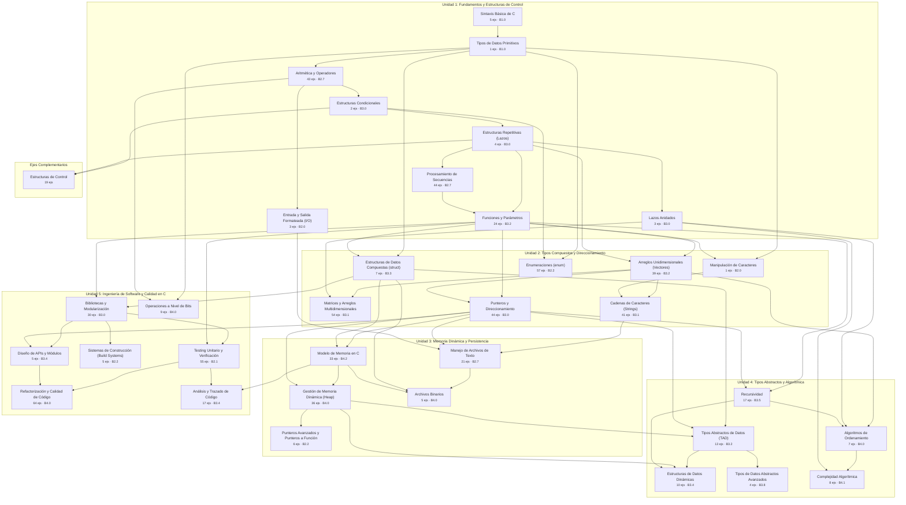

# 🗺️ Grafo de Dependencias Temáticas y Rutas de Aprendizaje

Este mapa conceptual modela las dependencias formativas entre los 35 ejes temáticos de **Programación 1**.
Cada relación representa un prerrequisito conceptual formal establecido mediante etiquetas de metadatos `dep:<tema>`.

::: {admonition} 🏷️ Convención de Etiquetas de Dependencia
:class: note
Las consignas prácticas declaran sus dependencias formativas mediante etiquetas:
- `dep:<tema>`: Indica que resolver el ejercicio requiere dominio previo del eje temático `<tema>` (ej. `dep:punteros`, `dep:arreglos`).
- `req:<id>`: Dependencia estricta respecto a un ejercicio atómico previo específico.
:::

## 🧭 Diagrama de Dependencias Curriculares

El siguiente diagrama de flujo acíclico dirigido (DAG) estructura la progresión cognitiva a lo largo de las 5 Unidades de la materia:



## 📊 Matriz Detallada de Prerrequisitos y Habilitaciones

| Eje Temático | Unidad | Prerrequisitos Requeridos (`dep:*`) | Habilita Temas Subsiguientes | Ejercicios | Carga Total |
| :--- | :---: | :--- | :--- | :---: | :---: |
| `algoritmos_ordenamiento`<br/>**Algoritmos de Ordenamiento** | U4 | `dep:arreglos`, `dep:lazos_anidados`, `dep:recursividad` | `complejidad` | 7 | ~245 min |
| `analisis_codigo`<br/>**Análisis y Trazado de Código** | U5 | `dep:memoria`, `dep:testing` | _Terminal_ | 17 | ~515 min |
| `archivos`<br/>**Manejo de Archivos de Texto** | U3 | `dep:cadenas`, `dep:punteros`, `dep:io_formato` | `archivos_binarios` | 21 | ~495 min |
| `archivos_binarios`<br/>**Archivos Binarios** | U3 | `dep:archivos`, `dep:estructuras`, `dep:memoria` | _Terminal_ | 5 | ~185 min |
| `aritmetica`<br/>**Aritmética y Operadores** | U1 | `dep:tipos_datos` | `io_formato`, `condicionales`, `operaciones_bits` | 43 | ~975 min |
| `arreglos`<br/>**Arreglos Unidimensionales (Vectores)** | U2 | `dep:funciones`, `dep:lazos` | `cadenas`, `matrices`, `punteros`, `algoritmos_ordenamiento` | 39 | ~1040 min |
| `build_systems`<br/>**Sistemas de Construcción (Build Systems)** | U5 | `dep:librerias` | _Terminal_ | 5 | ~95 min |
| `cadenas`<br/>**Cadenas de Caracteres (Strings)** | U2 | `dep:arreglos`, `dep:caracteres` | `archivos` | 41 | ~1085 min |
| `caracteres`<br/>**Manipulación de Caracteres** | U2 | `dep:tipos_datos`, `dep:funciones` | `cadenas` | 1 | ~15 min |
| `complejidad`<br/>**Complejidad Algorítmica** | U4 | `dep:algoritmos_ordenamiento`, `dep:lazos_anidados` | _Terminal_ | 8 | ~290 min |
| `condicionales`<br/>**Estructuras Condicionales** | U1 | `dep:aritmetica` | `lazos`, `estructuras_control`, `enumeraciones` | 2 | ~50 min |
| `diseno_api`<br/>**Diseño de APIs y Módulos** | U5 | `dep:librerias`, `dep:punteros` | `refactorizacion` | 5 | ~145 min |
| `enumeraciones`<br/>**Enumeraciones (enum)** | U2 | `dep:tipos_datos`, `dep:condicionales` | _Terminal_ | 57 | ~1000 min |
| `estructuras`<br/>**Estructuras de Datos Compuestas (struct)** | U2 | `dep:tipos_datos`, `dep:funciones` | `memoria`, `archivos_binarios`, `librerias`, `tad` | 7 | ~195 min |
| `estructuras_control`<br/>**Estructuras de Control** | Extra | `dep:condicionales`, `dep:lazos` | _Terminal_ | 19 | ~350 min |
| `estructuras_datos`<br/>**Estructuras de Datos Dinámicas** | U4 | `dep:tad`, `dep:memoria_dinamica`, `dep:recursividad` | _Terminal_ | 10 | ~310 min |
| `funciones`<br/>**Funciones y Parámetros** | U1 | `dep:lazos`, `dep:secuencias` | `caracteres`, `arreglos`, `punteros`, `estructuras`, `recursividad`, `librerias`, `testing` | 24 | ~645 min |
| `io_formato`<br/>**Entrada y Salida Formateada (I/O)** | U1 | `dep:aritmetica` | `archivos` | 3 | ~55 min |
| `lazos`<br/>**Estructuras Repetitivas (Lazos)** | U1 | `dep:condicionales` | `lazos_anidados`, `secuencias`, `estructuras_control`, `funciones`, `arreglos` | 4 | ~100 min |
| `lazos_anidados`<br/>**Lazos Anidados** | U1 | `dep:lazos` | `matrices`, `algoritmos_ordenamiento`, `complejidad` | 3 | ~75 min |
| `librerias`<br/>**Bibliotecas y Modularización** | U5 | `dep:funciones`, `dep:estructuras` | `build_systems`, `diseno_api`, `testing` | 30 | ~770 min |
| `matrices`<br/>**Matrices y Arreglos Multidimensionales** | U2 | `dep:arreglos`, `dep:lazos_anidados` | _Terminal_ | 54 | ~1420 min |
| `memoria`<br/>**Modelo de Memoria en C** | U3 | `dep:punteros`, `dep:estructuras` | `memoria_dinamica`, `archivos_binarios`, `analisis_codigo` | 33 | ~1210 min |
| `memoria_dinamica`<br/>**Gestión de Memoria Dinámica (Heap)** | U3 | `dep:memoria`, `dep:punteros` | `punteros_avanzados`, `tad`, `estructuras_datos` | 36 | ~1280 min |
| `operaciones_bits`<br/>**Operaciones a Nivel de Bits** | U5 | `dep:tipos_datos`, `dep:aritmetica` | _Terminal_ | 9 | ~320 min |
| `punteros`<br/>**Punteros y Direccionamiento** | U2 | `dep:funciones`, `dep:arreglos` | `memoria`, `memoria_dinamica`, `recursividad`, `archivos`, `diseno_api`, `tad` | 44 | ~1145 min |
| `punteros_avanzados`<br/>**Punteros Avanzados y Punteros a Función** | U3 | `dep:memoria_dinamica` | _Terminal_ | 6 | ~105 min |
| `recursividad`<br/>**Recursividad** | U4 | `dep:funciones`, `dep:punteros` | `algoritmos_ordenamiento`, `estructuras_datos` | 17 | ~505 min |
| `refactorizacion`<br/>**Refactorización y Calidad de Código** | U5 | `dep:testing`, `dep:diseno_api` | _Terminal_ | 64 | ~2260 min |
| `secuencias`<br/>**Procesamiento de Secuencias** | U1 | `dep:lazos` | `funciones` | 44 | ~1010 min |
| `sintaxis`<br/>**Sintaxis Básica de C** | U1 | _Raíz (sin requisitos)_ | `tipos_datos` | 5 | ~50 min |
| `tad`<br/>**Tipos Abstractos de Datos (TAD)** | U4 | `dep:estructuras`, `dep:punteros`, `dep:memoria_dinamica` | `tipos_datos_abstractos`, `estructuras_datos` | 13 | ~360 min |
| `testing`<br/>**Testing Unitario y Verificación** | U5 | `dep:librerias`, `dep:funciones` | `refactorizacion`, `analisis_codigo` | 55 | ~1015 min |
| `tipos_datos`<br/>**Tipos de Datos Primitivos** | U1 | `dep:sintaxis` | `aritmetica`, `caracteres`, `estructuras`, `enumeraciones`, `operaciones_bits` | 1 | ~10 min |
| `tipos_datos_abstractos`<br/>**Tipos de Datos Abstractos Avanzados** | U4 | `dep:tad` | _Terminal_ | 4 | ~190 min |

## 🚀 Rutas Críticas de Especialización

### 1. Ruta de Memoria Dinámica y Tipos Abstractos de Datos (Heap & TAD)
Progresión medular de la materia para el desarrollo de estructuras de datos persistentes y dinámicas:
```
sintaxis ➔ tipos_datos ➔ funciones ➔ arreglos ➔ punteros ➔ memoria ➔ memoria_dinamica ➔ tad ➔ estructuras_datos
```

### 2. Ruta de Algorítmia, Búsqueda y Complejidad
Enfoque orientado a optimización, eficiencia temporal y espacial:
```
lazos ➔ lazos_anidados ➔ arreglos ➔ recursividad ➔ algoritmos_ordenamiento ➔ complejidad
```

### 3. Ruta de Persistencia y Entrada/Salida en Disco
Flujo para el tratamiento de archivos secuenciales y registros binarios estructurados:
```
io_formato + cadenas + punteros ➔ archivos (texto) ➔ estructuras ➔ archivos_binarios
```

### 4. Ruta de Ingeniería de Software, Testing y Calidad en C
Desarrollo de módulos robustos, aserciones, diseño de APIs y refactorización continua:
```
funciones ➔ librerias ➔ diseno_api ➔ testing ➔ refactorizacion ➔ analisis_codigo
```
